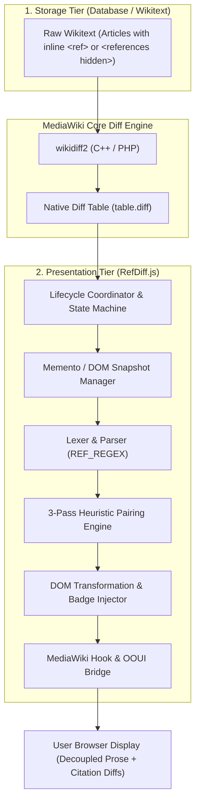
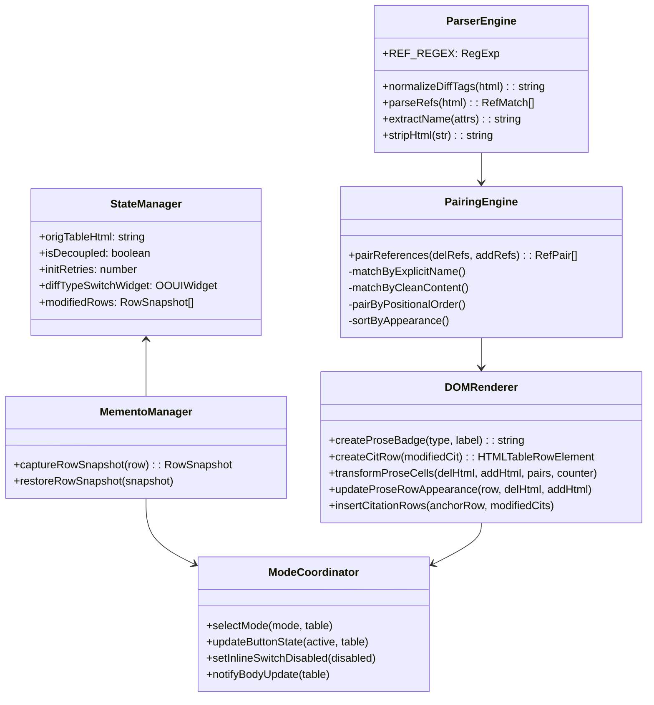
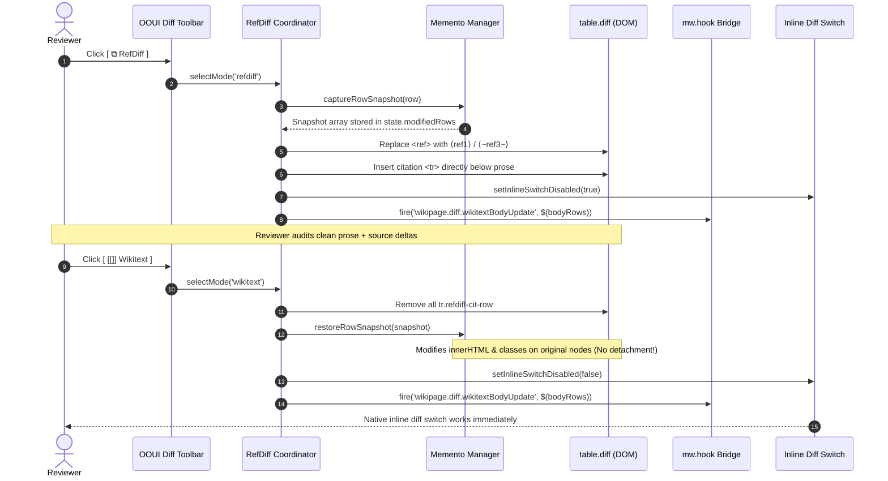
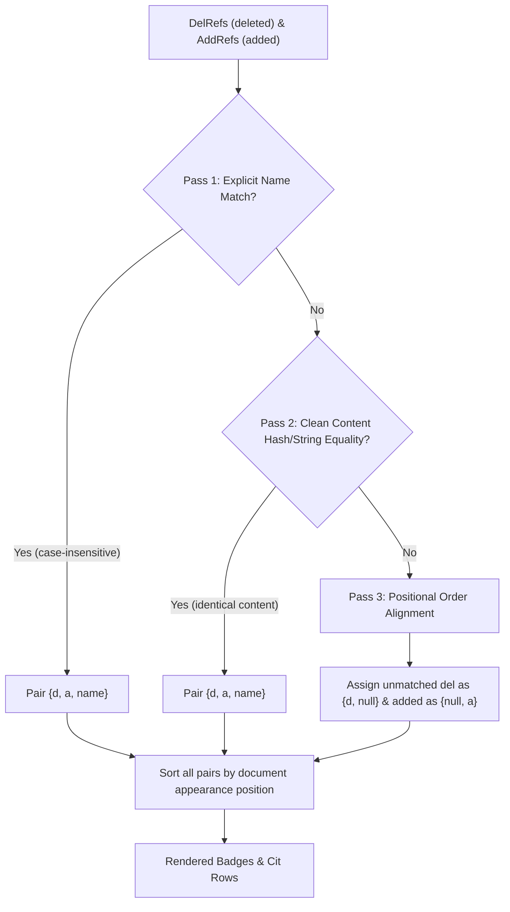

# RefDiff & Decoupled References: Architecture & Technical Design Document

This document provides a comprehensive architectural and engineering specification for **RefDiff** (*The Ref-Differentiator*) and the section-modular citation decoupling ecosystem.

---

## 1. Executive Summary & Architectural Goals

Traditional inline citations (`<ref>{{Cite ...}}</ref>`) interleave prose assertions with verbose bibliographic metadata. On MediaWiki and Git, this creates **severe diff noise**, **artificial merge conflicts**, and **cognitive fatigue during reviews**.

The project resolves this through a **two-tier architecture**:
1. **Storage Tier (Wikitext / Git):** Section-modular storage where citations are defined in section-scoped blocks (`<references hidden>`).
2. **Review & Presentation Tier (`RefDiff.js`):** A client-side gadget that provides a **virtual decoupling lens** directly on MediaWiki `Special:Diff`, transforming monolithic diff tables into clean, decoupled prose rows paired with isolated citation diff rows.



---

## 2. RefDiff.js Component Architecture

`refdiff.js` is structured as a zero-dependency, self-contained Universal Module Definition (UMD) module. It runs in browser environments (`common.js`, Tampermonkey, ResourceLoader) and headless Node.js testing environments without modification.

### 2.1 Core Subsystems



### 2.1 Virtual File Architecture (Single-File Modularization)

Although physically maintained and deployed as a **single file** (`refdiff.js`) to satisfy MediaWiki's user-script runtime constraints without requiring an external bundler, the internal architecture is explicitly delineated into **multiple virtual files** using standardized region boundaries (`/* === [VIRTUAL FILE: src/...] === */`).

This provides the architectural separation of a multi-file project while preserving single-file zero-dependency distribution:

| Virtual File | Primary Symbols / Scope | Responsibility |
| :--- | :--- | :--- |
| **`src/constants.js`** | `REF_REGEX`, `TEMPLATE_REF_REGEX`, `STORAGE_KEY`, `SELECTORS`, `CLASSES`, `HOOKS`, `BADGE_STYLES` | Centralizes regex patterns, storage keys, DOM selectors, CSS classes, hook names, and inline badge styles. |
| **`src/state.js`** | `state` (`origTableHtml`, `isDecoupled`, `initRetries`, `modifiedRows`, etc.) | Encapsulates runtime state, lifecycle flags, and modified row snapshot mementos. |
| **`src/utils.js`** | `stripHtml`, `escapeRegex`, `extractName`, `normalizeDiffTags`, `extractSfnInfo` | Preprocesses diff boundary splits, regex escaping, HTML stripping, name extraction, and sfn parameter parsing. |
| **`src/parser.js`** | `parseRefs` | Unified reference parser. Scans `<ref>` tags and footnote templates (`{{sfn}}`, `{{r}}`, `{{efn}}`, `{{harv}}`), preserving document order. |
| **`src/pairing.js`** | `pairReferences` | 3-pass heuristic matching associating deleted citations with added citations (name, content equality, positional alignment). |
| **`src/anchor.js`** | `sanitizeAnchor`, `findCiteNoteAnchor` | Scans live article preview for matching footnote IDs (`cite_note-*`, `cite_note-FOOTNOTE*`) and binds native `Extension:Popups`. |
| **`src/renderer.js`** | `createProseBadge`, `createCitRow`, `replaceRefInHtml` | Constructs mathematical angle bracket badges (`⟨ref1⟩`, `⟨~mod~⟩`) and decoupled citation diff rows (`<tr class="refdiff-cit-row">`). |
| **`src/memento.js`** | `captureRowSnapshot`, `restoreRowSnapshot` | Non-destructive DOM row snapshots preserving native MediaWiki event closures in-place. |
| **`src/pipeline.js`** | `applyDecoupling`, `restoreOriginal`, `transformProseCells`, `insertCitationRows`, `onTableClick` | Orchestrates prose badge substitution, citation row injection, click handling, jump target flashing, and restoration. |
| **`src/dom_helpers.js`** | `getDiffBodyRows`, `notifyBodyUpdate` | Categorizes diff body rows and fires MediaWiki synchronization hooks (`wikipage.diff.wikitextBodyUpdate` & `wikipage.content`). |
| **`src/mode_coordinator.js`** | `selectMode`, `updateButtonState`, `setInlineSwitchDisabled`, `isRefDiffPreferred` | Manages transitions between `wikitext`, `refdiff`, and `visual` modes, locks the inline format switch, and persists user preference. |
| **`src/init.js`** | `init`, `isDiffPage`, `createRefDiffButton`, `createFallbackModeBar` | Page/diff view detection, OOUI button injection, fallback mode bar creation, lifecycle wiring, and browser auto-start. |
| **`src/exports.js`** | `module.exports` / `root.RefDiff` return object | Universal Module Definition (UMD) exports and public API surface. |

---

## 3. The Decoupling Lifecycle & State Machine

RefDiff operates alongside MediaWiki's native Wikitext Diff and VisualEditor Visual Diff modes.

### 3.1 Mode State Transition Diagram

```mermaid
stateDiagram-v2
    [*] --> Initializing: Page Loaded (table.diff detected)
    Initializing --> WikitextMode: User Preference = false
    Initializing --> RefDiffMode: User Preference = true (default)

    WikitextMode --> RefDiffMode: User clicks [ ⧉ RefDiff ]
    RefDiffMode --> WikitextMode: User clicks [ [[]] Wikitext ]
    
    RefDiffMode --> VisualMode: User clicks [ 👁 Visual ]
    VisualMode --> RefDiffMode: User clicks [ ⧉ RefDiff ]
    
    WikitextMode --> VisualMode: User clicks [ 👁 Visual ]
    VisualMode --> WikitextMode: User clicks [ [[]] Wikitext ]

    state RefDiffMode {
        [*] --> CaptureSnapshots: Backup live row properties
        CaptureSnapshots --> DecoupleProse: Replace &lt;ref&gt; with badges
        DecoupleProse --> InsertCitRows: Append &lt;tr class="refdiff-cit-row"&gt;
        InsertCitRows --> DisableInlineSwitch: Lock native 2-col switch
        DisableInlineSwitch --> NotifyHook: wikipage.diff.wikitextBodyUpdate
    }

    state WikitextMode {
        [*] --> RemoveCitRows: Remove .refdiff-cit-row
        RemoveCitRows --> RestoreSnapshots: Restore DOM in-place
        RestoreSnapshots --> EnableInlineSwitch: Unlock native 2-col switch
        EnableInlineSwitch --> ShowBodyRows: Remove .oo-ui-element-hidden
    }

    state VisualMode {
        [*] --> RestoreOriginal: Restore wikitext table
        RestoreOriginal --> HideBodyRows: Add .oo-ui-element-hidden
        HideBodyRows --> DelegateToVE: VisualEditor renders diff
    }
```

### 3.2 Sequence: Transitioning from Wikitext to RefDiff and Back



---

## 4. Critical Architecture Decision: The Memento Pattern for DOM Preservation

### The Problem
MediaWiki's native diff scripts (`mediawiki.diff/inlineFormatToggle.js`) and VisualEditor cache references to the table's `<tr>` elements when the page loads. 

If a tool uses destructive table replacement:
```javascript
// ANTIPATTERN (DO NOT USE):
table.innerHTML = modifiedTableHtml;
```
All event closures inside MediaWiki become bound to detached DOM nodes. When the user later toggles the native **Inline Diff** switch, MediaWiki mutates detached nodes off-screen, completely breaking the interface.

### The Solution: Non-Destructive In-Place Memento
RefDiff implements the **Memento Design Pattern** (`captureRowSnapshot` / `restoreRowSnapshot`):

```javascript
function captureRowSnapshot(row) {
  const delDiv = row.querySelector('.diff-deletedline div');
  const addDiv = row.querySelector('.diff-addedline div');
  const delTd = row.querySelector('.diff-deletedline');
  const addTd = row.querySelector('.diff-addedline');
  const markers = Array.from(row.querySelectorAll('.diff-marker'));

  return {
    row,
    delDiv,
    addDiv,
    delTd,
    addTd,
    delHtml: delDiv ? delDiv.innerHTML : null,
    addHtml: addDiv ? addDiv.innerHTML : null,
    delTdClass: delTd ? delTd.className : null,
    addTdClass: addTd ? addTd.className : null,
    markers: markers.map(mk => ({ el: mk, marker: mk.getAttribute('data-marker') }))
  };
}
```

During `restoreOriginal()`:
1. All injected citation rows (`tr.refdiff-cit-row`) are pruned via `.remove()`.
2. The preserved cell elements (`delDiv`, `addDiv`, `delTd`, `addTd`) have their exact original HTML strings and classes restored in-place.
3. **Zero `<tr>` or `<td>` nodes are detached from the document tree**, keeping all MediaWiki event closures 100% operational.

---

## 5. Algorithmic Specifications

### 5.1 Regex Tokenization, Entity Handling & Boundary Normalization
MediaWiki's diff engine escapes raw HTML wikitext into HTML entities:
* `<ref>` becomes `&lt;ref&gt;`
* `</ref>` becomes `&lt;/ref&gt;`
* Attributes may contain `&quot;` or `&apos;`
* Diff spans (`<ins class="diffchange">` or `<del class="diffchange">`) may wrap whole tags, slice across attributes, or cut through tag delimiters.

#### Diffchange Boundary Normalization (`normalizeDiffTags`)
When common characters (such as `>`) border deleted or added text, MediaWiki's character-level diff engine (`wikidiff2`) shifts `<del>` or `<ins>` tags across the boundary, splitting HTML entity sequences:
* `&lt;/ref<del class="diffchange">&gt;` (opening `del` splits closing tag delimiter)
* `/<del class="diffchange">&gt;` or `/(</del>|</ins>)&gt;` (`del`/`ins` boundaries split self-closing delimiters)
* `&lt;ref...<del...>&gt;` (opening tag split before delimiter)

Before executing regular expressions, `normalizeDiffTags(html)` safely shifts split delimiters outside diffchange spans so that tags remain structurally well-formed, and purges empty diffchange spans (`<del></del>`).

#### Robust Lookahead-Constrained Tokenization (`REF_REGEX`)
```javascript
const REF_REGEX = /&lt;ref\b((?:(?!&gt;|\/&gt;)[\s\S])*?)(?:\/&gt;|&gt;((?:(?!&lt;ref\b)[\s\S])*?)&lt;\/ref&gt;)/gi;
```
* **Inner Content Constraint:** Rather than unconstrained non-greedy matching (`[\s\S]*?`), the content capture group enforces a negative lookahead assertion `((?:(?!&lt;ref\b)[\s\S])*?)`.
* **Failure Cascading Prevention:** Even if an article contains unclosed or malformed markup, an unclosed tag can never swallow subsequent `<ref>` tags or surrounding prose.

#### Shortened Footnote & Template Reference Support (`TEMPLATE_REF_REGEX` & `extractSfnInfo`)
In addition to standard `<ref>` tags, millions of Wikipedia articles use Shortened Footnotes (`{{sfn|...}}`, `{{sfnp|...}}`, `{{sfnm|...}}`), Explanatory Footnotes (`{{efn|...}}`), Shorthand references (`{{r|...}}`), and Harvard citations (`{{harvnb|...}}`).

RefDiff integrates dedicated lexing and parsing for footnote templates:
```javascript
const TEMPLATE_REF_REGEX = /\{\{\s*(?:<(?:ins|del)[^>]*>)?\s*(sfn|sfnp|sfnm|sfnmp|efn|efn-[a-z0-9_-]+|r|rp|harv|harvnb|harvtxt|harvp)\b((?:(?!\{\{\s*(?:sfn|sfnp|sfnm|sfnmp|efn|r\b|\/)).)*?)\}\}/gi;
```

* **Intelligent Author & Year Labeling (`extractSfnInfo`):** Positional parameters are extracted and formatted into human-readable scholarly labels:
  * `{{sfn|Castritius|2005}}` $\rightarrow$ `⟨Castritius 2005⟩`
  * `{{sfn|Reichert|Wolfram|2010|p=574}}` $\rightarrow$ `⟨Reichert & Wolfram 2010⟩` (page arguments cleanly omitted from prose badges)
  * `{{sfn|Smith|Jones|Brown|2020|pp=12-15}}` $\rightarrow$ `⟨Smith, Jones & Brown 2020⟩`
  * `{{sfn|Author1|Author2|Author3|Author4|2023}}` $\rightarrow$ `⟨Author1 et al. 2023⟩`
* **FOOTNOTE Anchor Synthesis:** Generates MediaWiki-compatible anchor tokens (`FOOTNOTE<Author1><Author2><Year>`), enabling instant DOM query correlation with generated `cite_note-FOOTNOTE*` footnote entries and hovercard activations.
* **Unified Document-Order Sorting:** `parseRefs` merges `<ref>` tags and citation templates into a single stream sorted by character position, preserving the author's exact narrative order.

### 5.2 Heuristic Reference Pairing (3-Pass Algorithm)



1. **Pass 1 (Name-addressed):** Matches citations sharing the identical `name="..."` attribute (e.g. `name="schmidt2020"`).
2. **Pass 2 (Content-addressed):** Matches citations where `stripHtml(content)` is identical, identifying references that were relocated or surrounded by new markup without attribute modifications.
3. **Pass 3 (Positional fallback):** Pairs remaining unlinked citations sequentially in order of appearance. Any leftover deleted or added citations are marked as pure deletions (`{d, null}`) or pure additions (`{null, a}`).
4. **Ordering Invariant:** Pairs are sorted by original index in the document stream to preserve reading linearity.

---

## 6. Visual Interface & Ergonomics Design

### 6.1 Mathematical Angle Bracket Notation
To prevent visual collisions with wikitext links, RefDiff avoids brackets `[...]` and braces `{...}`:
* External links: `[https://example.org text]`
* Internal wikilinks: `[[Page Title]]`
* RefDiff badges: `⟨ref1⟩`, `⟨~schmidt2020~⟩`, `⟨+newref+⟩`, `⟨-oldref-⟩`

### 6.2 Cognitive Load Reduction (No "Blue Noise")
In earlier prototypes, unchanged reference badges were colored blue. Reviewers reported cognitive fatigue because blue badges mimicked clickable hyperlinks and competed with actual text edits.

**RefDiff Color Specification:**
* **Unmodified Citation (`norm`):** Subtle secondary neutral color (`var(--color-subtle, #72777d)` / `#8c9196`), normal font weight. Blends into prose.
* **Modified Citation (`mod`):** Amber/Gold background (`#ffd043` / `#9a6700`), tildes `⟨~name~⟩`. Flags metadata changes clearly.
* **Added Citation (`add`):** Green tint (`#36c39a` / `#14866d`), pluses `⟨+name+⟩`.
* **Removed Citation (`del`):** Red tint (`#ff6e6e` / `#b32424`), minuses and strikethrough `⟨-name-⟩`.

### 6.3 Interactive Reference Badges & Native Extension:Popups Integration

RefDiff seamlessly bridges the diff table with Wikipedia's native reading infrastructure:

1. **Native Reference Previews (`Extension:Popups`):**
   * Badges in the diff prose are wrapped in standard MediaWiki footnote markup:
     ```html
     <sup class="reference refdiff-ref"><a href="#cite_note-name-num" class="ref-badge ...">⟨label⟩</a></sup>
     ```
   * RefDiff fires `mw.hook('wikipage.content').fire($(table))` upon rendering.
   * As a result, hovering over any reference badge triggers Wikipedia's standard **Reference Preview hovercard (`ext.popups`)** completely out-of-the-box, displaying the full formatted citation card without requiring custom popup logic.

2. **Anchor Discovery Engine (`findCiteNoteAnchor`):**
   * **Named Citations:** Automatically queries the live article preview below the diff for `[id^="cite_note-${name}-"]` or `[id="cite_note-${name}"]`.
   * **Shortened Footnotes (`{{sfn}}`):** Queries synthesized `cite_note-FOOTNOTE*` anchor IDs or text matching author-year strings across `.references li`.
   * **Anonymous Citations:** Extracts the URL from the citation template (e.g. `|url=https://...`) and queries matching external links in `.references a[href*="${url}"]`, discovering the parent `cite_note-*` list item.

3. **In-Table Citation Row Jumping:**
   * For modified, added, or deleted citations, the badge links to its injected citation diff row (`#refdiff-cit-${label}-${index}`).
   * Clicking the badge smoothly scrolls the diff table to the row and triggers a subtle `@keyframes refdiff-flash` highlight animation.

---

## 7. MediaWiki Integration Matrix

| Integration Point | Mechanism | Failure Mode Prevented |
| :--- | :--- | :--- |
| **OOUI Mode Switcher** | Injects `ButtonOptionWidget` into `.ve-init-mw-diffPage-diffMode` | Native look-and-feel; no ugly non-native banners |
| **Fallback Skins** | Injects `#refdiff-mode-bar` above table if OOUI is absent | Compatibility with Monobook, Timeless, and legacy skins |
| **VisualEditor Bridge** | Listens to `wikipage.diff.wikitextBodyUpdate` & applies `oo-ui-element-hidden` | Visual Diff row leakage and phantom table stacking |
| **Inline Toggle Switch** | Infuses `mw-diffPage-inline-toggle-switch` & locks disabled during RefDiff | Preventing contradictory side-by-side vs inline states |
| **Reference Previews (Extension:Popups)** | Semantic `<sup class="reference refdiff-ref"><a href="...">` + `mw.hook('wikipage.content')` | Displays native reading-mode citation cards on hover |
| **diffedit (Inline Diff Editor)** | Isolates cell classes (`refdiff-cit-addedline`) & restores raw wikitext on `.diff-editmode` | Line enumeration corruption in `diffedit` and editing mathematical badges |
| **Vector 2022 Dark Mode** | Uses `skin-theme-clientpref-night` and CSS variables | High-contrast dark theme without flash-of-unstyled-content |

### 7.1 Third-Party Gadget Interoperability: `diffedit.js`
[`diffedit.js`](https://meta.wikimedia.org/wiki/User:Jon_Harald_S%C3%B8by/diffedit.js) allows editors to edit article sections directly on `Special:Diff`. Because both tools operate directly on `table.diff`, RefDiff implements two explicit architectural safeguards to guarantee 100% interoperability:
1. **Line-Enumeration Protection:** `diffedit` enumerates lines by querying `tbody tr td:last-of-type` for `.diff-addedline` and `.diff-context`. If RefDiff's decoupled citation rows used these native classes, `diffedit` would increment its internal line counter (`currentLine++`), causing edits to publish to corrupted line offsets. RefDiff assigns isolated classes (`refdiff-cit-addedline`, `refdiff-cit-context`), styled identically to native diffs via CSS, ensuring `diffedit`'s line scanner completely ignores citation rows.
2. **Automatic Raw Wikitext Restoration:** When an editor clicks `[ Edit ]` in `diffedit` or when `table.diff` gains `.diff-editmode`, RefDiff observes the class mutation and automatically restores native wikitext mode (`selectMode('wikitext')`). This guarantees that `contenteditable="true"` operates on raw wikitext rather than badge tokens (`⟨ref1⟩`), preventing accidental vandalism upon saving.

### 7.2 Source Integrity & AI Verification Ecosystem (`AI Source Verification` & `CNfirmed`)
RefDiff isolates and clarifies citation diffs on `Special:Diff`. In production user configurations (such as `User:Johnjbarton/common.js`), editors pair RefDiff with AI-assisted verification and citation discovery tools:
1. **AI Source Verification** ([`User:Alaexis/AI Source Verification.js`](https://en.wikipedia.org/wiki/User:Alaexis/AI_Source_Verification.js)): Leverages LLMs (Gemini, Claude, GPT) to evaluate citations in-browser, verifying whether cited references factually support article claims. RefDiff complements this by separating prose from citation clutter, giving human reviewers an unambiguous claim baseline when inspecting AI-flagged citation discrepancies.
2. **CNfirmed** ([`User:Alaexis/CNfirmed.js`](https://en.wikipedia.org/wiki/User:Alaexis/CNfirmed.js)): Discovers and verifies candidate references for `{{citation needed}}` tags using Internet Archive APIs and LLM judges.

Together with RefDiff on `Special:Diff`, `diffedit` for rapid editing, and `HarvErrors` for anchor integrity, these tools form a layered, end-to-end citation quality ecosystem.

---

## 8. Verification & Test Architecture

RefDiff enforces a rigorous two-layer verification pipeline with a 4-level test pyramid (see [**TEST_PLAN.md**](TEST_PLAN.md) for the comprehensive specification):

1. **Modular Unit & Component Testing (`tests/test_*.js` & `tests/runner.js`):**
   * **79 zero-dependency tests** (100% headless function coverage) across **13 modular test files** mapped 1-to-1 to each virtual file of `refdiff.js`.
   * Fast execution budget: entire suite executes in **~18–25 ms** via `node tests/runner.js` (`npm test`).
   * **Selective execution:** Any module can be tested in isolation (e.g. `node tests/test_parser.js` or `node tests/test_pairing.js`).
   * **Mock Sandboxing:** Safe `withMockEnvironment` harness guarantees restoration of global DOM mocks (`window`, `document`, `location`) even on assertion failures.
   * **Parser & Templates (`tests/test_parser.js`, `tests/test_constants.js`):** XML entity decoding (`&quot;`), self-closing tags, nested `diffchange` spans, boundary split normalization, `TEMPLATE_REF_REGEX`, mixed sequential order, and `extractSfnInfo` for 1, 2, 3, and 4+ authors.
   * **Heuristic Pairing (`tests/test_pairing.js`):** 3-pass matching algorithm, insertions at front/end, surrounded edits, pure additions/deletions, self-closing identicals, and `{{sfn}}` pairing by label.
   * **Anchor Discovery & Popups (`tests/test_anchor.js`):** Resolves explicit named footnotes, anonymous URL matching, shortened `cite_note-FOOTNOTE*` anchors, and `sanitizeAnchor` tokenization.
   * **Memento & Pipeline (`tests/test_memento.js`, `tests/test_pipeline.js`):** In-place DOM snapshotting (`captureRowSnapshot` / `restoreRowSnapshot`), table decoupling mutation and clean round-trip restoration preserving native MediaWiki event closures.
   * **Mode Coordination & UI (`tests/test_mode_coordinator.js`, `tests/test_dom_helpers.js`):** 3-way mode switching (visual/wikitext/refdiff), row categorization, `wikitextBodyUpdate` hook firing, and locking `mw-diffPage-inline-toggle-switch`.
   * **Persistence (`tests/test_state.js`):** `localStorage`, `mw.storage`, and `?refdiff=0/1` URL parameter overrides.
   * **Stress & Performance Benchmarks (`tests/test_benchmarks.js`):** Real-world stress testing on high-density changesets (e.g. enwiki `diff=1379409916`, airport destination tables with 114 dense citations verified in <50ms with 0 leaks).

2. **Live Browser Automation via CDP (`tests/test_live_cdp.py`):**
   * Uses Chrome DevTools Protocol over WebSocket port 9222.
   * Executes live end-to-end tests against real MediaWiki DOM (Meta-Wiki Special:Diff, local test fixtures, standalone stress fixtures, and live diffs such as Odoacer `diff=1379486498` with 10 shortened footnotes).
   * Verifies reference badge anchor discovery (114/114 links on stress fixture), native popup hovercards (`Extension:Popups`), visual diff transitions, inline toggle switch lock/unlock, dark mode tokens, and dense table parsing.

---

## 9. Future Architecture & Evaluation Tasks

### 9.1 Evaluating Regex Parsing vs. Preloaded MediaWiki / Meta-Wiki Libraries

* **Context:**
  RefDiff currently relies on regular expressions (`REF_REGEX`, `TEMPLATE_REF_REGEX`) and string normalizers to identify and extract `<ref>` tags and shortened footnotes (`{{sfn}}`) from diff table cells.

* **Research Problem:**
  Wikitext is non-regular; nested templates, complex parser functions (`{{#tag:ref|...}}`), and diffchange tags dissecting template boundaries can challenge pure regex heuristics. MediaWiki environments (such as English Wikipedia and Meta-Wiki) include various preloaded ResourceLoader modules and editing libraries. An architectural evaluation is needed to determine whether native libraries should replace or augment the regex pipeline.

* **Evaluation Dimensions:**
  1. **Availability Across Wikis:**
     * Meta-Wiki provides a leaner default module set than English Wikipedia.
     * Candidate modules (e.g. `mediawiki.util`, `ext.visualEditor.mwwikitext`, `ve.dm.MWReferenceModel`, or Parsoid DOM representations) may not be preloaded on `Special:Diff` on all wikis without explicit asynchronous loading (`mw.loader.using`).
  2. **Execution Latency & Budget:**
     * RefDiff executes in <25 ms across 100+ citations using pure string/regex matching. Heavyweight AST parsers or DOM-based tokenizers must be benchmarked against this performance standard.
  3. **Portability & Headless Testing:**
     * The current zero-dependency bundle runs anywhere (in-browser gadget, tampermonkey, and headless Node.js tests). Introducing hard dependencies on `mw.*` or `ve.*` would require mocking those frameworks in headless CI or maintaining separate parsing paths.
  4. **Hybrid Strategy Potential:**
     * A proposed candidate architecture is a **two-tier parsing model**: fast-path regex execution for standard citations (`<ref name="...">`, `{{Cite book}}`, `{{sfn}}`), with fallback to native MediaWiki parser libraries only when unclosed tags or nested template anomalies are encountered.

