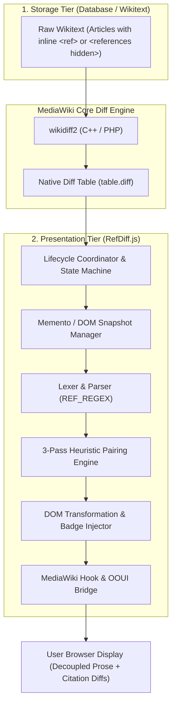
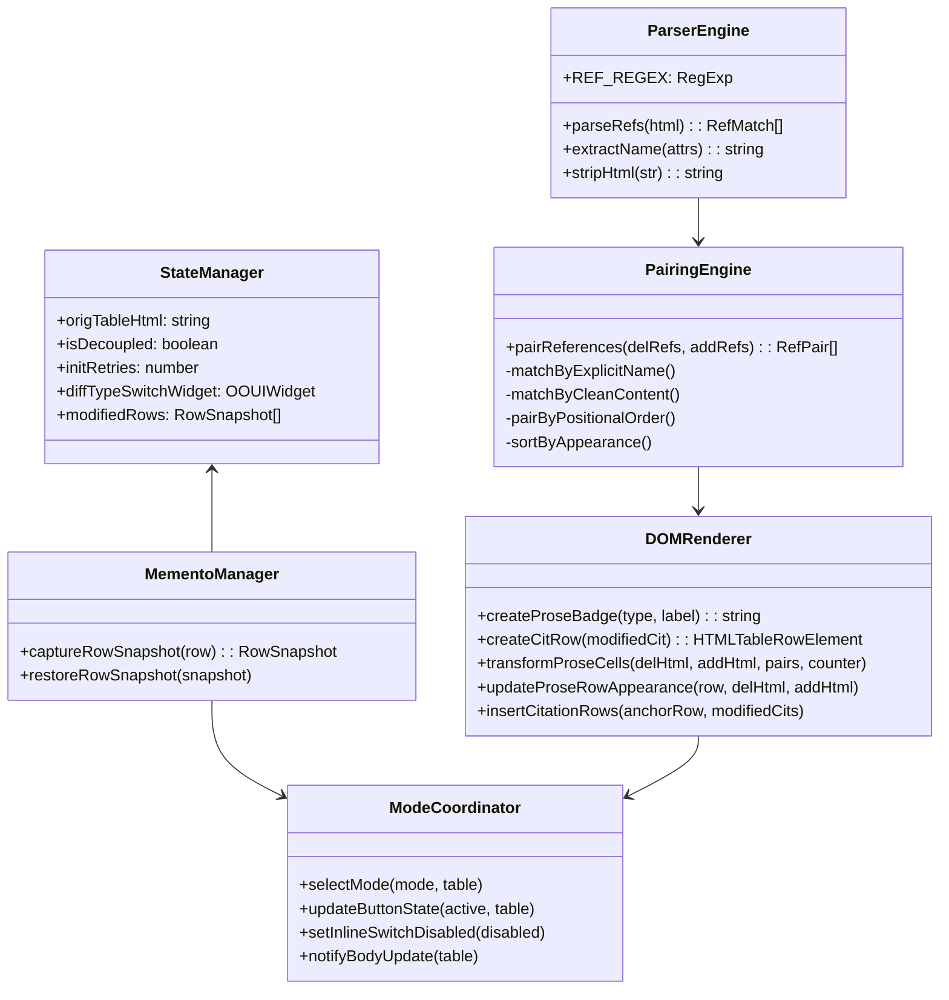
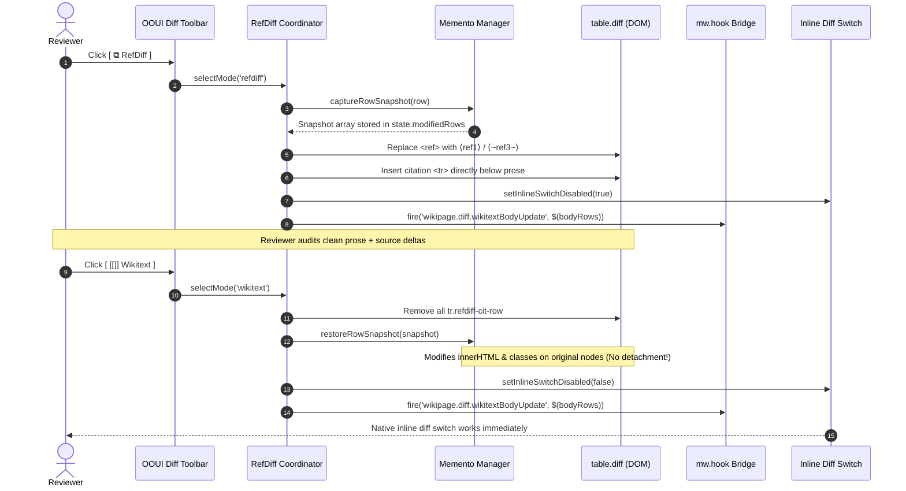
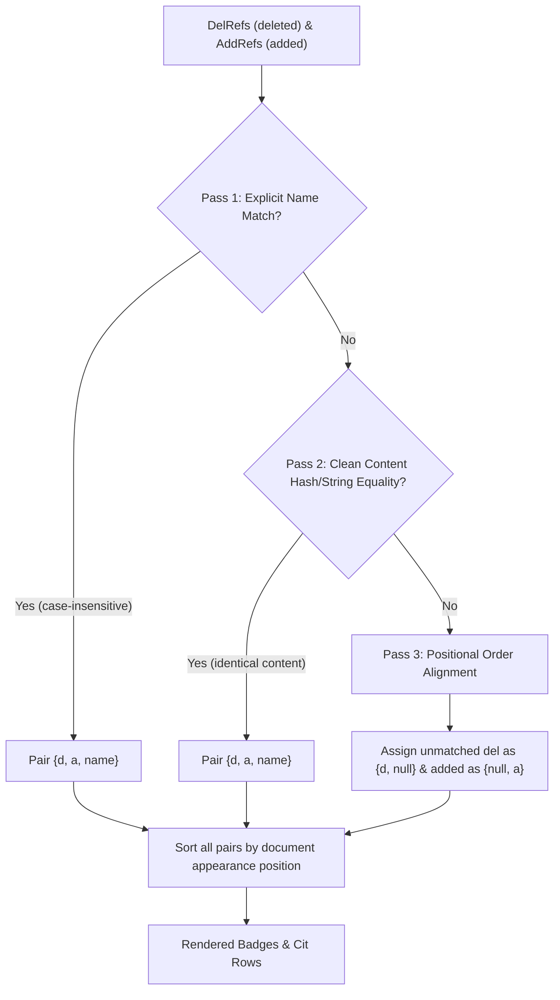

# RefDiff & Decoupled References: Architecture & Technical Design Document

This document provides a comprehensive architectural and engineering specification for **RefDiff** (*The Ref-Differentiator*) and the section-modular citation decoupling ecosystem.

---

## 1. Executive Summary & Architectural Goals

Traditional inline citations (`<ref>{{Cite ...}}</ref>`) interleave prose assertions with verbose bibliographic metadata. On MediaWiki and Git, this creates **severe diff noise**, **artificial merge conflicts**, and **cognitive fatigue during reviews**.

The project resolves this through a **two-tier architecture**:
1. **Storage Tier (Wikitext / Git):** Section-modular storage where citations are defined in section-scoped blocks (`<references hidden>`).
2. **Review & Presentation Tier (`RefDiff.js`):** A client-side gadget that provides a **virtual decoupling lens** directly on MediaWiki `Special:Diff`, transforming monolithic diff tables into clean, decoupled prose rows paired with isolated citation diff rows.



---

## 2. RefDiff.js Component Architecture

`refdiff.js` is structured as a zero-dependency, self-contained Universal Module Definition (UMD) module. It runs in browser environments (`common.js`, Tampermonkey, ResourceLoader) and headless Node.js testing environments without modification.

### 2.1 Core Subsystems



| Subsystem | File Location | Responsibility |
| :--- | :--- | :--- |
| **Constants & Selectors** | Lines 39–140 | Centralizes regex patterns, CSS selectors, theme variables, and color schemes. |
| **State Manager** | Lines 142–156 | Encapsulates runtime state and modified row mementos. |
| **Parser Engine** | Lines 158–260 | Extracts, validates, and decodes HTML-escaped `<ref>` tags. |
| **Pairing Engine** | Lines 262–341 | 3-pass heuristic matching associating deleted citations with added citations. |
| **Badge & Row Renderer** | Lines 343–425 | Constructs mathematical angle bracket badges and decoupled citation rows. |
| **Memento Manager** | Lines 427–475 | Preserves live DOM references for non-destructive in-place restoration. |
| **Transformation Pipeline** | Lines 477–645 | Orchestrates prose badge substitution and citation row insertion. |
| **Mode Coordinator** | Lines 647–880 | Manages transitions between `wikitext`, `refdiff`, and `visual` modes. |
| **UI & Hook Integration** | Lines 882–1045 | Handles OOUI ButtonSelectWidget, DOM mutations, and MediaWiki hooks. |

---

## 3. The Decoupling Lifecycle & State Machine

RefDiff operates alongside MediaWiki's native Wikitext Diff and VisualEditor Visual Diff modes.

### 3.1 Mode State Transition Diagram

```mermaid
stateDiagram-v2
    [*] --> Initializing: Page Loaded (table.diff detected)
    Initializing --> WikitextMode: User Preference = false
    Initializing --> RefDiffMode: User Preference = true (default)

    WikitextMode --> RefDiffMode: User clicks [ ⧉ RefDiff ]
    RefDiffMode --> WikitextMode: User clicks [ [[]] Wikitext ]
    
    RefDiffMode --> VisualMode: User clicks [ 👁 Visual ]
    VisualMode --> RefDiffMode: User clicks [ ⧉ RefDiff ]
    
    WikitextMode --> VisualMode: User clicks [ 👁 Visual ]
    VisualMode --> WikitextMode: User clicks [ [[]] Wikitext ]

    state RefDiffMode {
        [*] --> CaptureSnapshots: Backup live row properties
        CaptureSnapshots --> DecoupleProse: Replace &lt;ref&gt; with badges
        DecoupleProse --> InsertCitRows: Append &lt;tr class="refdiff-cit-row"&gt;
        InsertCitRows --> DisableInlineSwitch: Lock native 2-col switch
        DisableInlineSwitch --> NotifyHook: wikipage.diff.wikitextBodyUpdate
    }

    state WikitextMode {
        [*] --> RemoveCitRows: Remove .refdiff-cit-row
        RemoveCitRows --> RestoreSnapshots: Restore DOM in-place
        RestoreSnapshots --> EnableInlineSwitch: Unlock native 2-col switch
        EnableInlineSwitch --> ShowBodyRows: Remove .oo-ui-element-hidden
    }

    state VisualMode {
        [*] --> RestoreOriginal: Restore wikitext table
        RestoreOriginal --> HideBodyRows: Add .oo-ui-element-hidden
        HideBodyRows --> DelegateToVE: VisualEditor renders diff
    }
```

### 3.2 Sequence: Transitioning from Wikitext to RefDiff and Back



---

## 4. Critical Architecture Decision: The Memento Pattern for DOM Preservation

### The Problem
MediaWiki's native diff scripts (`mediawiki.diff/inlineFormatToggle.js`) and VisualEditor cache references to the table's `<tr>` elements when the page loads. 

If a tool uses destructive table replacement:
```javascript
// ANTIPATTERN (DO NOT USE):
table.innerHTML = modifiedTableHtml;
```
All event closures inside MediaWiki become bound to detached DOM nodes. When the user later toggles the native **Inline Diff** switch, MediaWiki mutates detached nodes off-screen, completely breaking the interface.

### The Solution: Non-Destructive In-Place Memento
RefDiff implements the **Memento Design Pattern** (`captureRowSnapshot` / `restoreRowSnapshot`):

```javascript
function captureRowSnapshot(row) {
  const delDiv = row.querySelector('.diff-deletedline div');
  const addDiv = row.querySelector('.diff-addedline div');
  const delTd = row.querySelector('.diff-deletedline');
  const addTd = row.querySelector('.diff-addedline');
  const markers = Array.from(row.querySelectorAll('.diff-marker'));

  return {
    row,
    delDiv,
    addDiv,
    delTd,
    addTd,
    delHtml: delDiv ? delDiv.innerHTML : null,
    addHtml: addDiv ? addDiv.innerHTML : null,
    delTdClass: delTd ? delTd.className : null,
    addTdClass: addTd ? addTd.className : null,
    markers: markers.map(mk => ({ el: mk, marker: mk.getAttribute('data-marker') }))
  };
}
```

During `restoreOriginal()`:
1. All injected citation rows (`tr.refdiff-cit-row`) are pruned via `.remove()`.
2. The preserved cell elements (`delDiv`, `addDiv`, `delTd`, `addTd`) have their exact original HTML strings and classes restored in-place.
3. **Zero `<tr>` or `<td>` nodes are detached from the document tree**, keeping all MediaWiki event closures 100% operational.

---

## 5. Algorithmic Specifications

### 5.1 Regex Tokenization & Entity Handling
MediaWiki's diff engine escapes raw HTML wikitext into HTML entities:
* `<ref>` becomes `&lt;ref&gt;`
* `</ref>` becomes `&lt;/ref&gt;`
* Attributes may contain `&quot;` or `&apos;`
* Diff spans (`<ins class="diffchange">` or `<del class="diffchange">`) may wrap whole tags or slice across attributes.

The regular expression handles self-closing and paired tags across multiple lines:
```javascript
const REF_REGEX = /&lt;ref\b((?:(?!&gt;|\/&gt;)[\s\S])*?)(?:\/&gt;|&gt;([\s\S]*?)&lt;\/ref&gt;)/gi;
```

### 5.2 Heuristic Reference Pairing (3-Pass Algorithm)



1. **Pass 1 (Name-addressed):** Matches citations sharing the identical `name="..."` attribute (e.g. `name="schmidt2020"`).
2. **Pass 2 (Content-addressed):** Matches citations where `stripHtml(content)` is identical, identifying references that were relocated or surrounded by new markup without attribute modifications.
3. **Pass 3 (Positional fallback):** Pairs remaining unlinked citations sequentially in order of appearance. Any leftover deleted or added citations are marked as pure deletions (`{d, null}`) or pure additions (`{null, a}`).
4. **Ordering Invariant:** Pairs are sorted by original index in the document stream to preserve reading linearity.

---

## 6. Visual Interface & Ergonomics Design

### 6.1 Mathematical Angle Bracket Notation
To prevent visual collisions with wikitext links, RefDiff avoids brackets `[...]` and braces `{...}`:
* External links: `[https://example.org text]`
* Internal wikilinks: `[[Page Title]]`
* RefDiff badges: `⟨ref1⟩`, `⟨~schmidt2020~⟩`, `⟨+newref+⟩`, `⟨-oldref-⟩`

### 6.2 Cognitive Load Reduction (No "Blue Noise")
In earlier prototypes, unchanged reference badges were colored blue. Reviewers reported cognitive fatigue because blue badges mimicked clickable hyperlinks and competed with actual text edits.

**RefDiff Color Specification:**
* **Unmodified Citation (`norm`):** Subtle secondary neutral color (`var(--color-subtle, #72777d)` / `#8c9196`), normal font weight. Blends into prose.
* **Modified Citation (`mod`):** Amber/Gold background (`#ffd043` / `#9a6700`), tildes `⟨~name~⟩`. Flags metadata changes clearly.
* **Added Citation (`add`):** Green tint (`#36c39a` / `#14866d`), pluses `⟨+name+⟩`.
* **Removed Citation (`del`):** Red tint (`#ff6e6e` / `#b32424`), minuses and strikethrough `⟨-name-⟩`.

---

## 7. MediaWiki Integration Matrix

| Integration Point | Mechanism | Failure Mode Prevented |
| :--- | :--- | :--- |
| **OOUI Mode Switcher** | Injects `ButtonOptionWidget` into `.ve-init-mw-diffPage-diffMode` | Native look-and-feel; no ugly non-native banners |
| **Fallback Skins** | Injects `#refdiff-mode-bar` above table if OOUI is absent | Compatibility with Monobook, Timeless, and legacy skins |
| **VisualEditor Bridge** | Listens to `wikipage.diff.wikitextBodyUpdate` & applies `oo-ui-element-hidden` | Visual Diff row leakage and phantom table stacking |
| **Inline Toggle Switch** | Infuses `mw-diffPage-inline-toggle-switch` & locks disabled during RefDiff | Preventing contradictory side-by-side vs inline states |
| **Vector 2022 Dark Mode** | Uses `skin-theme-clientpref-night` and CSS variables | High-contrast dark theme without flash-of-unstyled-content |

---

## 8. Verification & Test Architecture

The codebase enforces a rigorous two-layer verification pipeline:

1. **Unit Testing (`tests/test_pairing.js`):**
   * 23 zero-dependency tests running in pure Node.js.
   * Exercises regex edge cases (HTML entities, self-closing tags, diffchange nesting).
   * Validates the 3-pass pairing algorithm, DOM memento snapshotting, and fallback storage engines (`mw.storage` / `localStorage`).
2. **Live Browser Automation via CDP (`tests/test_live_cdp.py`):**
   * Uses Chrome DevTools Protocol over WebSocket port 9222.
   * Executes live end-to-end tests against real MediaWiki DOM (Meta-Wiki Special:Diff).
   * Verifies visual diff transitions, inline toggle switch lock/unlock, and dark mode tokens.
