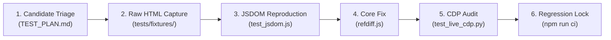

# RefDiff: Audit and Review Strategy

> **Status:** Active & Implemented &bull; **Version:** 1.3.0  
> **Target Audience:** Script Maintainers, Wikimedia Reviewers, Wikipedia Patrollers & Source Auditors  
> **Governing Artifacts:** [`refdiff.js`](refdiff.js), [`tests/`](tests/), [`refdiff.wiki`](refdiff.wiki), [`DEPLOYMENT_PLAN.md`](DEPLOYMENT_PLAN.md), [`TEST_PLAN.md`](TEST_PLAN.md), [`LOG.md`](LOG.md)

---

## 1. Executive Summary & Purpose

The **Audit and Review Strategy** establishes the quality, security, and editorial governance framework for RefDiff across two pillars:

1. **Pillar 1: Codebase & Security Audit (Engineering Integrity):** Enforces Wikimedia gadget security compliance, clean code and anti-test-smell standards, real DOM regression testing (JSDOM and live CDP), and test proportionality.
2. **Pillar 2: Editorial Source Audit (Editorial Integrity):** Provides patrollers with actionable workflows to uncover "template camouflage", combat "AI slop", and audit citations parameter-by-parameter on `Special:Diff`.

---

## 2. Pillar 1: Codebase Quality & Security Audit

### 2.1 Quality Review Taxonomy & Findings Registry

Review findings and comparative audits are classified using a three-tier severity taxonomy:

| Class | Severity | Description | Action Threshold |
|:---:|:---:|:---|:---|
| **K** (*Kritisch*) | **P0** | Architectural flaw, DOM mutation hazard, or test mock blind spot hiding runtime failures. | Blocker for release; immediate remediation. |
| **M** (*Major*) | **P1** | Security hygiene issue (XSS, unpinned CDN) or on-wiki compliance blocker. | Blocker for on-wiki gadget promotion. |
| **N** (*Minor*) | **P2** | Code style, documentation drift, or non-blocking micro-optimizations. | Addressed during regular refactoring. |

> [!NOTE]
> All detailed finding histories and remediation records are maintained in [**`LOG.md` (§3.2 Audit Findings Register)**](LOG.md#32-audit-findings-register-k1--m1--m6--m7-taxonomy).

#### Architectural Audit Findings Summary
* **[K1] Real DOM Mock Weakness (P0 — Resolved):** Replaced synthetic DOM mocks with authentic MediaWiki diff fixtures in `tests/test_jsdom.js` and live CDP browser testing. ([`LOG.md#k1`](LOG.md#k1-real-dom-mock-weakness))
* **[M1] HTML via Template Strings (P1 — Resolved):** Replaced `.innerHTML` string interpolation with native DOM builder `el()` and text nodes. ([`LOG.md#m1`](LOG.md#m1-html-generation-via-template-strings))
* **[M6] Unpinned CDN Distribution (P1 — Resolved):** Eliminated external CDNs in favor of on-wiki loading with optional commit-pinned SHA loaders. ([`LOG.md#m6`](LOG.md#m6-unpinned-cdn-distribution))
* **[M7] On-Wiki `<nowiki>` Protection (P1 — Resolved):** Wrapped script in `/* <nowiki> */` comments with automated delimiter balance checks. ([`LOG.md#m7`](LOG.md#m7-on-wiki-nowiki-template-transclusion))

---

### 2.2 Security & Sanitization Protocols

Because RefDiff processes untrusted wikitext and HTML attributes from arbitrary revisions:
1. **Attribute Stripping:** All badge titles, labels, and anchor lookups are processed through `stripHtml()` and XML entity decoding.
2. **Anchor Sanitization:** All internal anchor targets (`#refdiff-cit-...`) must pass `sanitizeAnchor()`, stripping characters outside `[a-zA-Z0-9_\-.:]`.
3. **Diffchange Balance:** `hasBalancedDiffTags` validates that candidate wikitext does not cross unclosed `<ins>` or `<del>` spans before parsing.
4. **Defensive Browser APIs:** Optional APIs (`scrollIntoView`, `pushState`, `MutationObserver`) are guarded via `typeof` checks or `try/catch` blocks.

---

### 2.3 Real DOM Regression Harness (JSDOM & Live CDP)

RefDiff operates a dual-engine DOM verification pipeline:
* **Level 2 — JSDOM Suite (`tests/test_jsdom.js`):** Headless Node.js execution on authentic MediaWiki diff fixtures. Validates byte-for-byte Memento invariance:
  $$\text{table.innerHTML}_{\text{initial}} \equiv \text{table.innerHTML}_{\text{restored}}$$
  Restoration must leave zero orphaned rows, leaked classes, or dangling event listeners.
* **Level 4 — Live Chromium CDP (`tests/test_live_cdp.py`):** Live browser verification over WebSocket port 9222 covering OOUI mode switcher, Vector 2022 Dark Mode tokens, and `Extension:Popups` Reference Previews.
* **Performance Budgets:** Processing 114 references across split diffchanges must complete in **< 50 ms** in browser environments and **< 250 ms** across all 15 suites in CI.

---

### 2.4 On-Wiki Distribution & Security Hygiene

To meet Wikimedia security policies for user scripts and gadgets:
1. **No External CDNs:** Production deployments load strictly from Wikimedia servers (`en.wikipedia.org`, `meta.wikimedia.org`, or local wiki `Special:MyPage`).
2. **Commit-Pinned Loader Pattern:** Users requiring immutable, tamper-proof versions can pin release revisions (`refdiff-v1.3.0.js`).
3. **Wikitext Protection:** The script begins with `/* <nowiki> */` and ends with `/* </nowiki> */` to prevent template parsing and signature expansion.

---

### 2.5 Clean Code & Test Code Smell Standards

To ensure tests remain resilient, diagnostic, and maintainable, RefDiff enforces strict clean-code rules:

#### Production Standards
* **Single Responsibility:** Decoupled modules (`parser`, `pairing`, `memento`, `renderer`, `init`, `state`) with zero circular dependencies.
* **XSS-Immune DOM Construction:** Dynamic elements built via native `el()` and `ownerDocument.createTextNode()`; zero `.innerHTML` interpolation.
* **ResourceLoader Encapsulation:** Zero global scope leaks; IIFE closure with explicit `window.RefDiff` exports only under Node.js test environments.

#### Test Code Smell Prevention
* **Assertion Roulette:** Prohibited. Every assertion must provide an explicit diagnostic failure message.
* **Mystery Guest & Magic Literals:** Tests must use explicit AAA (Arrange-Act-Assert) structure and named fixtures (`tests/fixtures/`).
* **Over-Mocking:** UI and table transformations must run against authentic HTML in JSDOM, never synthetic mock objects.
* **Polluted Globals:** All mocked globals must execute within `withMockEnvironment()` or `try/finally` with guaranteed teardown.
* **Conditional Logic:** Prohibited. Tests must execute linearly without branching (`if`/`switch`) to prevent silently skipped assertions.
* **Timing Flakes:** Prohibited. Synchronization must rely on deterministic hooks (`mw.hook`) rather than wall-clock `sleep()` delays.
* **DAMP over DRY in Tests:** Test cases prioritize Descriptive And Meaningful Phrases over aggressive DRY abstraction to maximize legibility.

#### Pre-Merge Review Checklist
- [ ] Clear Arrange-Act-Assert structure with zero branching logic.
- [ ] Every assertion contains an explanatory failure message.
- [ ] All global modifications run inside `withMockEnvironment()`.
- [ ] DOM tests execute against authentic MediaWiki fixtures in JSDOM.
- [ ] Deterministic synchronization (no `setTimeout` or `sleep`).
- [ ] Passes `npm run ci` with 0 ESLint warnings.

---

### 2.6 Test Proportionality & Sufficiency Audit: "Is it Enough or Too Much?"

#### Proportionality Audit: Is it Too Much?
**Verdict: No.**
* **Zero Runner Bloat:** Pure Node.js built-in `assert` without third-party frameworks (no Jest/Mocha/Babel). 15 modular suites run in **~250 ms**.
* **High-Value Invariants:** Every assertion guards a specific failure mode: tag splitting across `diffchange`, Memento restoration, author-year synthesis (`{{sfn}}`), anchor discovery, and inline-modified mode.
* **Sandboxed Mock Isolation:** Scoped `withMockEnvironment()` guarantees state restoration with zero cross-test interference.

#### Sufficiency Audit: Is it Enough?
**Verdict: Sufficient for production release (v1.3.0), with explicit, monitored boundaries.**
* **100% Core Production Coverage:** 71 of 71 internal functions covered, authentic DOM fixtures in JSDOM, live CDP browser automation, and stress benchmarks.
* **Monitored Testing Boundaries:**
  1. *Malformed Wikitext:* Unclosed `<ref>` tags gracefully remain in-situ in prose.
  2. *Transcluded Footnotes:* Citations inside complex template wrappers (`{{refn}}`, `{{sfnp}}`) remain in-situ without badging.
  3. *Mobile Diffs:* Single-column stacked layouts (MinervaNeue) are outside desktop test scope.
  4. *Dynamic AJAX Lifecycle:* Successive diff reloads without full page refresh.
  5. *Prose Invariance:* Continuous differential fuzzing of prose diff preservation is delegated to [`LOG.md` §3.3](LOG.md#33-real-world-diff-verification-register).

---

### 2.7 10-User Adoption & Stability Policy

To govern the transition from local canary release to gadget proposal:
1. **Adoption Threshold:** Active transclusions monitored via `Special:WhatLinksHere/Template:User_RefDiff` reaching $\ge 10$ active patrollers.
2. **Defect Threshold:** Zero uncaught runtime errors (P0) and zero unhandled table corruptions across real Wikipedia diff reviews.
3. **Fail-Open Invariant:** Uncaught exceptions in any auxiliary component must cleanly restore the native diff view without impacting reviewer workflows or common.js tools (Twinkle, HotCat).

---

## 3. Pillar 2: Editorial Review & Source Auditing Playbook

### 3.1 The "Template Camouflage" Audit Workflow
* **Threat:** Vandals conceal prose changes inside massive citation template additions, turning entire paragraphs yellow/blue in standard diffs.
* **Audit Workflow:**
  1. Open diff on `Special:Diff` (RefDiff decouples automatically).
  2. **Prose Scan:** Review prose rows; word changes stand out cleanly in green/red highlights.
  3. **Badge Inspection:** Unmodified citations appear as grey badges (`⟨ref1⟩`), modified as amber (`⟨~name~⟩`), and added as green (`⟨+name+⟩`).
  4. **Citation Delta Scan:** Inspect the dedicated citation diff row directly beneath the prose row to review parameter changes (URLs, page numbers, authors).

### 3.2 Auditing Against "AI Slop" & Hallucinated Sources
* **Threat:** LLM-generated edits produce syntactically valid wikitext with fabricated citations (hallucinated DOIs, fake books, dead URLs).
* **Audit Workflow:**
  1. **Source Decoupling:** Extract citations to inspect prose coherence and neutrality in isolation.
  2. **Preview Verification:** Hover over badges (`⟨1⟩`, `⟨2⟩`) to trigger MediaWiki Reference Previews (`Extension:Popups`) without scrolling to footnotes.
  3. **Anchor Matching:** Badges link to `#cite_note-*`; orphaned or broken citations are flagged immediately when no popover appears.

### 3.3 Tri-Mode Review Triage

```
[ 👁 Visual ]  [ [[]] Wikitext ]  [ ⧉ RefDiff ]  [✓] Inline modified refs
```

| Edit Type | Recommended Mode | Rationale |
|:---|:---:|:---|
| **Simple Typos / Formatting** | **Visual Diff** | Fast WYSIWYG review. |
| **Templates / Tables / Infoboxes** | **Wikitext Diff** | Inspect parser functions and syntax. |
| **Scholarly / Citation-Heavy Edit** | **RefDiff Mode** | Decouples citations from prose; audits sources parameter by parameter. |
| **Dense Destination Matrix / Tables** | **RefDiff (Inline modified checked)** | Keeps modified citations inline with `⟨~label~⟩` badges without altering row heights. |

### 3.4 Integration with the Review Ecosystem
* **[`diffedit.js`](https://en.wikipedia.org/wiki/User:BrandonXLF/diffedit):** RefDiff automatically yields and restores native wikitext when in-diff editing begins.
* **[`CNfirmed.js`](https://en.wikipedia.org/wiki/User:Alaexis/CNfirmed.js):** Cross-check unsourced claims in RefDiff's prose pane against the Internet Archive.
* **[`HarvErrors.js`](https://en.wikipedia.org/wiki/User:Svick/HarvErrors.js):** Author-year badges (`⟨Castritius 2005⟩`) link to shortened footnote anchors, exposing missing bibliography citations.

---

## 4. Real-World Diff Verification Lifecycle

Every real-world diff anomaly submitted to the audit queue follows a strict 6-stage funnel:



1. **Candidate Triage:** Diff URL, revision ID, and anomaly logged in [`TEST_PLAN.md`](TEST_PLAN.md#51-real-world-diffs--verification-queue).
2. **Raw HTML Capture:** Raw MediaWiki diff HTML saved into test fixtures.
3. **JSDOM Reproduction:** Failing test added without mocks to `test_jsdom.js`.
4. **Core Fix:** `refdiff.js` patched following modular standards.
5. **CDP Browser Audit:** Live browser testing on port 9222 verifies switcher, themes, and popups.
6. **Regression Lock:** Diff marked `Verified` in `TEST_PLAN.md` and recorded in `LOG.md` §3.3.

---

## 5. Continuous Quality Gates & Enforcement

All criteria must pass before merging or tagging releases:

| Quality Gate | Invariant / Threshold | Verification Command |
|:---|:---|:---|
| **Test Suite Pass Rate** | **115 / 115 passing tests across 15 suites** | `npm test` |
| **Code Style & Linting** | **0 errors, 0 ESLint warnings** | `npm run lint` |
| **Clean Code & Test Smells** | **AAA pattern, descriptive assertions, 0 global leaks** | `npm test && npm run lint` |
| **Deployment Pre-Flight** | **10 checks: zero BOM, nowiki, version sync, rollback, deployment consistency** | `node tests/test_deployment.js` |
| **CI Execution Budget** | **< 250 ms across all 15 test suites** | `npm run ci` |
| **Stress Benchmark Budget** | **< 50 ms on 114-reference table** | `node tests/test_benchmarks.js` |
| **DOM Memento Invariance** | **Byte-for-byte table restoration** | `node tests/test_jsdom.js` |
