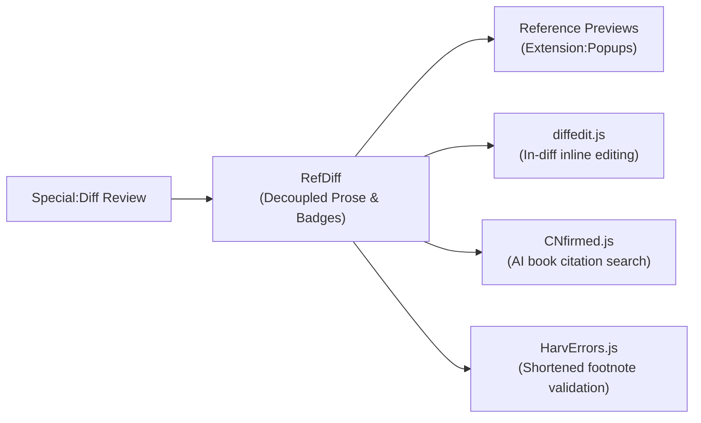
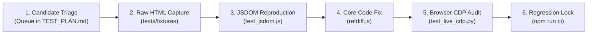

# RefDiff: Audit and Review Strategy

> **Status:** Active & Implemented  
> **Target Audience:** Script Maintainers, Wikimedia Code Reviewers, Wikipedia Patrollers & Source Auditors  
> **Applies to:** [`refdiff.js`](refdiff.js), [`tests/`](tests/), [`refdiff.wiki`](refdiff.wiki), and Wikimedia `Special:Diff` workflows

---

## 1. Executive Summary & Purpose

The **Audit and Review Strategy** defines the end-to-end framework for ensuring quality, security, and editorial integrity across RefDiff. It bridges two critical domains:

1. **Codebase & Security Audit (Engineering Integrity):** A systematic verification pipeline ensuring that `refdiff.js` complies with Wikimedia's gadget and security guidelines, enforces clean-code standards and anti-test-smell hygiene, eliminates mock blind spots through real DOM testing, and maintains zero regressions across real-world Wikipedia diffs.
2. **Editorial Source Audit (Editorial Integrity):** An operational playbook providing Wikipedia patrollers, fact-checkers, and reviewers with structured workflows to detect vandalism, "template camouflage", and "AI slop" without cognitive overload.

```
┌────────────────────────────────────────────────────────────────────────────────────────┐
│                                REFDIFF AUDIT STRATEGY                                  │
├───────────────────────────────────────────┬────────────────────────────────────────────┤
│   PILLAR 1: CODEBASE & SECURITY AUDIT     │     PILLAR 2: EDITORIAL REVIEW AUDIT       │
├───────────────────────────────────────────┼────────────────────────────────────────────┤
│ • Security & XSS Audit Protocols          │ • Anti-Template-Camouflage Workflow        │
│ • Severity Taxonomy (K1/M1/M6 Framework)  │ • Anti-AI-Slop Fact-Checking Playbook      │
│ • Clean Code & Anti-Test-Smell Governance │ • 3-Way Mode Triage (Visual/Wikitext/Dec.) │
│ • Real DOM (JSDOM) Regression Harness     │ • Ecosystem Synergies (diffedit, CNfirmed) │
│ • On-Wiki ResourceLoader Compliance       │ • Real-World Diff Lifecycle (6 Stages)     │
└───────────────────────────────────────────┴────────────────────────────────────────────┘
```

---

## 2. Pillar 1: Codebase Quality & Security Audit

### 2.1 Quality Review Taxonomy & Findings Registry

Findings from internal code reviews and comparative audits (e.g. against [Ultraviolet](poc/ultraviolet/COMPARISON.md)) are tracked using a standardized severity taxonomy:

| ID Class | Severity | Description | Action Threshold |
|:---:|:---:|:---|:---|
| **K** (*Kritisch* / Critical) | **P0** | Architectural flaw, DOM mutation hazard, or test mock blind spot hiding runtime failures. | Blocker for release; immediate architectural remediation required. |
| **M** (*Major* / Medium) | **P1** | Security hygiene issue (e.g. unescaped HTML injection, unpinned loader) or on-wiki compliance blocker. | Must be resolved before general on-wiki gadget promotion. |
| **N** (*Minor* / Nit) | **P2** | Code style, documentation drift, or non-blocking micro-optimizations. | Addressed during regular refactoring sprints. |

> [!NOTE]
> **Record Keeping in [`LOG.md`](LOG.md):** While this section defines the severity taxonomy and architectural requirements, all individual finding entries, chronological transitions, and detailed remediation logs are continuously recorded and tracked in the authoritative ledger: [**`LOG.md` (§3.2 Audit Findings Register)**](LOG.md#32-audit-findings-register-k1--m1--m6--m7-taxonomy).

#### Audit Findings Summary & Status

| ID | Finding Title | Severity | Status | Primary Remediation | Ledger Record |
|:---:|:---|:---:|:---:|:---|:---:|
| **[K1]** | Real DOM Mock Weakness | **P0** | ✅ Resolved | Integrated `jsdom` suite (`test_jsdom.js`) on real diff fixtures; guarded DOM APIs. | [`LOG.md#k1`](LOG.md#k1-real-dom-mock-weakness) |
| **[M1]** | HTML via Template Strings | **P1** | ✅ Resolved | Built native DOM builder `el()` and `createProseBadgeElement()`; 0% `.innerHTML`. | [`LOG.md#m1`](LOG.md#m1-html-generation-via-template-strings) |
| **[M6]** | Unpinned CDN Distribution | **P1** | ✅ Resolved | Standardized on-wiki distribution from Meta-Wiki with commit-pinned SHA loaders. | [`LOG.md#m6`](LOG.md#m6-unpinned-cdn-distribution) |
| **[M7]** | On-Wiki `<nowiki>` Transclusion | **P1** | ✅ Resolved | Enclosed `refdiff.js` in `/* <nowiki> */` comments; added delimiter balance tests. | [`LOG.md#m7`](LOG.md#m7-on-wiki-nowiki-template-transclusion) |

---

### 2.2 Security & XSS Audit Protocols

Because RefDiff processes untrusted wikitext and HTML attributes entered by arbitrary Wikipedia users, the codebase adheres to strict sanitization invariants:

1. **Tag & Attribute Stripping:** All attribute strings passed into badge titles, labels, or anchor lookups are processed through `stripHtml()` and XML entity decoding.
2. **Anchor Sanitization:** All internal anchor targets (`#refdiff-cit-...`) must pass `sanitizeAnchor()`, stripping any character outside `[a-zA-Z0-9_\-.:]`.
3. **Diffchange Tag Balancing:** The parser verifies tag balance (`hasBalancedDiffTags`) before attempting any entity extraction, ensuring candidate wikitext does not cross unclosed `<ins>` or `<del>` spans.
4. **Defensive API Invocations:** Browser APIs not universally implemented across all engines or iframe sandboxes (`target.scrollIntoView`, `history.pushState`, `window.MutationObserver`) must be wrapped in `typeof` feature checks or `try/catch` blocks.

---

### 2.3 Real DOM Regression Harness (JSDOM & Live CDP)

RefDiff enforces a dual-engine DOM audit pipeline:

```
┌─────────────────────────────────┐     ┌─────────────────────────────────┐
│     Level 2: JSDOM Suite        │     │      Level 4: Live CDP          │
│     (tests/test_jsdom.js)       │     │    (tests/test_live_cdp.py)     │
├─────────────────────────────────┤     ├─────────────────────────────────┤
│ • Headless Node.js execution    │     │ • Real Chromium instance        │
│ • Real MediaWiki diff fixtures  │     │ • Port 9222 WebSocket protocol  │
│ • Byte-for-byte Memento check   │     │ • Extension:Popups hovercards   │
│ • Sub-250ms CI quality gate     │     │ • Night Mode / Dark tokens      │
└─────────────────────────────────┘     └─────────────────────────────────┘
```

1. **In-Place Memento Byte-for-Byte Invariance:**
   Every test run on a real diff table verifies that:
   $$\text{table.innerHTML}_{\text{initial}} \equiv \text{table.innerHTML}_{\text{restored}}$$
   Restoration must leave zero orphaned rows, zero leaked badge classes, and zero detached event closures.
2. **Stress & Benchmark Budget:**
   The Zagreb Airport destination schedule (`diff=1379409916`, 114 citations) must process in **< 50 ms** in browser environments and **< 250 ms** in JSDOM, guaranteeing that RefDiff never triggers "Page Unresponsive" dialogs.

---

### 2.4 On-Wiki Distribution & Security Hygiene

To meet Wikimedia security policies for user scripts and gadgets:

1. **No Third-Party CDNs:** Production deployments must never use external CDNs (`jsdelivr`, `unpkg`, `cdnjs`). All code is loaded from Wikimedia servers (`meta.wikimedia.org` or local wiki `Special:MyPage`).
2. **Commit-Pinned Loader Pattern:**
   Users who require immutable, tamper-proof versions can load pinned revisions:
   ```javascript
   // <nowiki>
   (function () {
     var commit = 'b0b7dde'; // Updated only by deliberate review
     mw.loader.load('https://en.wikipedia.org/w/index.php?title=User:Powercycler/refdiff-' + commit + '.js&action=raw&ctype=text/javascript');
   })();
   // </nowiki>
   ```
3. **Wikitext Protection:** The script begins with `/* <nowiki> */` and ends with `/* </nowiki> */` to prevent template parsing and signature expansion.

---

### 2.5 Clean Code & Test Code Smell Audit Protocols

High automated test coverage can create a false sense of security if the underlying test suite suffers from **test smells**—anti-patterns that make tests brittle, opaque, slow, or prone to false positives. Similarly, user script production code must remain modular, readable, and defensive against MediaWiki's dynamic DOM lifecycle.

RefDiff enforces rigorous **Clean Code** standards and an active **Test Smell Audit Taxonomy** inspired by Gerard Meszaros' *xUnit Test Patterns* and modern clean-code engineering:

#### 2.5.1 Test Code Smell Taxonomy & Prevention Rules

| Test Smell | Anti-Pattern Description | Hazard / Failure Mode | Mandatory Prevention Rule in RefDiff |
|:---|:---|:---|:---|
| **Assertion Roulette** | Multiple unlabelled assertions in a single test case without failure explanations. | When a test fails in headless CI, reviewers cannot determine which invariant broke without line-number tracing. | **Descriptive Assertion Messages:** Every `assert.strictEqual()`, `assert.ok()`, or `assert.deepStrictEqual()` must supply an explanatory message string detailing the expected behavior. |
| **The Mystery Guest** /<br/>**Obscure Test** | Tests relying on implicit global state, obscure fixtures, or hidden magic literals whose origin is not visible in the test body. | Reviewers cannot understand why the test expects a specific output or what input conditions caused it. | **Explicit Arrange-Act-Assert (AAA):** Tests must explicitly declare inputs or use named fixtures (e.g. `comprehensive_test.html`). No anonymous magic strings. |
| **Over-Mocking &**<br/>**The Mockery** | Synthesizing elaborate fake DOM/window objects instead of testing real MediaWiki DOM structures. | Tests pass against artificial mocks but break on real Wikipedia diff tables (Finding **[K1]**). | **Real DOM First:** UI and table transformations must be tested in real JSDOM DOM trees (`withJsdom()`) using authentic MediaWiki HTML fixtures rather than synthetic mock trees. |
| **Polluted Global State &**<br/>**Resource Leaks** | Mutating `global.window`, `global.document`, `global.mw`, or storage engines without guaranteed teardown. | Inter-test interference, flaky test runs, and order-dependent execution failures in the runner. | **Guaranteed Sandbox Teardown:** All global mutations must execute inside `withMockEnvironment()` or `try / finally` blocks with unconditional global cleanup. |
| **Conditional Test Logic** | Using `if`, `else`, `switch`, or `for` loops wrapped around assertions inside a test case. | Assertions may be skipped silently when conditional branches are not reached, producing false green passes. | **Linear, Unconditional Tests:** Test cases must execute deterministically without branching logic. Parameterized cases must use declarative arrays (`[...].forEach()`) with separate test invocations. |
| **The Eager Test** /<br/>**Split Responsibility** | A single test case testing multiple unrelated subsystems or multiple edge cases at once. | Difficult to pinpoint regressions; failure in step 1 masks regressions in steps 2–5. | **Single Behavioral Contract:** 1 test = 1 behavioral guarantee or 1 specific bug reproduction (e.g. Donnie Brasco unclosed quotes vs. Bihar embedded apostrophes). |
| **Sleep-Based Timing &**<br/>**Async Flakiness** | Using arbitrary `setTimeout()` or `sleep()` to wait for asynchronous UI mutations. | Flaky tests in resource-constrained CI; false alarms or sluggish test runs. | **Deterministic Synchronization:** Wait for deterministic events, mutation observers, or hooks (`mw.hook`) rather than wall-clock delays. |
| **Silent / Hollow Tests** | Empty catch blocks (`try { ... } catch (e) {}`), or asserting `assert.ok(true)` without validating resulting DOM state. | Tests appear green in reporting but fail to exercise or verify any actual code paths. | **Zero Silent Catches:** Never catch assertion errors silently. Tests must assert resulting DOM mutations or return values directly. |
| **Duplicated Fixture Logic** | Copy-pasting 50-line diff table mock strings across multiple test files. | Maintenance burden; changes to DOM schema require updating dozens of disconnected strings. | **Shared Modular Fixtures:** Centralize diff HTML fixtures in `tests/fixtures/` and shared helpers in `tests/harness.js`. |

#### 2.5.2 Production Code Cleanliness Standards

1. **Single Responsibility per Subsystem:**
   - Parsing (`src/parser.js`), pairing (`src/pairing.js`), DOM restoration (`src/memento.js`), UI widgets (`src/init.js`), and storage (`src/state.js`) are decoupled with zero circular dependencies.
2. **DAMP over DRY in Test Code:**
   - While production code strictly enforces **DRY** (Don't Repeat Yourself), test code favors **DAMP** (Descriptive And Meaningful Phrases). Test cases should read like executive specifications where inputs, actions, and expectations are immediately legible without excessive indirection.
3. **Pure Functions & Guard Clauses:**
   - String parsers (`extractName`, `extractSfnInfo`, `normalizeDiffTags`) are pure functions with early return guard clauses. Deeply nested `if` pyramids are prohibited.
4. **XSS-Immune DOM Construction:**
   - Dynamic elements are constructed via native `el()` with `ownerDocument.createTextNode()` escaping (Finding **[M1]**). Zero dynamic `.innerHTML` string interpolation.
5. **ResourceLoader Encapsulation:**
   - No variable leaks into the global `window` scope. All internal states are encapsulated inside an IIFE closure with explicit `window.RefDiff` exports only when running under Node.js test harnesses.

#### 2.5.3 Clean Code & Anti-Test-Smell Review Checklist

Reviewers and contributors must verify the following checklist before merging:

* [ ] **[AAA Compliance]** Does every test follow a clear Arrange, Act, Assert structure?
* [ ] **[Descriptive Assertions]** Does every assertion provide an explanatory error message string?
* [ ] **[No Global Leakage]** Are all mocked globals restored via `finally` or `withMockEnvironment()`?
* [ ] **[No Assertion Roulette]** Can a failure immediately identify the exact broken invariant from the error message?
* [ ] **[No Conditional Logic]** Is the test execution path completely linear and free of `if`/`switch` skips?
* [ ] **[Real DOM Validation]** Do DOM-mutating tests run against genuine MediaWiki diff HTML rather than synthetic objects?
* [ ] **[Deterministic Timing]** Are all tests free of arbitrary `sleep()` or timeout delays?
* [ ] **[Lint Hygiene]** Does the test file pass `npm run lint` with 0 warnings and 0 errors?

---

### 2.6 Test Proportionality & Sufficiency Audit: "Is it Enough or Too Much?"

A critical responsibility of quality auditing is evaluating whether automated testing is **proportional** to the risk profile—avoiding both under-testing (critical blind spots) and over-testing (fragile test bloat, high maintenance friction, and sluggish CI).

#### 2.6.1 Is it Too Much? (Audit Against Over-Engineering & Bloat)
**Audit Verdict: No.**

* **Zero Framework Bloat:** The test runner uses Node.js built-in `assert` module without third-party runner overhead (no Jest, Mocha, Karma, or Babel transpilers). The entire 15-suite suite executes in **~250 ms**.
* **Zero Redundant Tests:** Every test case addresses a concrete MediaWiki architectural constraint or known failure mode:
  - Splitting of tag boundaries by MediaWiki's backend `wikidiff2` engine (`normalizeDiffTags`).
  - In-place DOM Memento preservation to protect live element closures and third-party scripts (`inlineFormatToggle.js`, `diffedit.js`, VisualEditor).
  - Shortened footnote tokenization and author-year synthesis (`{{sfn}}`, `{{r}}`, `{{efn}}`, `{{harvnb}}`).
  - Positional and underscore-converted anchor discovery for native `Extension:Popups` / Reference Previews tooltips.
  - Configurable inline-change mode (`[✓] Inline modified refs`) preserving prose flow while decoupling additions and deletions.
  - Pre-flight deployment packaging safety (nowiki wrapping, zero BOM, zero `console.log`, syntax safety).
* **Sandboxed Mock Isolation:** All DOM/window mocks execute within `withMockEnvironment()`, guaranteeing state restoration and eliminating cross-test interference.
* **Low Maintenance Cost:** Tests are deterministic, fast, and linear, avoiding flaky async timeouts or external network dependencies.

#### 2.6.2 Is it Enough? (Audit of Coverage Sufficiency & Known Risk Boundaries)
**Audit Verdict: Sufficient for production release (v1.3.0), with explicit, monitored testing boundaries.**

* **Core Production Capabilities are 100% Covered:**
  - 100.0% headless function coverage (all 71 internal functions verified across 15 modular suites).
  - Authentic MediaWiki DOM fixtures tested in JSDOM (`test_jsdom.js`) and live Chromium browser automation (`test_live_cdp.py`).
  - High-density stress diffs (114 references) benchmarked < 50 ms.
  - Multi-skin theming (Vector 2022 light/dark, Vector legacy, Monobook) and three-way OOUI mode switching.
* **Acknowledged Testing Boundaries & Prioritized Risk Queue:**
  1. **Malformed Wikitext:** Unclosed `<ref>` tags, missing brackets, or abnormal multiline breaks are intentionally skipped by the parser and remain safely in-situ in the prose diff (graceful degradation).
  2. **Transcluded & Nested Footnotes:** Citations deeply nested inside complex wrapper templates (`{{refn}}`, `{{sfnp}}`, infobox cells) remain in-situ without badging.
  3. **Mobile Diff Layouts (MinervaNeue):** Responsive single-column stacked diff tables on mobile skins are outside current automated layout testing (RefDiff is optimized primarily for desktop two-column diffs).
  4. **Dynamic AJAX Page Lifecycle:** Rapid successive diff updates fired by live script reloads or interactive history navigation without full page reloads.
  5. **Prose Diff Retention & False-Negative Invariance:** While real DOM tests verify whitespace preservation (Cosmic inflation), systematic differential fuzzing comparing MediaWiki's native word/character split patterns against RefDiff's transformed DOM remains an ongoing verification track (delegated to [`LOG.md` §3.3](LOG.md#33-real-world-diff-verification-register)).

---

## 3. Pillar 2: Editorial Review & Source Auditing Playbook

### 3.1 The "Template Camouflage" Audit Workflow

**The Threat:** Unscrupulous editors or vandals conceal substantive prose changes inside massive citation template additions. Standard `wikidiff2` wraps the entire paragraph in yellow/blue blocks, making character-level prose changes invisible.

**The RefDiff Audit Workflow:**
1. Open the diff on `Special:Diff`. RefDiff activates automatically.
2. **Prose Scan:** The prose row displays only the human-readable text. Any word change (e.g. changing `"1982"` to `"1989"`) is immediately obvious in green/red highlights.
3. **Badge Inspection:** Unmodified references appear as subtle grey badges (`⟨ref1⟩`). Modified references appear in amber gold (`⟨~schmidt2020~⟩`). Added references appear in bright green (`⟨+esa2022+⟩`).
4. **Citation Delta Scan:** Inspect the dedicated citation diff row directly below the prose line to audit parameter modifications (e.g. changed URLs, altered page numbers, or swapped authors).

---

### 3.2 Auditing Against "AI Slop" & Hallucinated Citations

**The Threat:** Generative AI tools produce syntactically flawless wikitext with fabricated citations (hallucinated DOIs, fake book titles, or dead URLs). Reviewers are overwhelmed by the sheer volume of template markup.

**The RefDiff Audit Workflow:**
1. **Source Decoupling:** RefDiff extracts all inline citations out of the sentences into the dedicated citation pane or rows.
2. **Prose Coherence Check:** Review the prose in isolation to evaluate factual plausibility, encyclopedic tone, and neutrality.
3. **One-Click Source Verification:** Hover or click each badge (`⟨1⟩`, `⟨2⟩`). RefDiff seamlessly activates MediaWiki's native **Reference Previews** (`Extension:Popups`), rendering the full citation preview without jumping down to the bibliography.
4. **Anchor Matching:** Badges link directly to the `#cite_note-*` footnotes. Broken anchors or orphaned citations are instantly flagged when no preview popover appears.

---

### 3.3 Tri-Mode Review Triage

RefDiff integrates directly into MediaWiki's native OOUI diff switcher:

```
[ 👁 Visual ]  [ [[]] Wikitext ]  [ ⧉ RefDiff ]  [✓] Inline modified refs
```

Reviewers select their diff view based on the edit type:

| Diff Type | Recommended Mode | Rationale |
|:---|:---:|:---|
| **Simple Typo / Formatting** | **Visual Diff** | Fast WYSIWYG inspection of formatting. |
| **Heavy Wikitext / Template Syntax** | **Wikitext Diff** | Raw code review of parser functions, infoboxes, and tables. |
| **Scholarly / Citation-Heavy Edit** | **RefDiff Mode** | Decouples citations from prose; audits sources parameter by parameter. |
| **Dense Table / Destination Matrix** | **RefDiff (Inline modified checked)** | Keeps modified citations inline with `⟨~label~⟩` badges without altering table row heights. |

---

### 3.4 Integration with the Review Ecosystem

RefDiff operates synergistically with leading editorial scripts:



* **[diffedit.js](https://en.wikipedia.org/wiki/User:BrandonXLF/diffedit):** RefDiff automatically yields to `diffedit` when the inline edit button is clicked, restoring clean wikitext for editing.
* **[CNfirmed.js](https://en.wikipedia.org/wiki/User:Alaexis/CNfirmed.js):** When unsourced claims are identified in RefDiff's clean prose pane, reviewers use CNfirmed to query the Internet Archive for authoritative sources.
* **[HarvErrors.js](https://en.wikipedia.org/wiki/User:Svick/HarvErrors.js):** RefDiff's author-year badges (`⟨Castritius 2005⟩`) link to shortened footnote anchors, allowing HarvErrors to instantly highlight missing target book citations.

---

## 4. Real-World Diff Verification Lifecycle

Every real-world diff submitted to the audit queue (Section 5.1 of [`TEST_PLAN.md`](TEST_PLAN.md)) follows a 6-stage verification lifecycle before being marked as **Verified**:



1. **Candidate Triage:** Diff URL, revision ID, and reported anomaly are logged in `TEST_PLAN.md` with status `⏳ Needs fix`.
2. **Raw HTML Capture:** The raw MediaWiki diff table HTML is saved into `tests/` or scratch fixtures.
3. **JSDOM Reproduction:** An automated test reproducing the failure without mocks is added to the test suite.
4. **Core Code Fix:** `refdiff.js` is patched following single-responsibility and modular architecture standards.
5. **Browser CDP Audit:** Live browser testing over WebSocket port 9222 verifies OOUI switcher, dark mode tokens, and hovercard popovers.
6. **Regression Lock:** The diff is marked as `Verified` in `TEST_PLAN.md`, documented in `LOG.md`, and committed with all CI gates passing.

---

## 5. Continuous Quality Gates & Enforcement

To merge any code change or issue release tags:

| Quality Gate | Requirement | Verification Command |
|:---|:---:|:---|
| **Test Suite Pass Rate** | **100% (111/111 passing)** | `npm test` |
| **Code Style & Linting** | **0 errors, 0 warnings** | `npm run lint` |
| **Clean Code & Test Smells** | **0 test smells; AAA pattern; descriptive assertions; 0 global leaks** | `npm test && npm run lint` |
| **Deployment Pre-Flight** | **Zero BOM, nowiki wrapper, version sync, API contract & syntax safety** | `node tests/test_deployment.js` |
| **Execution Budget** | **< 250 ms across all 15 suites** | `npm run ci` |
| **Stress Benchmark** | **< 50 ms on 114-ref table** | `node tests/test_benchmarks.js` |
| **Real DOM Invariance** | **Byte-for-byte Memento restoration** | `node tests/test_jsdom.js` |
| **On-Wiki Syntax Safety** | **`<nowiki>` delimiters balanced** | `node tests/test_jsdom.js` |
