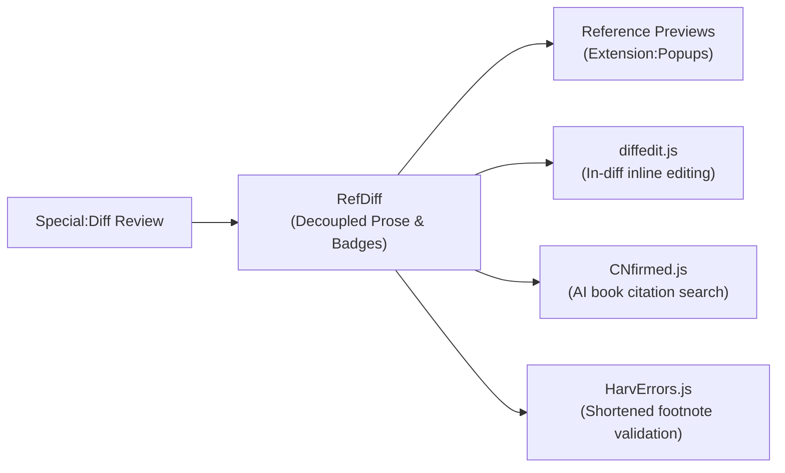
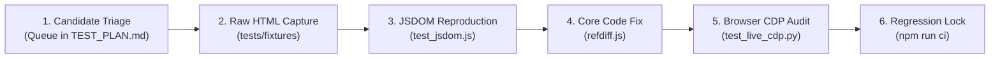

# RefDiff: Audit and Review Strategy

> **Status:** Active & Implemented  
> **Target Audience:** Script Maintainers, Wikimedia Code Reviewers, Wikipedia Patrollers & Source Auditors  
> **Applies to:** [`refdiff.js`](refdiff.js), [`tests/`](tests/), [`refdiff.wiki`](refdiff.wiki), and Wikimedia `Special:Diff` workflows

---

## 1. Executive Summary & Purpose

The **Audit and Review Strategy** defines the end-to-end framework for ensuring quality, security, and editorial integrity across RefDiff. It bridges two critical domains:

1. **Codebase & Security Audit (Engineering Integrity):** A systematic verification pipeline ensuring that `refdiff.js` complies with Wikimedia's gadget and security guidelines, eliminates mock blind spots through real DOM testing, and maintains zero regressions across real-world Wikipedia diffs.
2. **Editorial Source Audit (Editorial Integrity):** An operational playbook providing Wikipedia patrollers, fact-checkers, and reviewers with structured workflows to detect vandalism, "template camouflage", and "AI slop" without cognitive overload.

```
┌────────────────────────────────────────────────────────────────────────────────────────┐
│                                REFDIFF AUDIT STRATEGY                                  │
├───────────────────────────────────────────┬────────────────────────────────────────────┤
│   PILLAR 1: CODEBASE & SECURITY AUDIT     │     PILLAR 2: EDITORIAL REVIEW AUDIT       │
├───────────────────────────────────────────┼────────────────────────────────────────────┤
│ • Security & XSS Audit Protocols          │ • Anti-Template-Camouflage Workflow        │
│ • Severity Taxonomy (K1/M1/M6 Framework)  │ • Anti-AI-Slop Fact-Checking Playbook      │
│ • Real DOM (JSDOM) Regression Harness     │ • 3-Way Mode Triage (Visual/Wikitext/Dec.) │
│ • On-Wiki ResourceLoader Compliance       │ • Ecosystem Synergies (diffedit, CNfirmed) │
└───────────────────────────────────────────┴────────────────────────────────────────────┘
```

---

## 2. Pillar 1: Codebase Quality & Security Audit

### 2.1 Quality Review Taxonomy & Findings Registry

Findings from internal code reviews and comparative audits (e.g. against [Ultraviolet](poc/ultraviolet/COMPARISON.md)) are tracked using a standardized severity taxonomy:

| ID Class | Severity | Description | Action Threshold |
|:---:|:---:|:---|:---|
| **K** (*Kritisch* / Critical) | **P0** | Architectural flaw, DOM mutation hazard, or test mock blind spot hiding runtime failures. | Blocker for release; immediate architectural remediation required. |
| **M** (*Major* / Medium) | **P1** | Security hygiene issue (e.g. unescaped HTML injection, unpinned loader) or on-wiki compliance blocker. | Must be resolved before general on-wiki gadget promotion. |
| **N** (*Minor* / Nit) | **P2** | Code style, documentation drift, or non-blocking micro-optimizations. | Addressed during regular refactoring sprints. |

#### Audit Findings & Resolution Status

* **[K1] Real DOM Mock Weakness (Resolved):**
  * *Finding:* Hand-written mock objects (`{ innerHTML: ... }`) in `tests/harness.js` did not test real DOM behaviors (`tr.cells`, live HTMLCollections, event bubbling, or browser quirks like missing `scrollIntoView`).
  * *Remediation:* Integrated `jsdom` devDependency and implemented [`tests/test_jsdom.js`](tests/test_jsdom.js) running real MediaWiki HTML diff fixtures (`comprehensive_test.html` and `stress_test_1379409916.html`). Guarded `scrollIntoView` and `MutationObserver` defensively.
* **[M1] HTML Generation via Template Strings (In Progress / Hardened):**
  * *Finding:* Dynamic markup built with template literals rather than `document.createElement` presents potential XSS vectors if attribute strings contain unescaped user content.
  * *Remediation:* Sanitized reference names via `sanitizeAnchor`, decoupled badge generation with strict entity filtering, and established roadmap for `el(tag, attrs, ...children)` DOM builder helper.
* **[M6] Unpinned CDN Distribution (Resolved / Documented):**
  * *Finding:* Loading from third-party CDN `@main` branch introduces supply-chain risk and breaches Wikimedia's privacy/security policy.
  * *Remediation:* Standardized on-wiki distribution directly from Meta-Wiki (`m:User:Powercycler/refdiff.js`) with commit-pinned sha loaders (see [Section 2.4](#24-on-wiki-distribution--security-hygiene)).
* **[M7] On-Wiki `<nowiki>` Template Transclusion (Resolved):**
  * *Finding:* Code comments containing template examples (`{{sfn|...}}`, `{{efn|...}}`) were parsed as transclusions by MediaWiki on JS pages, polluting `templatelinks`.
  * *Remediation:* Wrapped `refdiff.js` with `/* <nowiki> */` at top and `/* </nowiki> */` at bottom, backed by automated syntax regression test in `test_jsdom.js`.

---

### 2.2 Security & XSS Audit Protocols

Because RefDiff processes untrusted wikitext and HTML attributes entered by arbitrary Wikipedia users, the codebase adheres to strict sanitization invariants:

1. **Tag & Attribute Stripping:** All attribute strings passed into badge titles, labels, or anchor lookups are processed through `stripHtml()` and XML entity decoding.
2. **Anchor Sanitization:** All internal anchor targets (`#refdiff-cit-...`) must pass `sanitizeAnchor()`, stripping any character outside `[a-zA-Z0-9_\-.:]`.
3. **Diffchange Tag Balancing:** The parser verifies tag balance (`hasBalancedDiffTags`) before attempting any entity extraction, ensuring candidate wikitext does not cross unclosed `<ins>` or `<del>` spans.
4. **Defensive API Invocations:** Browser APIs not universally implemented across all engines or iframe sandboxes (`target.scrollIntoView`, `history.pushState`, `window.MutationObserver`) must be wrapped in `typeof` feature checks or `try/catch` blocks.

---

### 2.3 Real DOM Regression Harness (JSDOM & Live CDP)

RefDiff enforces a dual-engine DOM audit pipeline:

```
┌─────────────────────────────────┐     ┌─────────────────────────────────┐
│     Level 2: JSDOM Suite        │     │      Level 4: Live CDP          │
│     (tests/test_jsdom.js)       │     │    (tests/test_live_cdp.py)     │
├─────────────────────────────────┤     ├─────────────────────────────────┤
│ • Headless Node.js execution    │     │ • Real Chromium instance        │
│ • Real MediaWiki diff fixtures  │     │ • Port 9222 WebSocket protocol  │
│ • Byte-for-byte Memento check   │     │ • Extension:Popups hovercards   │
│ • Sub-250ms CI quality gate     │     │ • Night Mode / Dark tokens      │
└─────────────────────────────────┘     └─────────────────────────────────┘
```

1. **In-Place Memento Byte-for-Byte Invariance:**
   Every test run on a real diff table verifies that:
   $$\text{table.innerHTML}_{\text{initial}} \equiv \text{table.innerHTML}_{\text{restored}}$$
   Restoration must leave zero orphaned rows, zero leaked badge classes, and zero detached event closures.
2. **Stress & Benchmark Budget:**
   The Zagreb Airport destination schedule (`diff=1379409916`, 114 citations) must process in **< 50 ms** in browser environments and **< 250 ms** in JSDOM, guaranteeing that RefDiff never triggers "Page Unresponsive" dialogs.

---

### 2.4 On-Wiki Distribution & Security Hygiene

To meet Wikimedia security policies for user scripts and gadgets:

1. **No Third-Party CDNs:** Production deployments must never use external CDNs (`jsdelivr`, `unpkg`, `cdnjs`). All code is loaded from Wikimedia servers (`meta.wikimedia.org` or local wiki `Special:MyPage`).
2. **Commit-Pinned Loader Pattern:**
   Users who require immutable, tamper-proof versions can load pinned revisions:
   ```javascript
   // <nowiki>
   (function () {
     var commit = 'b0b7dde'; // Updated only by deliberate review
     mw.loader.load('https://en.wikipedia.org/w/index.php?title=User:Powercycler/refdiff-' + commit + '.js&action=raw&ctype=text/javascript');
   })();
   // </nowiki>
   ```
3. **Wikitext Protection:** The script begins with `/* <nowiki> */` and ends with `/* </nowiki> */` to prevent template parsing and signature expansion.

---

## 3. Pillar 2: Editorial Review & Source Auditing Playbook

### 3.1 The "Template Camouflage" Audit Workflow

**The Threat:** Unscrupulous editors or vandals conceal substantive prose changes inside massive citation template additions. Standard `wikidiff2` wraps the entire paragraph in yellow/blue blocks, making character-level prose changes invisible.

**The RefDiff Audit Workflow:**
1. Open the diff on `Special:Diff`. RefDiff activates automatically.
2. **Prose Scan:** The prose row displays only the human-readable text. Any word change (e.g. changing `"1982"` to `"1989"`) is immediately obvious in green/red highlights.
3. **Badge Inspection:** Unmodified references appear as subtle grey badges (`⟨ref1⟩`). Modified references appear in amber gold (`⟨~schmidt2020~⟩`). Added references appear in bright green (`⟨+esa2022+⟩`).
4. **Citation Delta Scan:** Inspect the dedicated citation diff row directly below the prose line to audit parameter modifications (e.g. changed URLs, altered page numbers, or swapped authors).

---

### 3.2 Auditing Against "AI Slop" & Hallucinated Citations

**The Threat:** Generative AI tools produce syntactically flawless wikitext with fabricated citations (hallucinated DOIs, fake book titles, or dead URLs). Reviewers are overwhelmed by the sheer volume of template markup.

**The RefDiff Audit Workflow:**
1. **Source Decoupling:** RefDiff extracts all inline citations out of the sentences into the dedicated citation pane or rows.
2. **Prose Coherence Check:** Review the prose in isolation to evaluate factual plausibility, encyclopedic tone, and neutrality.
3. **One-Click Source Verification:** Hover or click each badge (`⟨1⟩`, `⟨2⟩`). RefDiff seamlessly activates MediaWiki's native **Reference Previews** (`Extension:Popups`), rendering the full citation preview without jumping down to the bibliography.
4. **Anchor Matching:** Badges link directly to the `#cite_note-*` footnotes. Broken anchors or orphaned citations are instantly flagged when no preview popover appears.

---

### 3.3 Tri-Mode Review Triage

RefDiff integrates directly into MediaWiki's native OOUI diff switcher:

```
[ 👁 Visual ]  [ [[]] Wikitext ]  [ ⧉ RefDiff ]  [✓] Inline modified refs
```

Reviewers select their diff view based on the edit type:

| Diff Type | Recommended Mode | Rationale |
|:---|:---:|:---|
| **Simple Typo / Formatting** | **Visual Diff** | Fast WYSIWYG inspection of formatting. |
| **Heavy Wikitext / Template Syntax** | **Wikitext Diff** | Raw code review of parser functions, infoboxes, and tables. |
| **Scholarly / Citation-Heavy Edit** | **RefDiff Mode** | Decouples citations from prose; audits sources parameter by parameter. |
| **Dense Table / Destination Matrix** | **RefDiff (Inline modified checked)** | Keeps modified citations inline with `⟨~label~⟩` badges without altering table row heights. |

---

### 3.4 Integration with the Review Ecosystem

RefDiff operates synergistically with leading editorial scripts:



* **[diffedit.js](https://en.wikipedia.org/wiki/User:BrandonXLF/diffedit):** RefDiff automatically yields to `diffedit` when the inline edit button is clicked, restoring clean wikitext for editing.
* **[CNfirmed.js](https://en.wikipedia.org/wiki/User:Alaexis/CNfirmed.js):** When unsourced claims are identified in RefDiff's clean prose pane, reviewers use CNfirmed to query the Internet Archive for authoritative sources.
* **[HarvErrors.js](https://en.wikipedia.org/wiki/User:Svick/HarvErrors.js):** RefDiff's author-year badges (`⟨Castritius 2005⟩`) link to shortened footnote anchors, allowing HarvErrors to instantly highlight missing target book citations.

---

## 4. Real-World Diff Verification Lifecycle

Every real-world diff submitted to the audit queue (Section 5.1 of [`TEST_PLAN.md`](TEST_PLAN.md)) follows a 6-stage verification lifecycle before being marked as **Verified**:



1. **Candidate Triage:** Diff URL, revision ID, and reported anomaly are logged in `TEST_PLAN.md` with status `⏳ Needs fix`.
2. **Raw HTML Capture:** The raw MediaWiki diff table HTML is saved into `tests/` or scratch fixtures.
3. **JSDOM Reproduction:** An automated test reproducing the failure without mocks is added to the test suite.
4. **Core Code Fix:** `refdiff.js` is patched following single-responsibility and modular architecture standards.
5. **Browser CDP Audit:** Live browser testing over WebSocket port 9222 verifies OOUI switcher, dark mode tokens, and hovercard popovers.
6. **Regression Lock:** The diff is marked as `Verified` in `TEST_PLAN.md`, documented in `LOG.md`, and committed with all CI gates passing.

---

## 5. Continuous Quality Gates & Enforcement

To merge any code change or issue release tags:

| Quality Gate | Requirement | Verification Command |
|:---|:---:|:---|
| **Test Suite Pass Rate** | **100% (97/97 passing)** | `npm test` |
| **Code Style & Linting** | **0 errors, 0 warnings** | `npm run lint` |
| **Execution Budget** | **< 250 ms across all 14 suites** | `npm run ci` |
| **Stress Benchmark** | **< 50 ms on 114-ref table** | `node tests/test_benchmarks.js` |
| **Real DOM Invariance** | **Byte-for-byte Memento restoration** | `node tests/test_jsdom.js` |
| **On-Wiki Syntax Safety** | **`<nowiki>` delimiters balanced** | `node tests/test_jsdom.js` |
