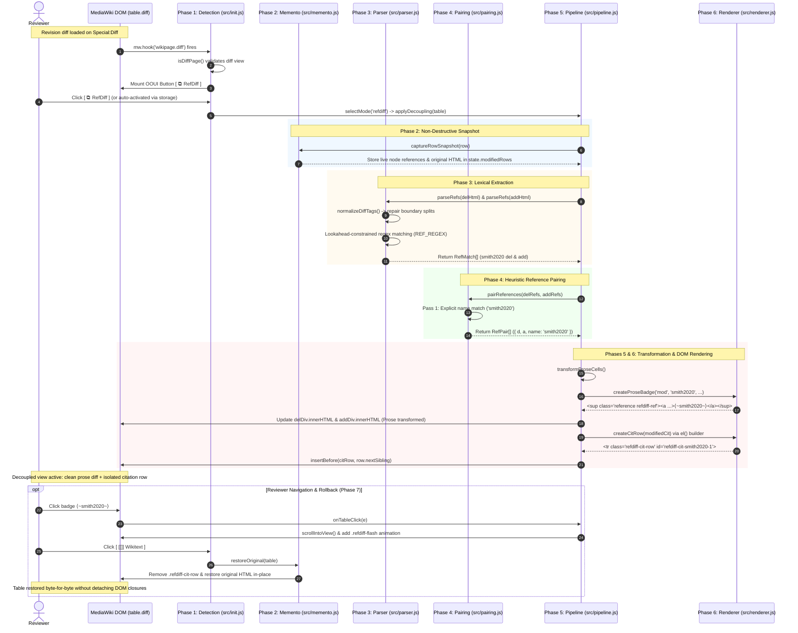
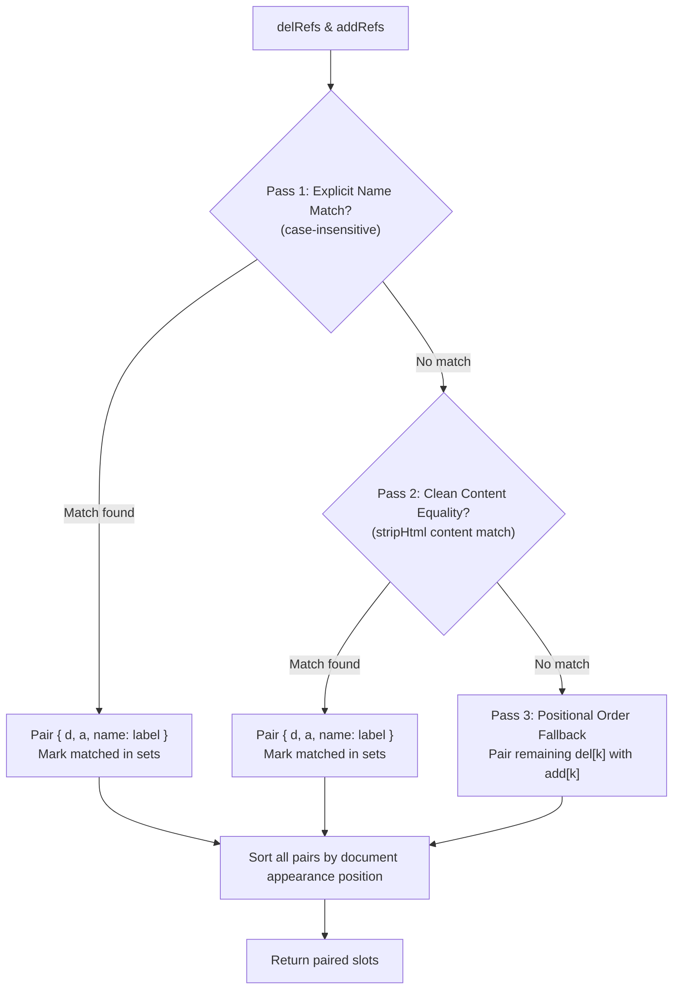

# 🧭 RefDiff Architectural Code Walkthrough: Execution Lifecycle & Representative Case

This document provides a pedagogical, step-by-step walkthrough of how **RefDiff** (*The Ref-Differentiator*) processes a MediaWiki diff table from initial page detection to DOM transformation, user interaction, and fail-open rollback.

It is designed for new maintainers, contributors, and reviewers who want to understand how RefDiff's subsystems collaborate to separate prose edits from citation metadata changes without data loss or interface breakage.

---

## 1. 🎯 The Representative Diff Case

To make every lifecycle phase tangible, this walkthrough traces a minimal, representative MediaWiki diff row containing simultaneous prose and citation edits:

* **Left (Old / Deleted revision):**
  ```wikitext
  The planet has an atmosphere.<ref name="smith2020">{{Cite book|title=Old Atmosphere}}</ref>
  ```
* **Right (New / Added revision):**
  ```wikitext
  The planet has a dense atmosphere.<ref name="smith2020">{{Cite book|title=New Atmosphere}}</ref>
  ```

### 1.1 The Dual Modification
This single row captures the core challenge RefDiff solves:
1. **Prose assertion edit:** The editor inserted the descriptive word `dense ` (`has an atmosphere` $\to$ `has a dense atmosphere`).
2. **Bibliographic metadata edit:** The editor updated the book title from `Old Atmosphere` to `New Atmosphere` inside a shared reference named `smith2020`.

### 1.2 The Problem: Citation Camouflage in Native MediaWiki Diffs
In MediaWiki's native diff engine (`wikidiff2`), citations are interleaved directly in the sentence string. When `wikidiff2` generates the diff table, it outputs:

```html
<!-- Deleted Cell (.diff-deletedline div) -->
The planet has an atmosphere.&lt;ref name=&quot;smith2020&quot;&gt;{{Cite book|title=<del class="diffchange">Old</del> Atmosphere}}&lt;/ref&gt;

<!-- Added Cell (.diff-addedline div) -->
The planet has a <ins class="diffchange">dense </ins>atmosphere.&lt;ref name=&quot;smith2020&quot;&gt;{{Cite book|title=<ins class="diffchange">New</ins> Atmosphere}}&lt;/ref&gt;
```

In a real article where citation templates contain 200–500 characters of parameters (`|author=`, `|date=`, `|url=`, `|archive-url=`), the single word prose change (`dense `) is visually camouflaged by hundreds of characters of citation markup. Reviewers easily overlook critical text distortions because their attention is overwhelmed by metadata noise.

### 1.3 The RefDiff Outcome
RefDiff transforms this single monolithic row into two specialized, synchronized views:

| View Level | Left Column (Deleted) | Right Column (Added) | Notes |
| :--- | :--- | :--- | :--- |
| **Prose Row** (Row 1) | `The planet has an atmosphere.⟨~smith2020~⟩` | `The planet has a dense atmosphere.⟨~smith2020~⟩` | Prose diff (`dense `) is highlighted cleanly; reference is replaced by an amber badge `⟨~smith2020~⟩`. |
| **Citation Row** (Row 2, injected) | `⟨~smith2020~⟩ <ref name="smith2020">{{Cite book\|title=Old Atmosphere}}</ref>` | `⟨~smith2020~⟩ <ref name="smith2020">{{Cite book\|title=New Atmosphere}}</ref>` | Granular intra-line diff highlights (`Old` vs. `New`) isolated directly below the sentence. |

---

## 2. 📊 Visual Transformation Lifecycle & Data Flow

The following sequence diagram illustrates how data flows chronologically through RefDiff's subsystems when the user views or toggles the representative diff:



---

## 3. 🔍 Chronological Phase-by-Phase Walkthrough

### Phase 1: 🟢 Detection & Lifecycle Hooking (`src/init.js`, `src/mode_coordinator.js`)

#### Purpose & Invariants
RefDiff must only execute on MediaWiki diff pages, must integrate seamlessly into the native diff toolbar without disrupting other gadgets (such as VisualEditor or `diffedit`), and must respect stored user preferences.

#### Execution Details
1. **Page Detection (`isDiffPage`):**
   RefDiff verifies that the current environment is a valid diff page by checking MediaWiki configuration globals and the DOM:
   ```javascript
   function isDiffPage() {
     if (typeof window === 'undefined' || typeof document === 'undefined') return false;
     return !!(
       (window.mw && window.mw.config && (window.mw.config.get('wgDiffNewId') || window.mw.config.get('wgDiffOldId'))) ||
       document.querySelector(SELECTORS.DIFF_TABLE) ||
       document.getElementById('wikiDiff') ||
       /[?&]diff=/.test(location.search) ||
       /\/wiki\/Special:Diff\//.test(location.pathname)
     );
   }
   ```
2. **Lifecycle Hooking (`mw.hook`):**
   Instead of relying on a fragile `window.onload` timer, RefDiff binds to MediaWiki's canonical diff event:
   ```javascript
   if (window.mw && window.mw.hook) {
     window.mw.hook('wikipage.diff').add(init);
   }
   ```
   If `mw.hook` is absent (such as in legacy skins or standalone test environments), it falls back to `DOMContentLoaded` / `$(document).ready()`.
3. **Toolbar Button Injection (`createRefDiffButton`):**
   RefDiff queries `.ve-init-mw-diffPage-diffMode .oo-ui-buttonGroupWidget` and appends an OOUI-compliant `ButtonOptionWidget` (`#refdiff-ooui-btn`):
   ```html
   <div id="refdiff-ooui-btn" class="oo-ui-widget oo-ui-optionWidget oo-ui-buttonElement oo-ui-buttonOptionWidget oo-ui-widget-enabled" role="option" aria-disabled="false">
     <a class="oo-ui-buttonElement-button" role="button" tabindex="0">
       <span class="oo-ui-iconElement-icon oo-ui-icon-diffs"></span>
       <span class="oo-ui-labelElement-label">RefDiff</span>
     </a>
   </div>
   ```
   If the OOUI button group is missing (e.g. Monobook or Timeless skin), RefDiff mounts a lightweight fallback bar (`#refdiff-mode-bar`) directly above `table.diff`.
4. **Preference Check (`isRefDiffPreferred`):**
   RefDiff inspects `localStorage` and `mw.storage` for the key `'refdiff-active'`. If enabled (default for active gadget users), `selectMode('refdiff')` triggers the transformation pipeline.

---

### Phase 2: 🔵 Memento Capture (`src/memento.js`)

#### Purpose & Invariants
MediaWiki's native scripts (such as `inlineFormatToggle.js`) cache direct JavaScript references to existing `<tr>` and `<td>` elements in `table.diff`. If RefDiff replaced `table.innerHTML` or detached rows from the DOM, all MediaWiki event closures would point to dead, off-screen nodes, permanently breaking the native inline diff toggle.

To prevent this, RefDiff implements the **Memento Design Pattern**: capturing the exact HTML and attributes of each cell before performing any mutation.

#### Execution Details
Before mutating the representative row, `applyDecoupling()` calls `captureRowSnapshot(row)`:

```javascript
function captureRowSnapshot(row) {
  const delDiv = row.querySelector('.diff-deletedline div');
  const addDiv = row.querySelector('.diff-addedline div');
  const delTd = row.querySelector('.diff-deletedline');
  const addTd = row.querySelector('.diff-addedline');
  const markers = Array.from(row.querySelectorAll('.diff-marker'));

  return {
    row,
    delDiv,
    addDiv,
    delTd,
    addTd,
    delHtml: delDiv ? delDiv.innerHTML : null,
    addHtml: addDiv ? addDiv.innerHTML : null,
    delTdClass: delTd ? delTd.className : null,
    addTdClass: addTd ? addTd.className : null,
    markers: markers.map(mk => ({ el: mk, marker: mk.getAttribute('data-marker') }))
  };
}
```

#### Snapshot State for Representative Case
For our representative diff row, the stored snapshot contains:
* `row`: Pointer to the live `HTMLTableRowElement`.
* `delDiv`: Pointer to the live `div` inside `.diff-deletedline`.
* `addDiv`: Pointer to the live `div` inside `.diff-addedline`.
* `delHtml`: `'The planet has an atmosphere.&lt;ref name=&quot;smith2020&quot;&gt;{{Cite book|title=<del class="diffchange">Old</del> Atmosphere}}&lt;/ref&gt;'`
* `addHtml`: `'The planet has a <ins class="diffchange">dense </ins>atmosphere.&lt;ref name=&quot;smith2020&quot;&gt;{{Cite book|title=<ins class="diffchange">New</ins> Atmosphere}}&lt;/ref&gt;'`
* `delTdClass`: `'diff-deletedline diff-side-deleted'`
* `addTdClass`: `'diff-addedline diff-side-added'`

The snapshot object is pushed into `state.modifiedRows`.

---

### Phase 3: 🟡 Lexical Extraction (`src/parser.js`, `src/utils.js`)

#### Purpose & Invariants
Diff HTML contains escaped entities (`&lt;`, `&gt;`, `&quot;`) and character-level diff tags (`<ins class="diffchange">`, `<del class="diffchange">`). Often, `wikidiff2` character boundaries dissect tag sequences (e.g. `&lt;/ref<del class="diffchange">&gt;`).

The parser must:
1. Normalize split diff tags without corrupting legitimate wikitext.
2. Extract all `<ref>` tags and footnote templates (`{{sfn}}`, `{{r}}`, `{{efn}}`) in strict sequential document order.
3. Use lookahead-constrained patterns to prevent malformed or unclosed markup from swallowing subsequent text.

#### Execution Details
1. **Diffchange Boundary Normalization (`normalizeDiffTags`):**
   `normalizeDiffTags` scans the HTML string to ensure tag boundaries are balanced. If a `<del>` or `<ins>` tag prematurely slices across a `&gt;` closing entity, the delimiter is shifted outside the diffchange wrapper. Empty tags (`<del></del>`) are cleanly pruned.
2. **Regex Scanning (`REF_REGEX`):**
   ```javascript
   const REF_REGEX = /&lt;ref\b((?:(?!&gt;|\/&gt;)[\s\S])*?)(?:\/&gt;|&gt;((?:(?!&lt;ref\b)[\s\S])*?)&lt;\/ref&gt;)/gi;
   ```
   Notice the negative lookahead assertion `(?:(?!&lt;ref\b)[\s\S])*?`. This guarantees that if a user forgot a closing `</ref>` tag earlier in the paragraph, the match halts immediately at the next `<ref` token rather than swallowing the entire document.
3. **Lexical Results for Representative Case:**
   Calling `parseRefs(delHtml)` on the left cell yields:
   ```javascript
   {
     raw: '&lt;ref name=&quot;smith2020&quot;&gt;{{Cite book|title=<del class="diffchange">Old</del> Atmosphere}}&lt;/ref&gt;',
     attrs: ' name=&quot;smith2020&quot;',
     content: '{{Cite book|title=<del class="diffchange">Old</del> Atmosphere}}',
     hasChange: true,
     isTemplate: false,
     name: 'smith2020',
     label: 'smith2020',
     index: 31
   }
   ```
   Calling `parseRefs(addHtml)` on the right cell yields:
   ```javascript
   {
     raw: '&lt;ref name=&quot;smith2020&quot;&gt;{{Cite book|title=<ins class="diffchange">New</ins> Atmosphere}}&lt;/ref&gt;',
     attrs: ' name=&quot;smith2020&quot;',
     content: '{{Cite book|title=<ins class="diffchange">New</ins> Atmosphere}}',
     hasChange: true,
     isTemplate: false,
     name: 'smith2020',
     label: 'smith2020',
     index: 37
   }
   ```

---

### Phase 4: 🔵 Heuristic Reference Pairing (`src/pairing.js`)

#### Purpose & Invariants
A diff row may contain multiple added and deleted references. RefDiff must pair corresponding citations across the left (deleted) and right (added) cells so that modifications are presented as paired comparisons rather than disjoint deletions and additions.

#### The 3-Pass Heuristic Algorithm
`pairReferences(delRefs, addRefs)` executes three successive matching passes:



1. **Pass 1 (Explicit Name Match):** Compares `name` attributes extracted from `<ref name="...">` or anchor tokens from `{{sfn|...}}`.
2. **Pass 2 (Clean Content Equality):** Compares wikitext stripped of HTML tags (`stripHtml(content)`). This catches relocated or reformatted references whose attributes were omitted.
3. **Pass 3 (Positional Fallback):** Pairs leftover citations sequentially in order of appearance. Remaining single-sided references become pure additions (`{ d: null, a }`) or pure deletions (`{ d, a: null }`).

#### Pairing for Representative Case
In our example:
* `delRefs[0].name === "smith2020"`
* `addRefs[0].name === "smith2020"`

Pass 1 matches them immediately:
```javascript
pairs = [
  {
    d: delRefs[0],
    a: addRefs[0],
    name: 'smith2020'
  }
];
```

---

### Phase 5: 🟡 Transformation Pipeline (`src/pipeline.js`)

#### Purpose & Invariants
The transformation pipeline replaces the verbose reference spans in the prose cells with compact mathematical angle badges, preserves native prose `diffchange` highlights, and prepares the citation diff row descriptors.

#### Execution Details
1. **Prose Cell Transformation (`transformProseCells`):**
   RefDiff iterates over the paired references:
   * Inspects change flags: `isMod = d.hasChange || a.hasChange || (stripHtml(d.raw) !== stripHtml(a.raw))`. Here, `isMod` is `true`.
   * Formats display label: `smith2020`.
   * Generates badge HTML:
     ```javascript
     const badge = createProseBadge('mod', 'smith2020', '#refdiff-cit-smith2020-1', modContent);
     ```
     This produces an amber badge: `⟨~smith2020~⟩`.
   * Replaces reference wikitext in the cell HTML using `replaceRefInHtml()`:
     - In deleted HTML: replaces `&lt;ref name=&quot;smith2020&quot;&gt;...&lt;/ref&gt;` with `⟨~smith2020~⟩`.
     - In added HTML: replaces `&lt;ref name=&quot;smith2020&quot;&gt;...&lt;/ref&gt;` with `⟨~smith2020~⟩`.
2. **Prose Diff Preservation:**
   Notice what remains in the added prose cell:
   ```html
   The planet has a <ins class="diffchange">dense </ins>atmosphere.<sup class="reference refdiff-ref">...⟨~smith2020~⟩</sup>
   ```
   The native `diffchange` span around `dense ` is **completely preserved and untouched**, now standing out with maximum visual clarity.
3. **Citation Descriptor Creation:**
   The modified citation is recorded for citation row construction:
   ```javascript
   modifiedCits.push({
     label: 'smith2020',
     oldRaw: '&lt;ref name=&quot;smith2020&quot;&gt;{{Cite book|title=<del class="diffchange">Old</del> Atmosphere}}&lt;/ref&gt;',
     newRaw: '&lt;ref name=&quot;smith2020&quot;&gt;{{Cite book|title=<ins class="diffchange">New</ins> Atmosphere}}&lt;/ref&gt;',
     rowId: 'refdiff-cit-smith2020-1',
     citeNoteId: null // or resolved DOM anchor
   });
   ```
4. **Mutating the Prose Row in the DOM:**
   The live cell containers receive their updated HTML strings:
   ```javascript
   delDiv.innerHTML = newDelHtml;
   addDiv.innerHTML = newAddHtml;
   ```
5. **Injecting the Citation Row (`insertCitationRows`):**
   `insertCitationRows` constructs the `<tr class="refdiff-cit-row">` and inserts it directly after the prose row:
   ```javascript
   const citRow = createCitRow(modifiedCits[0]);
   anchorRow.parentNode.insertBefore(citRow, anchorRow.nextSibling);
   ```

---

### Phase 6: 🛡️ Safe DOM Rendering (`src/renderer.js`, `src/anchor.js`)

#### Purpose & Invariants
RefDiff must construct DOM trees safely to eliminate Cross-Site Scripting (XSS) risks (Audit Finding M1). It must never interpolate untrusted wikitext into `.innerHTML` when creating UI containers. Furthermore, it must isolate citation row CSS classes to prevent line-number corruption in third-party tools like `diffedit`.

#### Execution Details
1. **Safe Native Element Builder (`el`):**
   All DOM elements are constructed using native browser primitives (`createElement`, `createTextNode`, `setAttribute`):
   ```javascript
   function el(tag, attrs, ...children) {
     const node = document.createElement(tag);
     if (attrs) {
       for (const [k, v] of Object.entries(attrs)) {
         if (k === 'className' || k === 'class') node.className = String(v);
         else if (k.startsWith('data-')) node.setAttribute(k, String(v));
         else if (k === 'role') node.setAttribute('role', String(v));
         else node.setAttribute(k, String(v));
       }
     }
     // Safe child appending with text escaping...
     return node;
   }
   ```
2. **Badge Rendering (`createProseBadgeElement`):**
   Constructs the badge anchor with styling and tooltips:
   ```html
   <sup class="reference refdiff-ref">
     <a href="#refdiff-cit-smith2020-1"
        class="ref-badge ref-badge-mod"
        title="Citation metadata modified: ⟨~smith2020~⟩&#10;{{Cite book}}&#10;• title: New Atmosphere"
        data-preview-json='{"title":"Citation metadata modified: ⟨~smith2020~⟩","data":[{"name":"Cite book","params":[{"key":"title","val":"New Atmosphere"}]}]}'>
       ⟨~smith2020~⟩
     </a>
   </sup>
   ```
3. **Citation Row DOM Structure (`createCitRow`):**
   The injected citation row is assembled with isolated classes:
   ```html
   <tr class="refdiff-cit-row" id="refdiff-cit-smith2020-1">
     <td class="diff-marker" data-marker="−"></td>
     <td class="refdiff-cit-deletedline diff-side-deleted">
       <div>
         <sup class="reference refdiff-ref"><a href="#refdiff-cit-smith2020-1" class="ref-badge ref-badge-mod">⟨~smith2020~⟩</a></sup>
         &lt;ref name="smith2020"&gt;{{Cite book|title=<del class="diffchange">Old</del> Atmosphere}}&lt;/ref&gt;
       </div>
     </td>
     <td class="diff-marker" data-marker="+"></td>
     <td class="refdiff-cit-addedline diff-side-added">
       <div>
         <sup class="reference refdiff-ref"><a href="#refdiff-cit-smith2020-1" class="ref-badge ref-badge-mod">⟨~smith2020~⟩</a></sup>
         &lt;ref name="smith2020"&gt;{{Cite book|title=<ins class="diffchange">New</ins> Atmosphere}}&lt;/ref&gt;
       </div>
     </td>
   </tr>
   ```
   > [!NOTE]
   > Notice the class names: `.refdiff-cit-deletedline` and `.refdiff-cit-addedline`. RefDiff deliberately avoids MediaWiki's native `.diff-deletedline` and `.diff-addedline` on citation rows so that third-party editing tools (like `diffedit.js`) do not miscount prose line offsets.
4. **Floating Preview Card (`showBadgePreview` / `hideBadgePreview`):**
   When the reviewer hovers over `⟨~smith2020~⟩`, RefDiff intercepts `mouseover`. If no live footnote anchor (`#cite_note-smith2020`) exists in the article footer, `parseTemplateList()` parses `{{Cite book|title=New Atmosphere}}` into structured key-value pairs and mounts a dark-mode ready preview card (`.refdiff-preview-card`):
   ```text
   Citation metadata modified: ⟨~smith2020~⟩
   {{Cite book}}
   • title: New Atmosphere
   ```

---

### Phase 7: 🛡️ Interaction & Fail-Open Rollback (`src/pipeline.js`, `src/memento.js`)

#### Purpose & Invariants
RefDiff must support seamless user interactions (jumping between prose badges and citation rows) and must guarantee **byte-for-byte in-place Memento rollback** whenever the reviewer switches diff modes or if an unexpected exception occurs.

#### 1. In-Table Jump Navigation & Flash Animation (`onTableClick`)
When a reviewer clicks the prose badge `⟨~smith2020~⟩`:
```javascript
function onTableClick(e) {
  const a = (e.target && e.target.closest) ? e.target.closest('.refdiff-ref a') : null;
  if (!a) return;
  const href = a.getAttribute('href');
  if (href && href.startsWith('#refdiff-cit-')) {
    const target = document.getElementById(href.slice(1));
    if (target) {
      e.preventDefault();
      target.scrollIntoView({ behavior: 'smooth', block: 'nearest' });
      target.classList.remove(CLASSES.FLASH_CIT);
      void target.offsetWidth; // Reflow trigger to restart CSS keyframe animation
      target.classList.add(CLASSES.FLASH_CIT);
    }
  }
}
```
The browser smoothly scrolls the viewport to row `#refdiff-cit-smith2020-1` and triggers the `@keyframes refdiff-flash` gold highlight animation, immediately confirming which citation changed.

#### 2. Byte-for-Byte Memento Rollback (`restoreOriginal`)
When the reviewer toggles back to standard Wikitext diff (clicks `[ [[]] Wikitext ]`) or selects Visual Diff mode:
1. All injected citation rows (`tr.refdiff-cit-row`) are pruned via `.remove()`.
2. For every modified row recorded in `state.modifiedRows`:
   ```javascript
   function restoreRowSnapshot(item) {
     if (item.delDiv && item.delHtml !== null) item.delDiv.innerHTML = item.delHtml;
     if (item.addDiv && item.addHtml !== null) item.addDiv.innerHTML = item.addHtml;
     if (item.delTd && item.delTdClass !== null) item.delTd.className = item.delTdClass;
     if (item.addTd && item.addTdClass !== null) item.addTd.className = item.addTdClass;
     // Restores data-marker attributes...
   }
   ```
3. Event listeners on `table.diff` (`click`, `mouseover`, `mouseout`) are detached.
4. The native inline diff toggle switch is re-enabled.

Because the original `<tr>` and `<td>` nodes were never detached from the document tree, MediaWiki's native event listeners (such as `inlineFormatToggle.js`) remain 100% functional. The table's HTML satisfies:
$$\text{table.innerHTML}_{\text{initial}} \equiv \text{table.innerHTML}_{\text{restored}}$$

#### 3. Top-Level Fail-Open Error Boundary
RefDiff wraps top-level entrypoints (`init` and `applyDecoupling`) in defensive `try ... catch` blocks:
```javascript
try {
  applyDecoupling(table);
} catch (err) {
  console.warn('[RefDiff] Decoupling failed, restoring original diff:', err);
  restoreOriginal(table);
}
```
If an edge-case syntax error occurs in unexpected wikitext markup, RefDiff automatically rolls back to the native diff view, ensuring reviewers are never blocked from performing their patrolling duties.

---

## 4. 📋 Contributor Quick Reference Map

The following map links modular source components in `src/` to their primary symbols, physical source files, and dedicated unit and integration tests under `tests/`:

| Component / Source Module | Primary Functions & Symbols | Source File (`src/`) | Test Suite (`tests/`) | Key Invariants Verified |
| :--- | :--- | :--- | :--- | :--- |
| **Constants & Configuration** | `VERSION`, `REF_REGEX`, `TEMPLATE_REF_REGEX`, `SELECTORS`, `CLASSES` | [`src/constants.js`](src/constants.js) | [`tests/test_constants.js`](tests/test_constants.js) | Regex boundary safety, lookahead assertions, selector integrity. |
| **State Management** | `state`, `isRefDiffPreferred`, `setRefDiffPreferred` | [`src/state.js`](src/state.js) | [`tests/test_state.js`](tests/test_state.js) | Persistence in `localStorage`, `mw.storage`, and `?refdiff=0/1` URL flags. |
| **Text Utilities** | `stripHtml`, `escapeRegex`, `normalizeDiffTags`, `hasBalancedDiffTags`, `extractSfnInfo`, `normalizeCnDiffPair` | [`src/utils.js`](src/utils.js) | [`tests/test_utils.js`](tests/test_utils.js) | Tag boundary repair, entity decoding, shortened footnote parsing. |
| **Reference Parser** | `parseRefs` | [`src/parser.js`](src/parser.js) | [`tests/test_parser.js`](tests/test_parser.js) | Sequential document order, `<ref>` and template parsing, unclosed tag protection. |
| **Reference Pairing** | `pairReferences` | [`src/pairing.js`](src/pairing.js) | [`tests/test_pairing.js`](tests/test_pairing.js) | 3-pass heuristic matching (name $\to$ content $\to$ position), appearance sort. |
| **Anchor Discovery** | `findCiteNoteAnchor`, `sanitizeAnchor` | [`src/anchor.js`](src/anchor.js) | [`tests/test_anchor.js`](tests/test_anchor.js) | Identifier matching (DOI, PMID, PMC, ISBN, URL), `#cite_note-*` resolution. |
| **Badge & Row Renderer** | `el`, `createProseBadgeElement`, `createCitRow`, `parseTemplateList`, `showBadgePreview` | [`src/renderer.js`](src/renderer.js) | [`tests/test_renderer.js`](tests/test_renderer.js) | Safe DOM construction (M1), mathematical angle badges, preview cards. |
| **Memento Manager** | `captureRowSnapshot`, `restoreRowSnapshot` | [`src/memento.js`](src/memento.js) | [`tests/test_memento.js`](tests/test_memento.js) | In-place snapshot and byte-for-byte restoration without node detachment. |
| **Transformation Pipeline** | `applyDecoupling`, `restoreOriginal`, `transformProseCells`, `insertCitationRows`, `onTableClick` | [`src/pipeline.js`](src/pipeline.js) | [`tests/test_pipeline.js`](tests/test_pipeline.js) | Prose badge substitution, citation row injection, click jump animations. |
| **DOM Query Helpers** | `getDiffBodyRows`, `notifyBodyUpdate` | [`src/dom_helpers.js`](src/dom_helpers.js) | [`tests/test_dom_helpers.js`](tests/test_dom_helpers.js) | Row categorization and firing `wikipage.diff.wikitextBodyUpdate`. |
| **Mode Coordinator** | `selectMode`, `updateButtonState`, `setInlineSwitchDisabled`, `isVisualDiffActive` | [`src/mode_coordinator.js`](src/mode_coordinator.js) | [`tests/test_mode_coordinator.js`](tests/test_mode_coordinator.js) | 3-way mode switching (visual/wikitext/refdiff), inline toggle switch lock. |
| **Lifecycle & Init** | `isDiffPage`, `createRefDiffButton`, `createFallbackModeBar`, `init` | [`src/init.js`](src/init.js) | [`tests/test_init.js`](tests/test_init.js) | URL/DOM detection, OOUI button mounting, retry mechanics. |
| **Module Exports (UMD)** | UMD export definition (`module.exports` / `root.RefDiff`) | [`src/exports.js`](src/exports.js) | [`tests/test_deployment.js`](tests/test_deployment.js) | Module export hygiene, zero global pollution, package verification. |
| **Full DOM Suite** | Real MediaWiki DOM integration across all change permutations | [`src/*.js`](src/) (Entire pipeline) | [`tests/test_jsdom.js`](tests/test_jsdom.js) | Full table decoupling, Memento roundtrip, OOUI interactions in real DOM. |
| **Benchmarks** | High-density changesets (100+ citations) | [`src/*.js`](src/) (Entire pipeline) | [`tests/test_benchmarks.js`](tests/test_benchmarks.js) | Sub-50ms execution budget, zero memory leaks across dense tables. |
| **Deployment Gate** | Quality checks, packaging, version sync, ticket registry parity | Repository-wide | [`tests/test_deployment.js`](tests/test_deployment.js) | BOM check, `<nowiki>` encapsulation, Gate 11 ticket synchronization. |
| **Live Browser CDP** | Live Chromium DevTools Protocol suite (port 9222) | [`refdiff.js`](refdiff.js) (Entire gadget) | [`tests/test_live_cdp.py`](tests/test_live_cdp.py) | End-to-end browser automation, hovercards, dark mode verification. |

---

## 5. 🛡️ Verification & Contributing Guidelines

When contributing changes to RefDiff:

1. **Run the Full Test Suite:**
   ```bash
   npm test
   ```
   Ensures all 142 modular tests pass (including Gate 11 bidirectional ticket parity).
2. **Run ESLint Style & Code Quality Checks:**
   ```bash
   npm run lint
   ```
   Enforces 0 errors and 0 warnings across `refdiff.js`, `tests/`, and `scripts/`.
3. **Test Modular Components in Isolation:**
   ```bash
   node tests/test_parser.js
   node tests/test_pairing.js
   node tests/test_pipeline.js
   node tests/test_renderer.js
   node tests/test_jsdom.js
   ```
4. **Preserve Architectural Invariants:**
   * **Never detach DOM elements** in `applyDecoupling` or `restoreOriginal`. Always mutate `.innerHTML` and attributes on preserved element nodes.
   * **Never concatenate user strings into innerHTML** in `src/renderer.js`. Always use `el()` to build DOM nodes natively.
   * **Never use native diff classes** (`.diff-addedline`, `.diff-deletedline`) on `.refdiff-cit-row` elements. Always use `.refdiff-cit-addedline` and `.refdiff-cit-deletedline`.
   * **Maintain ticket parity:** Any ticket additions or transitions must be synchronized across `tickets/open/`, `tickets/done/`, `tickets/INDEX.md`, and `tickets/DONE.md` to satisfy Gate 11.
