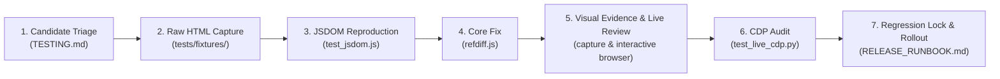

# 🛡️ RefDiff Review Guide: Code Review, Security Invariants & Editorial Diff Playbook

> **Status:** Active & Implemented &bull; **Framework:** Codebase & Editorial Review Strategy  
> **Target Audience:** Script Maintainers, Wikimedia Reviewers, Wikipedia Patrollers & Source Auditors  
> **Governing Artifacts:** [`refdiff.js`](refdiff.js), [`tests/`](tests/), [`refdiff.wiki`](refdiff.wiki), [`RELEASE_RUNBOOK.md`](RELEASE_RUNBOOK.md), [`TESTING.md`](TESTING.md), [`ROADMAP.md`](ROADMAP.md)

---

## 1. 📋 Executive Summary & Governance Framework

The **Review Guide** establishes the specification-driven development, security, and editorial verification framework for RefDiff across core governance principles and two operational review pillars:

### 1.1 🎯 Specification-Driven Agentic Coding & Ticket Governance
The project enforces strict specification-driven pair programming between human maintainers and AI agents:
1. **The "Ticket-Only by Default" Golden Rule:** Questions, quick lookups, status checks, and short analyses are answered immediately in chat. In contrast, for code modifications, bug fixes, refactorings, structural documentation changes, or large research spikes, the AI agent **must only create a ticket** in `tickets/open/` without unsolicited implementation.
2. **Explicit Execution Boundary & Subagent Delegation:** Implementation occurs exclusively when the maintainer explicitly commands `Execute ticket NNN` or `Work on ticket NNN`. The root conversational agent acts as architectural coordinator and dispatcher, delegating implementation exclusively to an autonomous subagent (`invoke_subagent`), which carries out the 7-step Ticket Execution Protocol codified in [`tickets/README.md`](tickets/README.md) within an isolated sub-context.
3. **Phase-Based Prioritization:** Backlog tickets are categorized and scheduled strictly according to canonical project phases:
   - 🟡 **Immediate Pre-Pilot (`P0 — Higher than Tier 1`):** Author self-testing on `en:User:Powercycler/common.js`, on-wiki documentation lead, userbox readiness, and P0 real-world diff parser hardening (T-012, T-013, T-016, T-014, T-018).
   - 🔵 **Tier 1: Early Adopter Pilot (`10-User Milestone`):** 10-user pilot group, fail-open boundaries, byte-for-byte Memento invariance, and community onboarding.
   - 🔵 **Tier 2: Community Reviewer Scale (`50-User Milestone`):** On-wiki script installer, non-interference contracts with Twinkle and Ultraviolet, preview cards, and multi-skin compatibility.
   - 🔵 **Tier 3: Mass Deployment (`Beyond 50 Users`):** Default-enabled gadget RFC (`MediaWiki:Gadgets-definition`), WCAG 2.1 AA accessibility certification, and legacy skin parity.
   - 🏛️ **Upstream `<ref def>` Strategy (`Phases 1–4`):** Section-modular reference storage proposal, MediaWiki core & Extension:Cite RFCs, bot migration, and Lua support.

### 1.2 🧭 Development Environment & Agent Execution Invariants
To maintain engineering consistency, transparency, and ergonomic collaboration between human maintainers and AI pair programmers, RefDiff codifies five core environment invariants:
1. **Writing Style & Natural Language:** Maintain a concise, natural, and professional tone in clear, plain, and precise technical English. Strictly eliminate conversational filler, meta-fluff, sycophancy, and corporate buzzwords.
2. **Visual Indicators & Documentation Scannability:** Use clean visual emojis and status indicators (e.g., 📊, 📋, 🧭, 🎯, 🛡️, 🟢, 🟡, 🔴, 🔵) strategically in internal documentation, headings, status tables, and lists to maximize visual hierarchy and scannability. Prose remains plain, direct, and professional.
3. **Question-Answering Scope & Side-Effect Boundaries:** Questions, lookups, and analytical inquiries are answered directly and immediately in chat without unsolicited file modifications, background commands, or project mutations.
4. **Design Document & Implementation Plan Prerequisite:** Before executing substantive code changes, architectural intent, criteria, and implementation plans must be formulated and agreed upon (codified via ticket specifications).
5. **Subagent Ticket Execution Invariant:** The root conversational agent serves as architectural coordinator, reviewer, and dispatcher, while all ticket implementations, code modifications, test runs, and lifecycle transitions are executed strictly in isolated, focused subagent sessions.

### 1.3 ⚖️ Two Operational Review Pillars
1. **Pillar 1: Codebase Quality & Security Review (Engineering Integrity):** Enforces Wikimedia gadget security compliance, clean code and anti-test-smell standards, real DOM regression testing (JSDOM and live CDP), test proportionality, and the "Git Diff as Quick Review" zero-debris protocol.
2. **Pillar 2: Editorial Source Review Playbook (Editorial Integrity):** Provides patrollers with actionable workflows to uncover "template camouflage", combat "AI slop", and audit citations parameter-by-parameter on `Special:Diff`.

---

## 2. 🛡️ Pillar 1: Codebase Quality & Security Audit

### 2.1 🏷️ Quality Review Taxonomy & Findings Registry

Review findings and comparative audits are classified using a three-tier severity taxonomy:

| Class | Severity | Description | Action Threshold |
|:---:|:---:|:---|:---|
| 🔴 **K** (*Kritisch*) | 🔴 **P0** | Architectural flaw, DOM mutation hazard, or test mock blind spot hiding runtime failures. | Blocker for release; immediate remediation. |
| 🟠 **M** (*Major*) | 🟠 **P1** | Security hygiene issue (XSS, unpinned CDN) or on-wiki compliance blocker. | Blocker for on-wiki gadget promotion. |
| 🔵 **N** (*Minor*) | 🔵 **P2** | Code style, documentation drift, or non-blocking micro-optimizations. | Addressed during regular refactoring. |

#### Authoritative Findings Register (K1 / M1 / M6 / M7)

This register records all major security, architecture, and compliance findings uncovered during codebase audits, external reviews (e.g. against [Ultraviolet](https://en.wikipedia.org/wiki/Wikipedia:Ultraviolet)), and on-wiki gadget security checks. Detailed sprint execution notes are recorded in [**Ticket 007**](tickets/done/T-007-audit-strategy-and-security-remediations.md).

| Finding ID | Title | Class | Severity | Status | Discovery Date | Target Component | Resolved In |
|:---:|:---|:---:|:---:|:---:|:---:|:---|:---:|
| [**K1**](#k1-real-dom-mock-weakness) | Real DOM Mock Weakness | Critical | 🔴 **P0** | ✅ Resolved | 2026-10-14 | `tests/harness.js`, `tests/test_jsdom.js` | [`b0b7dde`](https://github.com/psytrap/einzelnachweise/commit/b0b7dde) |
| [**M1**](#m1-html-generation-via-template-strings) | HTML Generation via Template Strings | Major / Security | 🟠 **P1** | ✅ Resolved | 2026-10-14 | `refdiff.js` (UI builders) | [`240d3bd`](https://github.com/psytrap/einzelnachweise/commit/240d3bd) |
| [**M6**](#m6-unpinned-cdn-distribution) | Unpinned CDN Distribution | Major / Security | 🟠 **P1** | ✅ Resolved | 2026-10-11 | Deployment & On-Wiki Loaders | [`ad6fe91`](https://github.com/psytrap/einzelnachweise/commit/ad6fe91) |
| [**M7**](#m7-on-wiki-nowiki-template-transclusion) | On-Wiki `<nowiki>` Template Transclusion | Major / Syntax | 🟠 **P1** | ✅ Resolved | 2026-10-14 | `refdiff.js` file wrapper | [`b0b7dde`](https://github.com/psytrap/einzelnachweise/commit/b0b7dde) |

---

#### K1: Real DOM Mock Weakness
* **Finding ID:** `K1`
* **Class & Severity:** Architectural / Test Integrity (**P0**)
* **Discovery Date & Origin:** 2026-10-14 (Ultraviolet architectural benchmark review).
* **Root Cause & Description:** Unit test harnesses previously relied on hand-crafted JavaScript mock objects (`{ innerHTML: ... }`) in `tests/harness.js`. These mocks failed to emulate real browser DOM semantics—such as live `HTMLCollection` mutation, `tr.cells` indexing, event propagation/bubbling, and missing API quirks (`scrollIntoView` undefined in certain headless frames).
* **Remediation & Implementation:** Integrated `jsdom` into devDependencies, implemented [`tests/test_jsdom.js`](tests/test_jsdom.js) using authentic MediaWiki diff fixtures, and verified byte-for-byte in-place Memento invariance ($\text{table.innerHTML}_{\text{initial}} \equiv \text{table.innerHTML}_{\text{restored}}$).
* **Reference:** [Ticket 007](tickets/done/T-007-audit-strategy-and-security-remediations.md), commit [`b0b7dde`](https://github.com/psytrap/einzelnachweise/commit/b0b7dde).

---

#### M1: HTML Generation via Template Strings
* **Finding ID:** `M1`
* **Class & Severity:** Security Hygiene / XSS Mitigation (**P1**)
* **Discovery Date & Origin:** 2026-10-14 (Comparative code review vs. Ultraviolet TSX/DOM generation).
* **Root Cause & Description:** Dynamic UI elements assembled HTML via string interpolation and template literals assigned to `.innerHTML`. If attribute values or citation labels contained unescaped characters or malicious injections from untrusted wikitext diffs, this introduced potential Cross-Site Scripting (XSS) vectors.
* **Remediation & Implementation:** Created native safe DOM builder `el(tag, attrs, ...children)` with automatic attribute whitelisting, Boolean handling, and text escaping via `ownerDocument.createTextNode`. Completely eliminated dynamic `.innerHTML` assignments in UI generation.
* **Reference:** [Ticket 007](tickets/done/T-007-audit-strategy-and-security-remediations.md), commit [`240d3bd`](https://github.com/psytrap/einzelnachweise/commit/240d3bd).

---

#### M6: Unpinned CDN Distribution
* **Finding ID:** `M6`
* **Class & Severity:** Supply-Chain Security & Compliance (**P1**)
* **Discovery Date & Origin:** 2026-10-11 (Wikimedia gadget compliance & privacy policy audit).
* **Root Cause & Description:** Loading user scripts from third-party CDNs (e.g. unpinned `@main` branch on jsDelivr or GitHub raw) violates Wikimedia privacy and security policies, exposes editors to upstream supply-chain poisoning, and bypasses on-wiki revision tracking.
* **Remediation & Implementation:** Standardized primary distribution exclusively via Wikimedia infrastructure: Meta-Wiki [`m:User:Powercycler/refdiff.js`](https://meta.wikimedia.org/wiki/User:Powercycler/refdiff.js) with commit-pinned SHA loaders using MediaWiki's `mw.loader.load()`.
* **Reference:** [Ticket 007](tickets/done/T-007-audit-strategy-and-security-remediations.md), commit [`ad6fe91`](https://github.com/psytrap/einzelnachweise/commit/ad6fe91).

---

#### M7: On-Wiki `<nowiki>` Template Transclusion
* **Finding ID:** `M7`
* **Class & Severity:** On-Wiki Parser Compliance (**P1**)
* **Discovery Date & Origin:** 2026-10-14 (On-wiki JavaScript page parsing audit).
* **Root Cause & Description:** Code comments and strings inside `refdiff.js` contained template patterns like `{{sfn|...}}`, `{{efn|...}}`, and signature markers `~~~~`. When hosted on `.js` subpages within MediaWiki, the wikitext parser parsed these sequences as real template transclusions, polluting `templatelinks` tables.
* **Remediation & Implementation:** Enclosed `refdiff.js` within `/* <nowiki> */` at line 1 and `/* </nowiki> */` at the end of the file. Added automated regex regression assertion in `tests/test_jsdom.js`.
* **Reference:** [Ticket 007](tickets/done/T-007-audit-strategy-and-security-remediations.md), commit [`b0b7dde`](https://github.com/psytrap/einzelnachweise/commit/b0b7dde).

---

### 2.2 Security & Sanitization Protocols

Because RefDiff processes untrusted wikitext and HTML attributes from arbitrary revisions:
1. **Attribute Stripping:** All badge titles, labels, and anchor lookups are processed through `stripHtml()` and XML entity decoding.
2. **Anchor Sanitization:** All internal anchor targets (`#refdiff-cit-...`) must pass `sanitizeAnchor()`, stripping characters outside `[a-zA-Z0-9_\-.:]`.
3. **Diffchange Balance:** `hasBalancedDiffTags` validates that candidate wikitext does not cross unclosed `<ins>` or `<del>` spans before parsing.
4. **Defensive Browser APIs:** Optional APIs (`scrollIntoView`, `pushState`, `MutationObserver`) are guarded via `typeof` checks or `try/catch` blocks.

---

### 2.3 🌐 Real DOM Regression Harness & Chromium CDP Protocol

RefDiff operates a dual-engine DOM verification pipeline:
* **Level 2 — JSDOM Suite (`tests/test_jsdom.js`):** Headless Node.js execution on authentic MediaWiki diff fixtures. Validates byte-for-byte Memento invariance:
  $$\text{table.innerHTML}_{\text{initial}} \equiv \text{table.innerHTML}_{\text{restored}}$$
  Restoration must leave zero orphaned rows, leaked classes, or dangling event listeners.
* **Level 4 — Live Chromium CDP (`tests/test_live_cdp.py`):** Live browser verification over WebSocket port 9222 covering OOUI mode switcher, Vector 2022 Dark Mode tokens, and `Extension:Popups` Reference Previews.
* **Mandatory CDP Pre-Condition:** Live browser CDP testing (`npm run test:live` on port 9222) is an invariant that must ALWAYS be executed before any update or deployment to `refdiff.js`. No changes to `refdiff.js` may be published without passing live CDP sign-off.
* **Performance Budgets:** Processing 114 references across split diffchanges must complete in **< 50 ms** in browser environments and **< 250 ms** across all 15 suites in CI.

#### Chromium Remote Debugging (`chromium-remote-debug`) Procedure & Architecture

Live browser testing and interactive visual validation utilize an isolated Chromium instance controlled via the Chrome DevTools Protocol (CDP):

1. **Isolated Launch Configuration:** Launch Chromium with remote debugging on port `9222` using a dedicated profile to guarantee isolation from personal browsing sessions:
   ```bash
   /snap/bin/chromium --remote-debugging-port=9222 --user-data-dir=/tmp/chromium-agent --no-first-run --no-default-browser-check
   ```
2. **HTTP DevTools Control Endpoints:** Once Chromium is running, tabs and targets are managed without browser restarts via HTTP REST endpoints:
   - **Check Connectivity:** `curl -s http://127.0.0.1:9222/json/version` (verifies browser status and returns `webSocketDebuggerUrl`).
   - **Open Target / Tab:** `curl -s -X PUT "http://127.0.0.1:9222/json/new?<URL>"` (navigates or spawns tab).
   - **List Active Tabs:** `curl -s http://127.0.0.1:9222/json/list` (enumerates target tabs and metadata).
   - **Activate Tab:** `curl -s http://127.0.0.1:9222/json/activate/<targetId>` (brings tab to foreground).
   - **Close Tab:** `curl -s http://127.0.0.1:9222/json/close/<targetId>` (terminates tab cleanly).
3. **Platform & Snap Confinement Invariants:** Under Linux distributions where Chromium is managed by Snap, browser state is confined to Snap sandbox directories. Automation harnesses must communicate directly via loopback networking (`http://127.0.0.1:9222`) rather than filesystem profile polling.
4. **Persistent CDP Monkey-Patching Workflow ([`scripts/run_persistent_cdp_patch.py`](scripts/run_persistent_cdp_patch.py)):**
   - RefDiff includes an automated persistent CDP runner that attaches to the browser instance using `Target.setAutoAttach` with flattening over a persistent WebSocket connection.
   - It intercepts remote script loads via `Network.setBlockedURLs` (`*refdiff.js*`), preventing deployed production or cached versions from clashing with local working-tree changes.
   - It executes `Page.addScriptToEvaluateOnNewDocument` with the local [`refdiff.js`](refdiff.js) source code so that all new diff tabs and subsequent navigations (`Page.frameNavigated`) execute the candidate code immediately.
   - On existing diff tabs, it executes a clean-up expression invoking `RefDiff.restoreOriginal()` before re-injecting the latest local build. This gives maintainers an instant, interactive diff verification environment across real Wikipedia articles before advancing to production release rings.

---

### 2.4 On-Wiki Distribution & Security Hygiene

To meet Wikimedia security policies for user scripts and gadgets:
1. **No External CDNs:** Production deployments load strictly from Wikimedia servers (`en.wikipedia.org`, `meta.wikimedia.org`, or local wiki `Special:MyPage`).
2. **Revision-Pinned Loader Pattern & No-Versioned-Filenames:** Users and downstream distributions requiring immutable versions pin release revisions via MediaWiki's native revision ID (`&oldid=123456789`) or commit SHA loader rather than creating versioned filenames (`refdiff-v1.js`).
3. **Meta Script Lead & en.WP SHA Pointer Architecture:**
   - **Script Lead (`m:User:Powercycler/refdiff.js`):** The primary unminified codebase payload lives canonically on Meta-Wiki to serve cross-wiki userbases.
   - **SHA Pointer (`en:User:Powercycler/refdiff.js`):** English Wikipedia hosts an immutable/release-pinned loader forwarding to Meta-Wiki with target release SHA-1 metadata.
   - **Early Testing Harness (`en:User:Powercycler/common.js`):** During deployment stages, maintainers smoke-test newly deployed Meta builds directly in personal `common.js` on live diffs before upreving the en.WP SHA pointer (eliminating the need for a separate canary page).
   - **Documentation Lead (`en:User:Powercycler/RefDiff`):** English Wikipedia leads the authoritative documentation, while Meta-Wiki (`m:User:Powercycler/RefDiff`) acts as a soft redirect.
4. **Wikitext Protection:** The script begins with `/* <nowiki> */` and ends with `/* </nowiki> */` to prevent template parsing and signature expansion.


---

### 2.5 Clean Code & Test Code Smell Standards

To ensure tests remain resilient, diagnostic, and maintainable, RefDiff enforces strict clean-code rules:

#### Production Standards
* **Single Responsibility:** Decoupled modules (`parser`, `pairing`, `memento`, `renderer`, `init`, `state`) with zero circular dependencies.
* **XSS-Immune DOM Construction:** Dynamic elements built via native `el()` and `ownerDocument.createTextNode()`; zero `.innerHTML` interpolation.
* **ResourceLoader Encapsulation:** Zero global scope leaks; IIFE closure with explicit `window.RefDiff` exports only under Node.js test environments.

#### Test Code Smell Prevention
* **Assertion Roulette:** Prohibited. Every assertion must provide an explicit diagnostic failure message.
* **Mystery Guest & Magic Literals:** Tests must use explicit AAA (Arrange-Act-Assert) structure and named fixtures (`tests/fixtures/`).
* **Over-Mocking:** UI and table transformations must run against authentic HTML in JSDOM, never synthetic mock objects.
* **Polluted Globals:** All mocked globals must execute within `withMockEnvironment()` or `try/finally` with guaranteed teardown.
* **Conditional Logic:** Prohibited. Tests must execute linearly without branching (`if`/`switch`) to prevent silently skipped assertions.
* **Timing Flakes:** Prohibited. Synchronization must rely on deterministic hooks (`mw.hook`) rather than wall-clock `sleep()` delays.
* **DAMP over DRY in Tests:** Test cases prioritize Descriptive And Meaningful Phrases over aggressive DRY abstraction to maximize legibility.

#### Pre-Merge Review Checklist
- [ ] Clear Arrange-Act-Assert structure with zero branching logic.
- [ ] Every assertion contains an explanatory failure message.
- [ ] All global modifications run inside `withMockEnvironment()`.
- [ ] DOM tests execute against authentic MediaWiki fixtures in JSDOM.
- [ ] Deterministic synchronization (no `setTimeout` or `sleep`).
- [ ] Passes `npm run ci` with 0 ESLint warnings.

---

### 2.6 Test Proportionality & Sufficiency Audit: "Is it Enough or Too Much?"

#### Proportionality Audit: Is it Too Much?
**Verdict: No.**
* **Zero Runner Bloat:** Pure Node.js built-in `assert` without third-party frameworks (no Jest/Mocha/Babel). 15 modular suites run in **~250 ms**.
* **High-Value Invariants:** Every assertion guards a specific failure mode: tag splitting across `diffchange`, Memento restoration, author-year synthesis (`{{sfn}}`), anchor discovery, and inline-modified mode.
* **Sandboxed Mock Isolation:** Scoped `withMockEnvironment()` guarantees state restoration with zero cross-test interference.

#### Sufficiency Audit: Is it Enough?
**Verdict: Sufficient for production release (v1.5.6), with explicit, monitored boundaries.**
* **100% Core Production Coverage:** 71 of 71 internal functions covered, authentic DOM fixtures in JSDOM, live CDP browser automation, and stress benchmarks.
* **Monitored Testing Boundaries:**
  1. *Malformed Wikitext:* Unclosed `<ref>` tags gracefully remain in-situ in prose.
  2. *Transcluded Footnotes:* Citations inside complex template wrappers (`{{refn}}`, infobox parameters) remain in-situ without badging.
  3. *Mobile Diffs:* Single-column stacked layouts (MinervaNeue) are outside desktop test scope.
  4. *Dynamic AJAX Lifecycle:* Successive diff reloads without full page refresh.
  5. *Prose Invariance:* Continuous differential fuzzing of prose diff preservation is delegated to [`TESTING.md` §5.1](TESTING.md#51-real-world-diffs--verification-register).

---

### 2.7 Adoption & Scaling Policy: 10-User Pilot, 50-User Gadget Milestone & Beyond

To govern the transition from initial release to broad community gadget candidacy and eventual mass adoption, RefDiff enforces a phased three-tier stability model:

#### Tier 1: Early Adopter Pilot Gate (10-User Milestone)
1. **Pilot Adoption Threshold:** Active transclusions monitored via `Special:WhatLinksHere/Template:User_RefDiff` reaching $\ge 10$ active patrollers on English Wikipedia.
2. **Defect Threshold:** Zero uncaught runtime errors (P0) and zero unhandled table corruptions across real Wikipedia diff reviews.
3. **Fail-Open Invariant:** Uncaught exceptions in any auxiliary component must cleanly restore the native diff view without impacting reviewer workflows or common.js tools (Twinkle, HotCat).
4. **Direct Qualitative Feedback:** Operational feedback and edge-case diff submissions triaged directly on `en:User talk:Powercycler/RefDiff`.

#### Tier 2: 50-User Community Reviewer Scale (Gadget Proposal Prerequisite)
1. **Critical Mass Threshold:** $\ge 50$ active NPP/RC reviewers sustained over $\ge 60$ days with 0 critical regressions.
2. **Ecosystem Non-Interference:** Formal automated test assertions verifying zero disruption to diff headers, revision metadata, and third-party buttons (verifying Twinkle and Ultraviolet compatibility, HotCat, diffedit).
3. **Dynamic SPA Re-Entrancy:** Safe re-initialization on sequential `wikipage.diff` Ajax table swaps without Memento memory leaks.
4. **Client-Side Observability:** Opt-in diagnostic troubleshooting flag (`?refdiff_debug=1`) for rapid triage of reviewer bug reports.
5. **Community Consensus:** Formal RFC proposal on `Wikipedia:Village pump (technical)` for definition as an opt-in gadget in `MediaWiki:Gadgets-definition`.

#### Tier 3: Beyond 50-User Goal (Mass Scale, Default Gadget & Upstream Integration)
1. **Formal Accessibility Compliance:** Full WCAG 2.1 AA keyboard focus navigation, screen reader semantics (`aria-label`), and contrast validation across light/dark themes.
2. **Multi-Skin & Mobile Fallback:** Verified support across legacy skins (Vector 2010, Monobook, Timeless) and graceful auto-disablement on single-column mobile viewports (`MinervaNeue`).
3. **Default-Enabled Status:** Broad community consensus for default-on gadget status (`[default]`) on English Wikipedia or cross-wiki deployment.
4. **Upstream MediaWiki Integration:** Core parser and `Extension:Cite` native support for `<ref def>` definitions (see [**`ROADMAP.md` §2**](ROADMAP.md#2-upstream-ref-def-strategy-roadmap)).


---

### 2.8 "Git Diff as Quick Review" Protocol (Clean & Complete Codebase Hygiene)

Even when test suites pass 100%, automated assertions cannot detect incomplete refactorings, stale documentation metrics, orphaned links, or extraneous debug debris. Maintainers and auditors enforce the **"Git Diff as Quick Review"** protocol as an essential pre-merge audit gate:

```bash
# 1. Concise summary of modified line counts and file scope
git diff --stat

# 2. Line-by-line inspection of unstaged working tree changes
git diff

# 3. Final verification of staged commit payload
git diff --staged

# 4. Status check to ensure no untracked scratch files remain
git status --short
```

#### The 4-Point Diff Audit Invariant Checklist

| Checkpoint | Target of Scrutiny in `git diff` | Failure Signature & Anti-Pattern Caught |
|:---|:---|:---|
| **1. Zero Debris & Scratch Residue** | Diff hunks must contain zero lingering `console.log`, temporary test variables, debug flags (`window.rw_debug`), or scratch test dumps. | Leftover exploratory prints, temporary variables (`let temp = ...`), disabled tests. |
| **2. Completeness of Cleanups** | When removing or deprecating an artifact, path, or function, verify that all references across docs, tables, and test harnesses are completely updated. | Removing a folder (e.g. `archive/`) but leaving dead markdown links; deleting a parameter without updating docstrings. |
| **3. Metric & Spec Synchronization** | Any change altering test counts, pre-flight checks, release versions, or canonical target URLs must update all governing specifications in lockstep. | Adding a test file while `TESTING.md` or `ARCHITECTURE.md` still reports obsolete counts (e.g. 113 vs 115). |
| **4. Hunk Conciseness & Zero Noise** | Every modified line must serve a dedicated purpose. Avoid gratuitous whitespace modifications, formatting churn, or accidental unrelated file touches. | Auto-formatter re-indenting 300 unchanged lines; accidental trailing whitespace; accidental touches to scratch files. |

> [!TIP]
> **Case Study in Incomplete Cleanups:** During the v1.3.0 audit, a quick `git diff` review revealed that while the `archive/` prototype directory was deleted, four documentation files still referenced dead `archive/python-prototype/` links, and two tables listed 113 instead of 115 tests. Running the `git diff` quick review protocol eliminated these discrepancies before release tagging.

#### Two-Phase Version Strategy: Patch Pre-Flight & Minor Post-Deployment

To ensure diff reviews remain fast, high-confidence, and zero-defect, all releases enforce RefDiff's two-phase version strategy:
1. **Pre-Flight Pass & Feature Completion (Patch Uprev):** When a scoped feature increment or architectural improvement is completed and passes all pre-flight quality gates (CI, DOM fixtures, live browser CDP, and live benchmark monkey patching), execute a **patch uprev bump** (`node scripts/bump_version.js patch`).
2. **Post-Deployment Milestone & Final Step (Minor Uprev):** Execute a minor uprev bump (`node scripts/bump_version.js minor`) as the final step only when pre-flight was completed, on-wiki rollout is verified across all Wikimedia targets (`npm run check:deploy`), and work on the feature is completed with user review.
3. **Mandatory Uprev Before Deployment:** Maintainers and release automation must assure a formal version uprev is executed across all repository release manifests (`package.json`, `package-lock.json`, `refdiff.js`, `refdiff.wiki`) before initiating on-wiki deployment. Deploying against unbumped version numbers is prohibited.
4. **Smaller Changes Between Uprevs:** Increments between uprevs must be scoped to small, single-focus batches rather than monolithic changesets to prevent reviewer fatigue, keep hunks immediately comprehensible, and make regressions straightforward to isolate.
5. **Uprev Triggers Diff Audit:** Every version bump strictly triggers the mandatory `git diff --stat && git diff` audit before advancing through the rollout rings in [`RELEASE_RUNBOOK.md`](RELEASE_RUNBOOK.md).

---

### 2.9 Engineering Methodology: Specification-Driven Agentic Coding

RefDiff is engineered via **agentic coding**—a collaborative human–AI development model where autonomous coding agents execute implementation, refactoring, and test design under strict human editorial direction and architectural governance.

#### Why Agentic Development Demands Extreme Formalism
In standard human solo programming, architectural assumptions and regression precautions often reside informally in developer memory. In an AI pair programming model, informal assumptions lead to context drift, subtle regressions, and code bloat. To make autonomous AI iteration safe, deterministic, and verifiable, RefDiff grounds every change in explicit, machine-readable specifications and continuous automated feedback loops:

1. **Specification as Single Source of Truth:**
   All features, heuristics, and invariants are pre-defined in formal documentation ([`ARCHITECTURE.md`](ARCHITECTURE.md), [`TESTING.md`](TESTING.md), [`REVIEW_GUIDE.md`](REVIEW_GUIDE.md), [`RELEASE_RUNBOOK.md`](RELEASE_RUNBOOK.md)). The AI agent does not generate spontaneous ad-hoc implementations; it translates verified specifications into code and tests.
2. **Deterministic Multi-Tier Test Anchors:**
   Rapid agentic generation is bounded by an exhaustive five-tier test pyramid (140 unit/DOM tests, JSDOM headless fixtures, 6 live CDP benchmarks, live Chromium CDP browser verification, and visual audit captures). If a proposed code edit introduces a subtle syntax slip, DOM leak, or heuristic drift, automated test gates immediately reject the change before it reaches the working tree.
3. **Cross-File Synchronization & Drift Prevention:**
   Agentic coding excels at systemic cross-artifact synchronization (e.g. updating version tokens, API exports, test assertions, and on-wiki wikitext simultaneously). Strict pre-flight gates ([`tests/test_deployment.js`](tests/test_deployment.js)) enforce that manifest files, documentation stats, and code exports remain 100% in sync.
4. **Human Editorial & Architectural Authority:**
   The human engineer operates as chief architect and release authority—directing scope, approving critical changes, scrutinizing git diffs, interactively inspecting candidate releases in a live browser, and signing off on all on-wiki deployments—while the agent executes implementation, regression testing, and verification. Automated captures support, but never substitute for, live human review.
5. **Concise, Descriptive, and Professional Tone:**
   All project documentation, on-wiki pages ([`refdiff.wiki`](refdiff.wiki), [`userbox.wiki`](userbox.wiki)), docstrings, and commit artifacts must maintain a concise, descriptive, and professional tone. Avoid promotional language, buzzwords, or AI-generated boilerplate; prioritize technical precision, direct architectural rationale, and factual clarity.

---

## 3. 🔍 Pillar 2: Editorial Review & Source Auditing Playbook

### 3.1 🎭 The "Template Camouflage" Audit Workflow
* **Threat:** Vandals conceal prose changes inside massive citation template additions, turning entire paragraphs yellow/blue in standard diffs.
* **Audit Workflow:**
  1. Open diff on `Special:Diff` (RefDiff decouples automatically).
  2. **Prose Scan:** Review prose rows; word changes stand out cleanly in green/red highlights.
  3. **Badge Inspection:** Unmodified citations appear as grey badges (`⟨ref1⟩`), modified as amber (`⟨~name~⟩`), and added as green (`⟨+name+⟩`).
  4. **Citation Delta Scan:** Inspect the dedicated citation diff row directly beneath the prose row to review parameter changes (URLs, page numbers, authors).

### 3.2 🛑 Auditing Against "AI Slop" & Hallucinated Sources
* **Threat:** LLM-generated edits produce syntactically valid wikitext with fabricated citations (hallucinated DOIs, fake books, dead URLs).
* **Audit Workflow:**
  1. **Source Decoupling:** Extract citations to inspect prose coherence and neutrality in isolation.
  2. **Preview Verification:** Hover over badges (`⟨1⟩`, `⟨2⟩`) to trigger MediaWiki Reference Previews (`Extension:Popups`) without scrolling to footnotes.
  3. **Anchor Matching:** Badges link to `#cite_note-*`; orphaned or broken citations are flagged immediately when no popover appears.

### 3.3 🎛️ Tri-Mode Review Triage

```
[✓] Inline modified refs  [ 👁 Visual ]  [ [[]] Wikitext ]  [ ⧉ RefDiff ]
```

| Edit Type | Recommended Mode | Rationale |
|:---|:---:|:---|
| **Simple Typos / Formatting** | **Visual Diff** | Fast WYSIWYG review. |
| **Templates / Tables / Infoboxes** | **Wikitext Diff** | Inspect parser functions and syntax. |
| **Scholarly / Citation-Heavy Edit** | **RefDiff Mode** | Decouples citations from prose; audits sources parameter by parameter. |
| **Dense Destination Matrix / Tables** | **RefDiff (Inline modified checked)** | Keeps modified citations inline with `⟨~label~⟩` badges without altering row heights. |

### 3.4 🧩 Integration with the Review Ecosystem
* **[m:User:Jon Harald Søby/diffedit](https://meta.wikimedia.org/wiki/User:Jon_Harald_S%C3%B8by/diffedit):** RefDiff automatically yields and restores native wikitext when in-diff editing begins.
* **[`CNfirmed.js`](https://en.wikipedia.org/wiki/User:Alaexis/CNfirmed.js):** Cross-check unsourced claims in RefDiff's prose pane against the Internet Archive.
* **[User:Trappist the monk/HarvErrors.js](https://en.wikipedia.org/wiki/User:Trappist_the_monk/HarvErrors):** Author-year badges (`⟨Castritius 2005⟩`) link to shortened footnote anchors, exposing missing bibliography citations.

---

## 4. 🧭 Real-World Diff Verification Lifecycle

Every real-world diff anomaly submitted to the audit queue follows a strict 7-stage funnel:



1. **Candidate Triage:** Diff URL, revision ID, and anomaly logged in [`TESTING.md`](TESTING.md#51-real-world-diffs--verification-register).
2. **Raw HTML Capture:** Raw MediaWiki diff HTML saved into test fixtures.
3. **JSDOM Reproduction:** Failing test added without mocks to `test_jsdom.js`.
4. **Core Fix:** `refdiff.js` patched following modular standards.
5. **Visual Evidence & Mandatory Live Human Review Gate:**
   - **Automated Visual Capture:** Automated capture of all citation change cases (pure additions, pure deletions, intra-line modifications, template refs across Vector 2022 Light and Dark themes) via [`scripts/capture_full_audit.py`](scripts/capture_full_audit.py) (`npm run capture`). Generates permanent visual regression artifacts.
   - **Mandatory Live Human Interactive Review:** Prior to any update to `refdiff.js` on Meta-Wiki, an interactive browser session is provided via Chromium remote debugging (CDP port 9222 via `scripts/run_persistent_cdp_patch.py`). The human reviewer interactively tests real Wikipedia diffs (mode switcher, reference previews, layout stability, Memento roundtrip). Meta-Wiki deployment is strictly blocked without explicit human sign-off.
6. **CDP Browser Audit:** Live browser testing on port 9222 verifies switcher, themes, and popups (`test_live_cdp.py`).
7. **Regression Lock & Rollout:** Diff marked `Verified` in `TESTING.md`, pre-flight CI locked, and phased rollout executed per [`RELEASE_RUNBOOK.md`](RELEASE_RUNBOOK.md).

---

## 5. 🛡️ Continuous Quality Gates & Enforcement

All criteria must pass before merging or tagging releases:

| Quality Gate | Invariant / Threshold | Verification Command |
|:---|:---|:---|
| 🧪 **Test Suite Pass Rate** | **140 / 140 passing tests across 15 suites** | `npm test` |
| 🎨 **Code Style & Linting** | **0 errors, 0 ESLint warnings** | `npm run lint` |
| 🧼 **Clean Code & Test Smells** | **AAA pattern, descriptive assertions, 0 global leaks** | `npm test && npm run lint` |
| 🚀 **Deployment Pre-Flight** | **10 checks: zero BOM, nowiki, version sync, rollback, deployment consistency** | `node tests/test_deployment.js` |
| 👁️ **Visual Evidence & Human Gate** | **Automated capture in Light/Dark & mandatory live human sign-off before Ring 1 Meta update** | `npm run capture` + browser review |
| 🌐 **Live On-Wiki Deployment** | **All release targets verified & synchronized across Wikimedia APIs** | `npm run check:deploy` |
| 🔍 **Uprev Diff Audit Gate** | **Small changes between uprevs; zero debris, no orphaned references, concise hunks** | `git diff --stat && git diff` |
| ⚡ **CI Execution Budget** | **< 250 ms across all 15 test suites** | `npm run ci` |
| 🏎️ **Stress Benchmark Budget** | **< 50 ms on 114-reference table** | `node tests/test_benchmarks.js` |
| 🔒 **DOM Memento Invariance** | **Byte-for-byte table restoration** | `node tests/test_jsdom.js` |

### 5.1 Deployment Governance & Sole Automation Exception
* **Zero Automated Pushing & Zero Deployment Automation:** Code publication, git pushes to upstream remotes, and on-wiki updates to Wikimedia script leads or user scripts are strictly reserved for manual execution by the maintainer.
* **Sole Read-Write Exception:** The single, strictly bounded exception to this zero-automation rule is [`scripts/check_toolpage_installer.py`](scripts/check_toolpage_installer.py) (`npm run check:installer --press` or `--toggle-roundtrip`), which is authorized to interactively press the `Install` / `Uninstall` button on the toolpage (`User:Powercycler/RefDiff`) via Chromium CDP to test that ScriptInstaller triggers proper `common.js` state transitions in the browser DOM.

