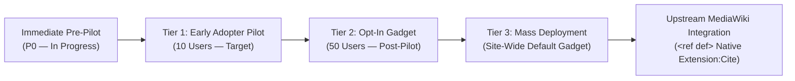
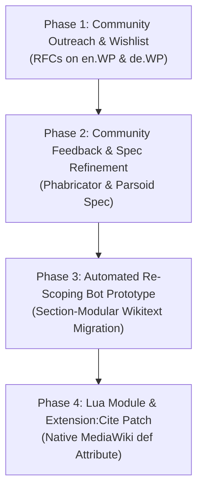

# 🧭 RefDiff & Section-Modular Citations: Scaling & Adoption Roadmap

This document outlines the multi-phase adoption strategy, scaling progression milestones, and long-term upstream integration roadmap for **RefDiff** (*The Ref-Differentiator*) and section-modular citations (`<ref def>`).

Operational deployment runbooks, pre-flight verification gates, and release rings are maintained separately in [**`RELEASE_RUNBOOK.md`**](RELEASE_RUNBOOK.md). Active task execution is governed by the [**Ticket Protocol**](tickets/README.md) in the [`tickets/`](tickets/) directory.

---

## 1. 📊 Scaling Progression Overview: Pre-Pilot, 10-User Pilot, 50-User Gadget & Mass Scale

The client-side adoption of RefDiff follows a tiered milestone progression designed to validate real-world diff stability across active Wikipedia editors before advancing to site-wide gadget default proposals.

### 1.1 🎯 Progression Milestones & Exit Criteria

| Milestone | Target Audience | Key Focus Areas | Exit Criteria |
| :--- | :--- | :--- | :--- |
| 🟡 **Immediate Pre-Pilot (P0)** | Author & Core Maintainer self-testing on `en:User:Powercycler/common.js` | • Real-world diff edge cases (T-012, T-013, T-016, T-014, T-018) • Memento roundtrip & zero drift • On-wiki documentation lead (`refdiff.wiki`) & userbox readiness | • Zero unresolved P0 crash bugs on live Wikipedia diffs • 100% test pass rate across all fixtures & live CDP benchmarks • Production hygiene verification (0 console.log, 0 debug flags) |
| 🔵 **Tier 1: Early Adopter Pilot** | 10 active editors / patrollers | • Core diff stability & Memento invariance • `wikidiff2` boundary shift edge cases • Offline test suite & live CDP verification | • $\ge 10$ confirmed user installations • Zero unresolved crash / data-loss reports • 100% test pass rate across all fixtures |
| 🔵 **Tier 2: Community Reviewer Scale** | 50+ patrollers, NPP, & AfC reviewers | • Multi-skin compatibility (Vector 2022, Vector legacy, Monobook) • Reviewer UX: badge ergonomics & preview cards • Non-interference with Twinkle & Ultraviolet | • $\ge 50$ active opt-in users • Sustained positive feedback on user talk pages • Zero regressions with major patrol tools |
| 🔵 **Tier 3: Mass Deployment** | All registered diff viewers | • Sub-25ms execution on high-density diffs • WCAG 2.1 AA accessibility & keyboard navigation • Community consensus via Village Pump RFC | • Passing community RFC for default-enabled gadget • Parsoid & VisualEditor visual diff compatibility • Comprehensive rollback and telemetry monitoring |

### 1.2 📋 Progression Details

#### 🟡 Immediate Pre-Pilot: Author Self-Testing & P0 Edge Cases (P0 — Higher than Tier 1)
* **Status:** 🟡 In Progress (Release Ring 0–1 / v1.5.6)
* **Goal:** Test and harden RefDiff in the author's live Wikipedia workflow (`en:User:Powercycler/common.js`), resolve P0 parser and diffchange displacement bugs, and establish on-wiki documentation leads prior to recruiting the initial 10-patroller test group.
* **Key Deliverables:**
  * Live author self-testing on complex, real-world diff fixtures across diverse Wikipedia topics (Dwight D. Eisenhower, Leonardo Torres Quevedo, Kim Domingo, Benny Indra Ardhianto).
  * Robust normalization of `wikidiff2` boundary shift artifacts, split template delimiters, and unclosed tag boundaries (T-012, T-013, T-016, T-014, T-018).
  * In-place byte-for-byte Memento snapshot restoration and fail-open crash boundaries.
  * On-wiki project documentation lead, installation instructions, and userbox readiness on `refdiff.wiki`.
  * Comprehensive automated test suite (140+ unit, DOM, and pre-flight tests) and live CDP browser verification.

#### 🔵 Tier 1: Early Adopter Pilot & Stability (10-User Milestone)
* **Status:** ⏳ Planned (Release Ring 2 / v1.5.6)
* **Goal:** Validate core parsing heuristics and decoupling stability on real Wikipedia diff tables under active editing conditions.
* **Key Deliverables:**
  * Strict fail-open boundaries guaranteeing zero disruption to native MediaWiki diff inspection.
  * Byte-for-byte Memento restoration verifying exact original table state upon toggling or failure.
  * Normalization rules for `wikidiff2` edge cases (split tag boundaries, unclosed quotes, and inter-template citation replacements).
  * 140+ unit, DOM, and pre-flight regression tests.

#### 🔵 Tier 2: Community Reviewer Scale (50-User Opt-In — Post-Pilot)
* **Status:** ⏳ Planned
* **Goal:** Scale adoption across active Wikipedia patrol teams (Recent Changes, New Page Patrol, Articles for Creation) through userboxes, WikiProject outreach, and opt-in gadget definitions.
* **Key Deliverables:**
  * Formalized non-interference contracts with companion patrol scripts (Twinkle, Ultraviolet).
  * Refined preview cards supporting both DOM footnote navigation and deterministic wikitext parsing for added/unmatched citations.
  * Client-side diagnostic telemetry (`?refdiff_debug=1`) for user-assisted troubleshooting.
  * Comprehensive cross-skin and cross-browser accessibility passes.

#### 🔵 Tier 3: Mass Deployment (Beyond 50 Users)
* **Status:** ⏳ Planned (Long-Term)
* **Goal:** Transition RefDiff from a user-script to a default-enabled gadget across Wikimedia projects, accompanied by community-wide Request for Comments (RFC).
* **Key Deliverables:**
  * Default-enabled gadget RFC on `Wikipedia:Village pump (technical)` (`MediaWiki:Gadgets-definition`).
  * Formal WCAG 2.1 AA accessibility certification, `aria-label` semantics, and keyboard focus navigation.
  * Legacy skin parity (Vector 2010, Monobook) and graceful single-column mobile self-disablement (`MinervaNeue`).

---

## 2. 🏛️ Upstream `<ref def>` Strategy Roadmap

While RefDiff resolves diff noise client-side on existing wikitext, the long-term architectural resolution to citation-induced merge conflicts is native MediaWiki storage tier support for section-modular reference definitions (`<ref def name="...">`). The complete proposal documentation dossier is indexed in [**`proposal/README.md`**](proposal/README.md) (comprising [**`proposal/PROPOSAL.md`**](proposal/PROPOSAL.md), [**`proposal/CONCEPT.md`**](proposal/CONCEPT.md), and [**`proposal/POST.md`**](proposal/POST.md)).

### 2.1 🎯 Upstream Execution Phases

| Phase | Milestone | Scope & Deliverables | Primary Artifacts |
| :--- | :--- | :--- | :--- |
| ⏳ **Phase 1** | Community Outreach & Wishlist | Publish concept proposals on English Wikipedia Village Pump, German Wikipedia Kurier/Verbesserungsvorschläge, and Wikimedia Community Wishlist. | [`proposal/POST.md`](proposal/POST.md) [`proposal/PROPOSAL.md`](proposal/PROPOSAL.md) |
| ⏳ **Phase 2** | Feedback & Spec Refinement | Synthesize community and developer feedback into Phabricator task; refine Parsoid DOM and wikitext edge-case handling. | [`proposal/CONCEPT.md`](proposal/CONCEPT.md) Phabricator Task |
| ⏳ **Phase 3** | Re-Scoping Bot Prototype | Author prototype Python/Node migration bot that converts legacy inline citations into section-scoped `<ref def>` blocks with single-line formatting. | [`scripts/`](scripts/) [`proposal/CONCEPT.md`](proposal/CONCEPT.md) |
| ⏳ **Phase 4** | Lua & Extension:Cite Patch | Develop a Scribunto Lua emulation module (`Module:RefDef`) followed by a formal MediaWiki `Extension:Cite` PHP patch supporting native `def` attribute parsing. | Gerrit Patch MediaWiki Core Hook Spec |

---

## 3. 🛡️ Ticket-Driven Execution & Governance Pointer

All ongoing development, research spikes, and implementation steps are tracked and executed strictly through the **Ticket Protocol**. 

To prevent documentation drift, static ticket tables have been retired from project documents. The authoritative state machine is represented directly by the filesystem:

* 📜 [**`tickets/README.md`**](tickets/README.md) — The 7-step Ticket Protocol, execution rules, and ticket lifecycle specification.
* 📋 [**`tickets/INDEX.md`**](tickets/INDEX.md) — Live index of active and prioritized backlog tickets.
* ✅ [**`tickets/DONE.md`**](tickets/DONE.md) — Historical register of completed tickets.
* 📂 [**`tickets/open/`**](tickets/open/) — Active and backlog tickets (`T-018`–`T-038`).
* 🗄️ [**`tickets/done/`**](tickets/done/) — Historical register of completed tickets (`T-001`–`T-017`, `T-039`–`T-043`).

Developers and contributors should consult [`tickets/README.md`](tickets/README.md) to pick up or execute tickets.