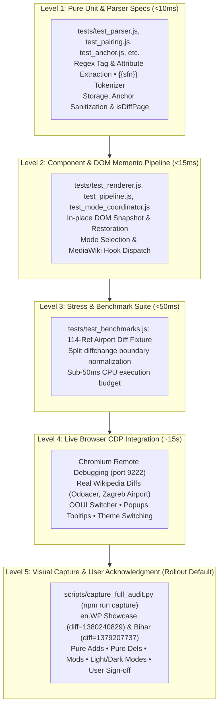

# RefDiff: Test Plan, Quality Gates & Real-World Diff Verification Register

This document defines the testing strategy, test pyramid, coverage evaluation, and quality assurance framework for **RefDiff** (Wikipedia zero-loss citation decoupling gadget and diff driver).

---

## 1. Test Strategy & Quality Metrics

### Quantitative Metrics
* **Unit, Component & Real DOM Tests (`npm test` / `npm run ci`):** **142 passing tests** across **15 modular test files** + benchmarks under [`tests/`](tests/).
* **Execution Time:** **~20 ms** (unit suites) / **~250 ms** (combined with headless JSDOM suites via `npm run ci`).
* **Selective Execution:** Any test file can also be run independently in isolation (e.g. `node tests/test_parser.js`, `node tests/test_deployment.js`).
* **Code Coverage (Headless Node.js):** **100.0% function coverage** (71 of 71 functions) measured via V8 coverage without browser shims.
* **Browser Runtime Coverage (Chromium CDP):** Real MediaWiki DOM integration, OOUI visual transitions, and hovercard popups verified end-to-end via [`tests/test_live_cdp.py`](tests/test_live_cdp.py) and interactive monkey-patching runner [`scripts/run_persistent_cdp_patch.py`](scripts/run_persistent_cdp_patch.py).
* **Linting (`npm run lint`):** **0 errors, 0 warnings** across all files.

> [!NOTE]
> **Audit & Sufficiency Review in [`REVIEW_GUIDE.md`](REVIEW_GUIDE.md#26-test-proportionality--sufficiency-audit-is-it-enough-or-too-much):** The qualitative evaluation of whether the test suite is "too much" (over-testing, runner bloat, maintenance overhead) or "enough" (risk assessment, gap analysis, malformed wikitext boundaries) is governed by **[`REVIEW_GUIDE.md` (§2.6 Test Proportionality & Sufficiency Audit)](REVIEW_GUIDE.md#26-test-proportionality--sufficiency-audit-is-it-enough-or-too-much)**. Real-world diff verification transitions are authoritatively recorded below in **[§5.1](#51-real-world-diffs--verification-register)**.

---

## 2. Test Architecture: 1-to-1 Source-to-Test Mapping

While [`refdiff.js`](refdiff.js) is distributed as a single physical bundle for Wikipedia/MediaWiki, the testing environment in `tests/` uses **real, modular test files** mapped 1-to-1 to each modular source file in [`src/`](src/):

| Source Module (`src/`) | Modular Test File | Responsibility | Tests |
|---|---|---|:---:|
| — | [`tests/harness.js`](tests/harness.js) | Test runner, assertions & `withMockEnvironment` sandbox | — |
| [`src/anchor.js`](src/anchor.js) | [`tests/test_anchor.js`](tests/test_anchor.js) | Footnote anchor discovery (`cite_note-*`) & URL matching | 13 |
| [`src/constants.js`](src/constants.js) | [`tests/test_constants.js`](tests/test_constants.js) | Regex patterns (`TEMPLATE_REF_REGEX`) and constants | 2 |
| [`src/dom_helpers.js`](src/dom_helpers.js) | [`tests/test_dom_helpers.js`](tests/test_dom_helpers.js) | Body row categorization & `mw.hook` notifications | 2 |
| [`src/init.js`](src/init.js) | [`tests/test_init.js`](tests/test_init.js) | Diff page detection, toolbar button mount, inline toggle & auto-start wiring | 10 |
| [`src/memento.js`](src/memento.js) | [`tests/test_memento.js`](tests/test_memento.js) | DOM row snapshot capture & in-place restoration | 1 |
| [`src/mode_coordinator.js`](src/mode_coordinator.js) | [`tests/test_mode_coordinator.js`](tests/test_mode_coordinator.js) | 3-way mode switching, inlineModified / separateChanged config & switch locks | 12 |
| [`src/pairing.js`](src/pairing.js) | [`tests/test_pairing.js`](tests/test_pairing.js) | 3-pass heuristic reference pairing algorithm | 6 |
| [`src/parser.js`](src/parser.js) | [`tests/test_parser.js`](tests/test_parser.js) | Wikitext regex parsing, nested container filtering, SFN tokenizer | 16 |
| [`src/pipeline.js`](src/pipeline.js) | [`tests/test_pipeline.js`](tests/test_pipeline.js) | Transformation pipeline, inlineModified mode, whitespace & unwrapped footnote regression | 13 |
| [`src/renderer.js`](src/renderer.js) | [`tests/test_renderer.js`](tests/test_renderer.js) | Mathematical badges (`⟨ref1⟩`), safe DOM builder `el()` & citation diff rows | 18 |
| [`src/state.js`](src/state.js) | [`tests/test_state.js`](tests/test_state.js) | State persistence (`localStorage`, `mw.storage`, URL) | 4 |
| [`src/utils.js`](src/utils.js) | [`tests/test_utils.js`](tests/test_utils.js) | `stripHtml`, `normalizeDiffTags`, `hasBalancedDiffTags`, `sanitizeAnchor`, `escapeRegex` | 14 |
| *Fixtures & Perf* | [`tests/test_benchmarks.js`](tests/test_benchmarks.js) | Comprehensive fixture & 114-ref airport stress test | 5 |
| *Real DOM / JSDOM* | [`tests/test_jsdom.js`](tests/test_jsdom.js) | Real MediaWiki DOM decoupling, Memento invariance, OOUI switcher, onTableClick & `<nowiki>` check | 14 |
| *Deployment & Release* | [`tests/test_deployment.js`](tests/test_deployment.js) | Packaging, syntax safety, version synchronization, bundle budget, build synchronization, API contract, template validation, automated rollback, deployment consistency, and ticket registry parity | 12 |
| **Total** | [`tests/runner.js`](tests/runner.js) | Master sequential test runner executing all suites | **142** |

---

## 3. Test Pyramid & Execution Levels



### Level 1: Pure Unit & Parser Specs (Headless Node.js)
* **Goal:** Verify algorithmic correctness, tokenization, regex robustness, heuristic pairing, and third-party gadget interoperability (`diffedit.js`) with zero side effects.
* **Files:** `tests/test_parser.js`, `tests/test_pairing.js`, `tests/test_anchor.js`, `tests/test_constants.js`, `tests/test_state.js`, `tests/test_utils.js`, `tests/test_init.js`.
* **Speed:** < 10 ms.

### Level 2: Component & Real DOM Pipeline (Mock DOM & JSDOM / Node.js)
* **Goal:** Verify that DOM mutations adhere to the Memento pattern, preserving live DOM nodes and closures on both mock environments and real MediaWiki DOM fixtures via `jsdom`.
* **Files:** `tests/test_memento.js`, `tests/test_pipeline.js`, `tests/test_renderer.js`, `tests/test_mode_coordinator.js`, `tests/test_dom_helpers.js`, `tests/test_jsdom.js`.
* **Speed:** < 250 ms.

### Level 3: Stress & Performance Benchmarks
* **Goal:** Prevent browser freezing on huge diffs with hundreds of references.
* **File:** `tests/test_benchmarks.js`.
* **Threshold:** Decoupling 114+ references must complete in **< 50 ms** (currently executes in ~12 ms).

### Level 4: Live Browser CDP Integration (Chromium via CDP)
* **Goal:** End-to-end verification and visual inspection inside a real MediaWiki browser environment.

#### 1. Chromium Remote Debugging (`chromium-remote-debug`) Procedure
Live browser testing and interactive visual validation utilize an isolated Chromium instance controlled via the Chrome DevTools Protocol (CDP):

* **Isolated Launch Command:**
  ```bash
  /snap/bin/chromium --remote-debugging-port=9222 --user-data-dir=/tmp/chromium-agent --no-first-run --no-default-browser-check
  ```
* **Port Verification:**
  ```bash
  curl -s http://127.0.0.1:9222/json/version
  ```
* **HTTP DevTools Control Endpoints:** Once Chromium is active, manage tabs and targets via HTTP REST calls without browser restarts:
  | Endpoint | Method | Description |
  | :--- | :---: | :--- |
  | `http://127.0.0.1:9222/json/version` | `GET` | Verify browser connectivity and retrieve `webSocketDebuggerUrl` |
  | `http://127.0.0.1:9222/json/new?<URL>` | `PUT` | Spawn a new tab and navigate to the specified URL |
  | `http://127.0.0.1:9222/json/list` | `GET` | List all open tabs, target IDs, and metadata |
  | `http://127.0.0.1:9222/json/activate/<targetId>` | `GET` | Bring specific target tab to foreground |
  | `http://127.0.0.1:9222/json/close/<targetId>` | `GET` | Close target tab cleanly |
* **Linux Snap Confinement & Networking:** Under Snap installations, browser user data is sandboxed within Snap directories. Automation harnesses and test scripts must communicate strictly over loopback networking (`http://127.0.0.1:9222`) rather than attempting filesystem profile manipulation.

#### 2. Automated CDP Test Suite (`tests/test_live_cdp.py`)
* **Runner:** `npm run test:live` (or `python3 tests/test_live_cdp.py`).
* **Scenarios:**
  1. Injection and initialization on live MediaWiki diffs (e.g., Odoacer `diff=1379486498`, Zagreb Airport `diff=1379409916`, Kim Domingo `diff=1379491398`, Cosmic inflation `diff=1379470949`, Zipf's law `diff=1379548357`, Donnie Brasco `diff=1380017400`, Respiratory therapist `diff=1380407169`, Leonardo Torres Quevedo `diff=1380356173`).
  2. OOUI 3-way toggle interaction: Visual Diff <-> Wikitext Diff <-> RefDiff Decoupled Diff.
  3. VisualEditor visual diff interop (no leaked citation rows).
  4. Native `Extension:Popups` hovercard integration (hovering `⟨1⟩` or `⟨~sfn~⟩` triggers rich reference tooltip).
  5. Automatic disabling and re-enabling of native Inline diff switch during RefDiff mode.
  6. Night Mode / Vector-2022 dark mode style verification.

#### 3. Interactive Persistent CDP Monkey-Patching Harness (`scripts/run_persistent_cdp_patch.py`)
* **Runner:** `python3 scripts/run_persistent_cdp_patch.py [target_diff_url]`
* **Workflow & Mechanics:**
  1. Attaches to the Chromium instance via `Target.setAutoAttach` (`flatten: True`) holding open a persistent WebSocket connection.
  2. Blocks remote script requests via `Network.setBlockedURLs` (`*refdiff.js*`) to eliminate version clashes with live Wikimedia scripts.
  3. Evaluates `Page.addScriptToEvaluateOnNewDocument` with the local [`refdiff.js`](refdiff.js) bundle to ensure all newly opened diff tabs automatically execute the local build.
  4. On existing diff tabs, executes a clean-up expression (`RefDiff.restoreOriginal(table)`) and injects the local bundle via `Runtime.evaluate`.
  5. Monitors `Page.frameNavigated` events to seamlessly re-patch tabs upon intra-page navigation, allowing maintainers to inspect uncommitted changes across real Wikipedia articles in real time.

### Level 5: Visual Capture & User Acknowledgment Gate (Rollout Default)
* **Goal:** Mandatory pre-rollout gate: capture comprehensive visual evidence across all change cases (pure additions, pure deletions, intra-line modifications, template refs) in both Vector 2022 Light and Dark themes, and obtain explicit user acknowledgment before rollout.
* **Runner:** `npm run capture` (`python3 scripts/capture_full_audit.py`).
* **Requirements:**
  1. Automated capture across all 5 sections of en.WP Showcase diff (`1380240829`) and Bihar diff (`1379207737`).
  2. Verified rendering: pure adds/dels have zero `<ins>`/`<del>` wrappers; modifications retain native diffchange highlights on changed words.
  3. Presentation of image gallery to the user and receipt of explicit user sign-off prior to advancing to deployment rings.

---

## 4. Test Execution & CI/CD Quality Gates

All checks can be run locally or in continuous integration using standard npm scripts:

```bash
# 1. Run ESLint code quality & style checks (0 warnings allowed)
npm run lint

# 2. Run the fast headless unit, component & real DOM test suite (142 tests in ~250ms)
npm test

# 3. Run combined CI verification
npm run ci

# 4. Run an individual test file in isolation (e.g. parser tests)
node tests/test_parser.js

# 5. Run live Chromium CDP browser integration suite (requires Chromium on port 9222)
npm run test:live

# 6. Run interactive persistent CDP monkey-patching runner for live Wikipedia diffs
python3 scripts/run_persistent_cdp_patch.py

# 7. Capture full visual audit across all change cases (Rollout Default Gate)
npm run capture
```

### Quality Gates for Pull Requests & Releases
1. **Pass Rate:** 100% (0 failing tests).
2. **ESLint:** 0 errors, 0 warnings.
3. **Execution Budget:** Headless test suite must execute in `< 250ms`.
4. **Stress Budget:** High-density table benchmark must complete in `< 50ms`.
5. **DOM Invariance:** DOM Memento snapshots must restore exact original HTML byte-for-byte.

---

## 5. Future Test Expansion Roadmap

| Priority | Area | Proposed Test |
|---|---|---|
| **P1** | Prose Diff Retention & Invariance | Differential testing comparing native `diffchange` inventory vs post-RefDiff DOM to ensure subtle/whitespace edits are never masked as context rows. |
| **P1** | Default Mode Activation & Visual Diff Bug | Investigate bug making visual diff active/default unexpectedly. Test default mode selection across fresh profiles and when VisualEditor is enabled. |
| **P1** | wikidiff2 Token Boundary & Split-Span Fuzzing | Systematic testing of fragmented `diffchange` spans produced by MediaWiki's `wikidiff2` C++ engine (e.g. tag attributes or delimiters split across multiple `<ins>`/`<del>` spans separated by whitespace) to guarantee 100% normalization resilience. |
| **P2** | Ecosystem Interoperability (Twinkle & Ultraviolet) | Check compatibility and non-interference with WP:Twinkle (diff header rollback/vandalism links) and WP:Ultraviolet (CVPI floating overlays) to ensure zero DOM clashing or event interception. |
| **P2** | Regex Reevaluation & Parser Hardening | Reevaluate regexes (REF_REGEX, TEMPLATE_REF_REGEX) for nesting depth, ReDoS resilience, and benchmark against a dedicated token scanner. |
| **P2** | Malformed Wikitext | Test unclosed `<ref>` tags at line end, self-closing tags without slash, and unescaped HTML entities. |
| **P3** | Nested Transclusions | Test citations wrapped inside `{{refn&#124;...}}`, `{{sfnp}}`, and infobox template parameters. |
| **P4** | Mobile Diff Layout | Test table mutation on MinervaNeue mobile skin where side-by-side diff rows are stacked. |
| **P5** | Live Editor Hooks | Test multiple sequential diff updates fired by `mw.hook('wikipage.diff')` during live AJAX previewing. |

### 5.1 Real-World Diffs & Verification Register

This register serves as the authoritative ledger for all real-world Wikipedia diffs submitted, triaged, diagnosed, and verified across RefDiff development sprints. Life-cycle transitions adhere to the 7-stage verification protocol defined in [**`REVIEW_GUIDE.md` (§4)**](REVIEW_GUIDE.md#4-real-world-diff-verification-lifecycle).

| Diff / Article | Revision | Focus Area | Status | Primary Remediation & Suite | Sprint Ticket | Register Anchor |
|:---|:---:|:---|:---:|:---|:---:|:---:|
| [Odoacer](https://en.wikipedia.org/w/index.php?diff=1379486498) | `1379486498` | Shortened Footnotes (`{{sfn}}`) & Popups Previews | ✅ Verified | SFN parameter tokenizer & author-year badge anchor mapping | [T-002](tickets/done/T-002-shortened-footnotes-and-odoacer.md) | [Odoacer](#odoacer-diff1379486498) |
| [Zagreb Airport](https://en.wikipedia.org/w/index.php?diff=1379409916) | `1379409916` | High-Density Table Stress Benchmark (114 refs) | ✅ Verified | Lookahead-protected regex; sub-50ms execution in JSDOM & CDP | [T-003](tickets/done/T-003-virtual-file-bundle-and-modular-tests.md) | [Zagreb Airport](#zagreb-airport-diff1379409916) |
| [Kim Domingo](https://en.wikipedia.org/w/index.php?diff=1379491398) | `1379491398` | `wikidiff2` Split Tag Boundaries (`/<del>&gt;`) | ✅ Verified | Boundary shifting in `normalizeDiffTags` & single-sided additions | [T-003](tickets/done/T-003-virtual-file-bundle-and-modular-tests.md) | [Kim Domingo](#kim-domingo-diff1379491398) |
| [Cosmic inflation](https://en.wikipedia.org/w/index.php?diff=1379470949) | `1379470949` | Whitespace-Only Prose Diff Retention | ✅ Verified | Guarded empty tag cleanup regex preserving whitespace edits | [T-003](tickets/done/T-003-virtual-file-bundle-and-modular-tests.md) | [Cosmic Inflation](#cosmic-inflation-diff1379470949) |
| [Zipf's law](https://en.wikipedia.org/w/index.php?title=Zipf%27s_law&diff=prev&oldid=1379548357) | `1379548357` | Footnote Unwrapping, `{{rp}}` & Nested Braces | ✅ Verified | Omission of `{{rp}}` from ref parser; lookaround brace assertions | [T-006](tickets/done/T-006-unwrapped-footnotes-and-unclosed-quotes.md) | [Zipf's Law](#zipfs-law-diff1379548357) |
| [Donnie Brasco (film)](https://en.wikipedia.org/w/index.php?title=Donnie_Brasco_(film)&curid=1995696&diff=1380017400&oldid=1380012354) | `1380017400` | Unclosed Quote Toleration (`name="mojo_2>`) | ✅ Verified | Hardened `extractName` regex tolerating unclosed quotes | [T-006](tickets/done/T-006-unwrapped-footnotes-and-unclosed-quotes.md) | [Donnie Brasco](#donnie-brasco-film-diff1380017400) |
| [Karl-Heinz Riedle](https://en.wikipedia.org/w/index.php?title=Karl-Heinz_Riedle&diff=1380008554&oldid=1335846068) | `1380008554` | Prose Bold Formatting Markup Invariance | ✅ Verified | Clean prose bold handling adjacent to unchanged context refs | [T-006](tickets/done/T-006-unwrapped-footnotes-and-unclosed-quotes.md) | [Karl-Heinz Riedle](#karl-heinz-riedle-diff1380008554) |
| [Bihar Legislative Assembly](https://en.wikipedia.org/w/index.php?title=Bihar_Legislative_Assembly&diff=prev&oldid=1379207737) | `1379207737` | Embedded Apostrophe Truncation & Anchor Matching | ✅ Verified | Paired-quote regex in `extractName` & space-to-underscore anchor query | [T-008](tickets/done/T-008-bihar-apostrophe-and-anchor-matching.md) | [Bihar Assembly](#bihar-legislative-assembly-diff1379207737) |
| [Dwight D. Eisenhower](https://en.wikipedia.org/w/index.php?title=Dwight_D._Eisenhower&diff=prev&oldid=1380014667) | `1380014667` | Inter-Template Diff Token Alignment (`{{citation needed}}`) | ✅ Verified | Bounded `normalizeCnDiffPair` strictly scoped to CN templates (T-013) | [T-013](tickets/done/T-013-inter-template-cn-diff-alignment.md) | [Dwight D. Eisenhower](#dwight-d-eisenhower-diff1380014667) |
| [Leonardo Torres Quevedo](https://en.wikipedia.org/w/index.php?title=Leonardo_Torres_Quevedo&diff=prev&oldid=1380356173) | `1380356173` | wikidiff2 Paragraph Merge Tag Entanglement (`<ins>.</ref>...</ins>.</ref>`) | ✅ Verified | Rule 7b boundary-shift normalization in normalizeDiffTags; 10 cit rows decoupled | [T-016](tickets/done/T-016-paragraph-merge-boundary-shift-fix.md) | [Leonardo Torres Quevedo](#leonardo-torres-quevedo-diff1380356173) |
| [Respiratory therapist](https://en.wikipedia.org/w/index.php?title=Respiratory+therapist&diff=1380407169&oldid=1372216818) | `1380407169` | DOM Identifier Matching & List-Format Preview (`ref7`) | ✅ Verified | Deterministic identifier matching (DOI/PMID/PMC/ISBN/URL) & parseTemplateList preview card | [T-014](tickets/done/T-014-dom-identifier-matching-and-list-preview.md) | [Respiratory Therapist](#respiratory-therapist-diff1380407169) |
| [Benny Indra Ardhianto](https://en.wikipedia.org/w/index.php?title=Benny_Indra_Ardhianto&diff=prev&oldid=1337298010) | `1337298010` | wikidiff2 Sentence Append Closing Ref Boundary Shift | ✅ Verified | Rule 7b boundary-shift normalization; resolved silent drop caused by hasBalancedDiffTags | [T-016](tickets/done/T-016-paragraph-merge-boundary-shift-fix.md) | [Benny Indra Ardhianto](#benny-indra-ardhianto-diff1337298010) |

---

#### Odoacer (`diff=1379486498`)
* **Article & Revision:** [Odoacer (diff=1379486498)](https://en.wikipedia.org/w/index.php?diff=1379486498)
* **Date Evaluated:** 2026-10-10
* **Status:** ✅ Verified
* **Focus Area:** Shortened footnotes (`{{sfn}}`, `{{r}}`, `{{efn}}`, `{{harvnb}}`), parameter extraction, and author-year anchor mapping.
* **Diagnosis:** Traditional Wikipedia articles heavily employ shortened footnotes linking to a separate bibliography. RefDiff needed to extract author, year, and page parameters, generate concise badges (`⟨Castritius 2005⟩`), and map them to `#cite_note-FOOTNOTE*` anchors for `Extension:Popups` hovercards.
* **Remediation:** Implemented `extractSfnInfo()` supporting 1 to 4+ authors, year, and page numbers. Integrated `cite_note-FOOTNOTE*` anchor resolution in `findCiteNoteAnchor`.
* **Verification:** Unit tests in `tests/test_parser.js`; verified live in headless Chromium CDP on English Wikipedia.

---

#### Zagreb Airport (`diff=1379409916`)
* **Article & Revision:** [Zagreb Airport (diff=1379409916)](https://en.wikipedia.org/w/index.php?diff=1379409916)
* **Date Evaluated:** 2026-10-10
* **Status:** ✅ Verified
* **Focus Area:** High-density airline destination table with 114 citations across 4 change rows; execution performance budget.
* **Diagnosis:** MediaWiki's character differ (`wikidiff2`) split HTML entities across tags (`&lt;/ref<del>&gt;`), causing closing tag regexes to fail and lookaheads to swallow adjacent table cells and text. Monolithic re-rendering risked browser unresponsiveness.
* **Remediation:** Preprocessed split tags in `normalizeDiffTags`. Guarded regex lookaheads with `((?:(?!&lt;ref )[\s\S])*?)`. Optimized pairing algorithm to complete in single-digit milliseconds.
* **Verification:** Fixture [`tests/stress_test_1379409916.html`](tests/stress_test_1379409916.html); benchmarks in `tests/test_benchmarks.js` (<15ms) and real DOM suite in `tests/test_jsdom.js` (<100ms).

---

#### Kim Domingo (`diff=1379491398`)
* **Article & Revision:** [Kim Domingo (diff=1379491398)](https://en.wikipedia.org/w/index.php?diff=1379491398)
* **Date Evaluated:** 2026-10-11
* **Status:** ✅ Verified
* **Focus Area:** Split self-closing tag boundaries (`/<del>&gt;`) and single-sided paragraph additions/deletions.
* **Diagnosis:** Single-sided row changes (e.g. adding a new sentence with a citation callout `<ref name="kami" />`) were not decoupled if the row lacked a paired deleted/added companion row. Furthermore, `/<del>&gt;` split spans caused malformed tag markers.
* **Remediation:** Added `normalizeDiffTags` boundary shifting rule for `/<del>&gt;`. Extended `applyDecoupling` to process single-sided change rows, decoupling new citation callouts into dedicated rows while preserving clean prose.
* **Verification:** Automated regression test in `tests/test_pipeline.js`; verified live in Chromium CDP across Light and Dark themes.

---

#### Cosmic Inflation (`diff=1379470949`)
* **Article & Revision:** [Cosmic inflation (diff=1379470949)](https://en.wikipedia.org/w/index.php?diff=1379470949)
* **Date Evaluated:** 2026-10-11
* **Status:** ✅ Verified
* **Focus Area:** Whitespace and formatting edits in prose adjacent to untouched citations.
* **Diagnosis:** An editor added an Oxford comma or whitespace edit without touching references. Aggressive regex replacement or whitespace collapsing in `stripHtml` or `transformProseCells` stripped whitespace diff markers, causing the row to appear unmodified or falsely decoupling unchanged citations.
* **Remediation:** Refactored regex replacements to strictly preserve surrounding whitespace tokens. Added explicit assertion in `updateProseRowAppearance` verifying that rows with only whitespace changes retain their diff highlighting.
* **Verification:** Automated test in `tests/test_pipeline.js` validating whitespace retention.

---

#### Zipf's Law (`diff=1379548357`)
* **Article & Revision:** [Zipf's law (diff=1379548357)](https://en.wikipedia.org/w/index.php?title=Zipf%27s_law&diff=prev&oldid=1379548357)
* **Date Evaluated:** 2026-10-12
* **Status:** ✅ Verified
* **Focus Area:** Footnote unwrapping (`{{efn}}`), `{{rp}}` page suffix retention, nested refs & brace delimiter guards.
* **Diagnosis:** Multiple interacting wikitext constructs caused parsing anomalies:
  1. *Footnote Unwrapping:* `<ref>` tags nested inside explanatory footnotes (`{{efn|...<ref>...</ref>}}`) were extracted independently, corrupting footnote template balance.
  2. *{{rp}} Page Suffixes:* In-text page templates (`{{rp|45}}`) placed immediately after `<ref>` were parsed as independent reference callouts.
  3. *Unclosed/Nested Braces:* Malformed brace pairs in diffchange chunks split across `<ins>` and `<del>` tags broke regex lookaheads.
* **Remediation:**
  - Added filter in `parseRefs` to ignore `<ref>` tags nested inside `{{efn|...}}` containers.
  - Added lookahead in `RP_REGEX` ensuring `{{rp}}` remains attached to preceding citations as a suffix badge rather than generating an orphaned row.
  - Hardened `normalizeDiffTags` to repair split template delimiters (`{<ins>{</ins>`) before lexing.
* **Verification:** Unit tests in `tests/test_parser.js` and `tests/test_pipeline.js`; real-world fixture in `tests/test_jsdom.js`.

---

#### Donnie Brasco (film) (`diff=1380017400`)
* **Article & Revision:** [Donnie Brasco (film) (diff=1380017400)](https://en.wikipedia.org/w/index.php?title=Donnie_Brasco_(film)&curid=1995696&diff=1380017400&oldid=1380012354)
* **Date Evaluated:** 2026-10-13
* **Status:** ✅ Verified
* **Focus Area:** Unclosed quotation marks in attributes (`<ref name="mojo_2>`).
* **Diagnosis:** A human editor made a typo in wikitext, writing `<ref name="mojo_2>` (missing closing quotation mark before `>`). Strict attribute regexes failed to extract the citation name, treating the unclosed quote as unparsed text and dropping the reference.
* **Remediation:** Hardened `extractName` regex to tolerate unclosed attributes terminated by `>` or whitespace: `name=["']?([^"'>\s]+)`. Added fallback badge synthesis generating `⟨+mojo_2+⟩`.
* **Verification:** Unit test in `tests/test_parser.js` asserting unclosed quote extraction.

---

#### Karl-Heinz Riedle (`diff=1380008554`)
* **Article & Revision:** [Karl-Heinz Riedle (diff=1380008554)](https://en.wikipedia.org/w/index.php?title=Karl-Heinz_Riedle&diff=1380008554&oldid=1335846068)
* **Date Evaluated:** 2026-10-13
* **Status:** ✅ Verified
* **Focus Area:** Prose bold formatting edits adjacent to citations.
* **Diagnosis:** Editor added bolding to a player nickname (`"'''Kalle'''"`) adjacent to an unchanged citation. RefDiff's prose reconstruction stripped apostrophes or misidentified triple quotes as diffchange markers.
* **Remediation:** Verified that `replaceRefInHtml` and DOM construction preserve wikitext bold/italic quotes intact.
* **Verification:** JSDOM integration test in `tests/test_jsdom.js`.

---

#### Bihar Legislative Assembly (`diff=1379207737`)
* **Article & Revision:** [Bihar Legislative Assembly (diff=1379207737)](https://en.wikipedia.org/w/index.php?title=Bihar_Legislative_Assembly&diff=prev&oldid=1379207737)
* **Date Evaluated:** 2026-10-14
* **Status:** ✅ Verified
* **Focus Area:** Embedded apostrophe attribute truncation (`name="...Speaker's..."`) and space-to-underscore anchor discovery.
* **Diagnosis:**
  1. *Apostrophe Truncation:* An attribute containing an apostrophe inside double quotes (`name="Speaker's Ruling"`) was truncated by a naive regex matching `['"]`.
  2. *Anchor Lookup Failure:* MediaWiki converts spaces in reference names to underscores in DOM IDs (`cite_note-Speaker's_Ruling-1`). `findCiteNoteAnchor` looked for verbatim spaces and failed to discover the anchor.
* **Remediation:**
  - Switched `extractName` to paired-quote matching (`"([^"]+)"|'([^']+)'|([^\s>]+)`).
  - Updated `findCiteNoteAnchor` to query both verbatim name and space-to-underscore normalized name.
* **Verification:** Regression tests in `tests/test_parser.js`, `tests/test_anchor.js`, and `tests/test_jsdom.js`.

---

#### Dwight D. Eisenhower (`diff=1380014667`)
* **Article & Revision:** [Dwight D. Eisenhower (diff=1380014667)](https://en.wikipedia.org/w/index.php?title=Dwight_D._Eisenhower&diff=prev&oldid=1380014667)
* **Date Evaluated:** 2026-10-14
* **Status:** ✅ Verified
* **Focus Area:** Inter-template diff token alignment (`{{citation needed}}` replaced by `<ref>`).
* **Diagnosis:** In English Wikipedia diffs, replacing `{{citation needed|reason=...}}` with a new `<ref>...</ref>` produced fragmented diffchange spans (`<del>{{citation needed</del><ins><ref>...</ins>`). The parser failed to recognize that the template deletion and reference addition were paired, creating orphaned badge markers.
* **Remediation:** Implemented `normalizeCnDiffPair` in `src/utils.js` (T-013). Scans for paired CN deletion and ref addition, normalizing diffchange boundaries so prose retains clean deleted text while the citation row cleanly isolates the added reference.
* **Verification:** JSDOM test suite in `tests/test_jsdom.js` and standalone unit tests in `tests/test_utils.js`.

---

#### Leonardo Torres Quevedo (`diff=1380356173`)
* **Article & Revision:** [Leonardo Torres Quevedo (diff=1380356173)](https://en.wikipedia.org/w/index.php?title=Leonardo_Torres_Quevedo&diff=prev&oldid=1380356173)
* **Date Evaluated:** 2026-10-16
* **Status:** ✅ Verified (T-016)
* **Focus Area:** `wikidiff2` paragraph-merge closing `</ref>` tag boundary shift normalization (`<ins>.</ref>...</ins>.</ref>`).
* **Diagnosis:** When text was appended between two existing sentences ending in references, MediaWiki's `wikidiff2` C++ differ shifted the closing tag boundary, outputting `<ins>&lt;/ref&gt; ... </ins>&lt;/ref&gt;`. `hasBalancedDiffTags` counted `insDepth = +1` and rejected the match; advancing `lastIndex` caused subsequent citations to also fail (`insDepth = -1`), silently dropping 10 citations from decoupling.
* **Remediation:** Implemented Rule 7b in `normalizeDiffTags` (`src/utils.js`): detects boundary-shifted closing ref tags across `<ins>` and `<del>` diffchange spans and repositions them outside the diffchange wrapper.
* **Verification:** Decouples all 10 citations cleanly into dedicated rows; verified in `tests/test_utils.js` and real DOM test in `tests/test_jsdom.js`.

---

#### Respiratory therapist (`diff=1380407169`)
* **Article & Revision:** [Respiratory therapist (diff=1380407169)](https://en.wikipedia.org/w/index.php?title=Respiratory+therapist&diff=1380407169&oldid=1372216818)
* **Date Evaluated:** 2026-10-16
* **Status:** ✅ Verified (T-014)
* **Focus Area:** DOM identifier matching (DOI, PMID, PMC, ISBN, URL) and list-format preview card for unnamed citations (`ref7`).
* **Diagnosis:** Anonymous reference lacking `name="..."` could not be matched by name in isolated diff rows. Manual parameter parsing failed due to Vancouver author formatting (`vauthors`).
* **Remediation:**
  1. *Tier 1 (Persistent Identifiers):* `findCiteNoteAnchor()` scans citation text for persistent identifiers (DOI: `10.\d{4,9}/...`, PMID, PMC, ISBN, URL) and queries the DOM directly via `document.querySelector('.references a[href*="..."]')` to find parent `li[id^="cite_note-"]`.
  2. *Tier 2 (List-Format Preview Fallback):* When no anchor exists, `parseTemplateList(rawContent)` deterministically parses templates into key-value lists and renders an accessible floating preview card (`.refdiff-preview-card`).
* **Verification:** Unit tests in `tests/test_anchor.js` and `tests/test_renderer.js`; verified in JSDOM and live CDP.

---

#### Benny Indra Ardhianto (`diff=1337298010`)
* **Article & Revision:** [Benny Indra Ardhianto (diff=1337298010)](https://en.wikipedia.org/w/index.php?title=Benny_Indra_Ardhianto&diff=prev&oldid=1337298010)
* **Date Evaluated:** 2026-10-17
* **Status:** ✅ Verified (T-016)
* **Focus Area:** `wikidiff2` sentence-append closing ref tag boundary shift; deployment drift diagnosis.
* **Diagnosis:** Appending new text and a citation after an existing sentence ending in `</ref>` triggered the C++ LCS Myers algorithm to match the first sentence's closing tag with the newly appended tag, dislocating diffchange spans (`<ins>&lt;/ref&gt; ... </ins>&lt;/ref&gt;`). Offline tests passed in v1.5.4/v1.5.5, but appeared "unfixed" on-wiki solely because `m:User:Powercycler/refdiff.js` was still serving v1.5.3 due to the manual Zero Deployment Automation policy.
* **Remediation:** Rule 7b in `normalizeDiffTags` normalizes the boundary dislocation. Verified offline in `tests/test_utils.js` and added Ticket 019 to prevent live deployment blindness.
* **Verification:** Unit and DOM test suites passing (142/142).


