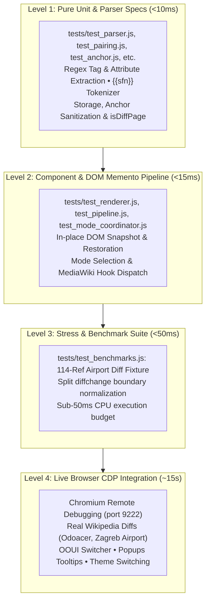

# RefDiff Test Plan & Quality Assurance Framework

This document defines the testing strategy, test pyramid, coverage evaluation, and quality assurance framework for **RefDiff** (Wikipedia zero-loss citation decoupling gadget and diff driver).

---

## 1. Executive Evaluation: "Is it Enough or Too Much?"

### Quantitative Metrics
* **Unit & Component Tests (`npm test`):** **67 passing tests** across **13 modular test files** + benchmarks under [`tests/`](file:///home/mik/Documents/Bastel/2023-/einzelnachweise/tests/).
* **Execution Time:** **~18–25 ms** (all 13 test files execute sequentially in a single process via `tests/runner.js`).
* **Selective Execution:** Any test file can also be run independently in isolation (e.g. `node tests/test_parser.js`).
* **Code Coverage (Headless Node.js):** **100.0% function coverage** (71 of 71 functions) measured via V8 coverage without browser shims.
* **Browser Runtime Coverage (Chromium CDP):** Real MediaWiki DOM integration, OOUI visual transitions, and hovercard popups verified end-to-end via [`tests/test_live_cdp.py`](file:///home/mik/Documents/Bastel/2023-/einzelnachweise/tests/test_live_cdp.py).
* **Linting (`npm run lint`):** **0 errors, 0 warnings** across all files.

---

### Is it Too Much?
**Verdict: No.**
* **Zero Runner Bloat:** The test suite uses Node's built-in `assert` module without third-party frameworks (no Jest, Mocha, Karma, or Babel overhead). It executes instantaneously in under 30 milliseconds.
* **No Redundant Tests:** Each assertion targets a specific regression point or MediaWiki architectural constraint:
  - Splitting of tag boundaries by MediaWiki's internal `diffchange` algorithm.
  - In-place DOM Memento preservation to avoid invalidating `inlineFormatToggle.js` and VisualEditor event closures.
  - Template parameter parsing for shortened footnotes (`{{sfn}}`, `{{r}}`, `{{efn}}`).
  - Anchor discovery for native `Extension:Popups` / Reference Previews tooltip generation.
  - Configurable inline-change mode (`separateChanged: false`) preserving inline `<del>`/`<ins>` wikitext while collapsing unchanged citations into hoverable badges.
  - Dynamic in-toolbar decouple toggle placement to the left of the mode bar to prevent UI layout jumps.
* **Sandboxed Mock Isolation:** All DOM/window mocks use a scoped `withMockEnvironment()` harness that guarantees restoration and prevents cross-test global pollution.
* **Minimal Maintenance Cost:** Pure unit, component, and benchmark tests execute deterministically without network calls or flaky async timeouts.

---

### Is it Enough?
**Verdict: It is sufficient for current production use, with targeted expansion areas for complex wikitext edge cases.**
* **Core Functionality is Fully Covered:**
  - Wikitext reference parsing and attribute extraction (including entities like `&quot;`).
  - Pairing heuristics (1-to-1, additions, deletions, surrounded edits, identical references).
  - Badge formatting with mathematical brackets (`⟨ref1⟩`, `⟨~name~⟩`).
  - Decoupling pipeline and round-trip DOM snapshot restoration.
  - Configurable decoupled vs inline-changed mode (`separateChanged` via `window.refdiffConfig`, URL param, storage, or toolbar checkbox).
  - Preference persistence (`localStorage`, `mw.storage`, URL parameters).
  - OOUI mode selection and body row toggling.
  - High-density stress testing (114 citations in a single table benchmarked < 50ms).
* **Identified Coverage Gaps (Prioritized for Future Enhancements):**
  1. **Malformed Wikitext:** Unclosed `<ref>` tags, nested `<ref>` inside templates, multiline citations with unusual carriage returns.
  2. **Transcluded Citation Templates:** Complex citation templates like `{{refn}}`, `{{sfnp}}`, or citations nested inside infobox tables.
  3. **Alternative Skins & Mobile Layouts:** Stacked diff tables on MinervaNeue (mobile skin) vs Vector-2022 desktop skin.
  4. **Dynamic Page Lifecycle:** MediaWiki `wikipage.diff` hook firing multiple times during live AJAX reloads or history pagination.

---

## 2. Test Architecture: 1-to-1 Source-to-Test Mapping

While [`refdiff.js`](file:///home/mik/Documents/Bastel/2023-/einzelnachweise/refdiff.js) is distributed as a single physical bundle for Wikipedia/MediaWiki, the testing environment in `tests/` uses **real, modular test files** mapped 1-to-1 to each virtual file of `refdiff.js`:

| Virtual Source File | Modular Test File | Responsibility | Tests |
|---|---|---|:---:|
| — | [`tests/harness.js`](file:///home/mik/Documents/Bastel/2023-/einzelnachweise/tests/harness.js) | Test runner, assertions & `withMockEnvironment` sandbox | — |
| `src/anchor.js` | [`tests/test_anchor.js`](file:///home/mik/Documents/Bastel/2023-/einzelnachweise/tests/test_anchor.js) | Footnote anchor discovery (`cite_note-*`) & URL matching | 5 |
| `src/constants.js` | [`tests/test_constants.js`](file:///home/mik/Documents/Bastel/2023-/einzelnachweise/tests/test_constants.js) | Regex patterns (`TEMPLATE_REF_REGEX`) and constants | 1 |
| `src/dom_helpers.js` | [`tests/test_dom_helpers.js`](file:///home/mik/Documents/Bastel/2023-/einzelnachweise/tests/test_dom_helpers.js) | Body row categorization & `mw.hook` notifications | 2 |
| `src/init.js` | [`tests/test_init.js`](file:///home/mik/Documents/Bastel/2023-/einzelnachweise/tests/test_init.js) | Diff page detection, toolbar button mount, decouple toggle & auto-start wiring | 9 |
| `src/memento.js` | [`tests/test_memento.js`](file:///home/mik/Documents/Bastel/2023-/einzelnachweise/tests/test_memento.js) | DOM row snapshot capture & in-place restoration | 1 |
| `src/mode_coordinator.js` | [`tests/test_mode_coordinator.js`](file:///home/mik/Documents/Bastel/2023-/einzelnachweise/tests/test_mode_coordinator.js) | 3-way mode switching, separateChanged config & switch locks | 10 |
| `src/pairing.js` | [`tests/test_pairing.js`](file:///home/mik/Documents/Bastel/2023-/einzelnachweise/tests/test_pairing.js) | 3-pass heuristic reference pairing algorithm | 6 |
| `src/parser.js` | [`tests/test_parser.js`](file:///home/mik/Documents/Bastel/2023-/einzelnachweise/tests/test_parser.js) | Wikitext regex parsing, HTML entities, SFN tokenizer | 8 |
| `src/pipeline.js` | [`tests/test_pipeline.js`](file:///home/mik/Documents/Bastel/2023-/einzelnachweise/tests/test_pipeline.js) | Transformation pipeline, separateChanged mode & table mutation roundtrip | 7 |
| `src/renderer.js` | [`tests/test_renderer.js`](file:///home/mik/Documents/Bastel/2023-/einzelnachweise/tests/test_renderer.js) | Mathematical badges (`⟨ref1⟩`) & citation diff rows | 5 |
| `src/state.js` | [`tests/test_state.js`](file:///home/mik/Documents/Bastel/2023-/einzelnachweise/tests/test_state.js) | State persistence (`localStorage`, `mw.storage`, URL) | 4 |
| `src/utils.js` | [`tests/test_utils.js`](file:///home/mik/Documents/Bastel/2023-/einzelnachweise/tests/test_utils.js) | `stripHtml`, `normalizeDiffTags`, `sanitizeAnchor`, `escapeRegex` | 4 |
| *Fixtures & Perf* | [`tests/test_benchmarks.js`](file:///home/mik/Documents/Bastel/2023-/einzelnachweise/tests/test_benchmarks.js) | Comprehensive fixture & 114-ref airport stress test | 5 |
| **Total** | [`tests/runner.js`](file:///home/mik/Documents/Bastel/2023-/einzelnachweise/tests/runner.js) | Master sequential test runner executing all suites | **67** |

---

## 3. Test Pyramid & Execution Levels



### Level 1: Pure Unit & Parser Specs (Headless Node.js)
* **Goal:** Verify algorithmic correctness, tokenization, regex robustness, and heuristic pairing with zero side effects.
* **Files:** `tests/test_parser.js`, `tests/test_pairing.js`, `tests/test_anchor.js`, `tests/test_constants.js`, `tests/test_state.js`, `tests/test_utils.js`, `tests/test_init.js`.
* **Speed:** < 10 ms.

### Level 2: Component & DOM Memento Pipeline (Mock DOM / Node.js)
* **Goal:** Verify that DOM mutations adhere to the Memento pattern, preserving live DOM nodes and closures.
* **Files:** `tests/test_memento.js`, `tests/test_pipeline.js`, `tests/test_renderer.js`, `tests/test_mode_coordinator.js`, `tests/test_dom_helpers.js`.
* **Speed:** < 15 ms.

### Level 3: Stress & Performance Benchmarks
* **Goal:** Prevent browser freezing on huge diffs with hundreds of references.
* **File:** `tests/test_benchmarks.js`.
* **Threshold:** Decoupling 114+ references must complete in **< 50 ms** (currently executes in ~12 ms).

### Level 4: Live Browser CDP Integration (Chromium via CDP)
* **Goal:** End-to-end verification inside a real MediaWiki browser environment.
* **Runner:** `python3 tests/test_live_cdp.py` (via port 9222).
* **Scenarios:**
  1. Injection and initialization on live MediaWiki diffs (e.g., Odoacer `diff=1379486498`, Zagreb Airport `diff=1379409916`).
  2. OOUI 3-way toggle interaction: Visual Diff <-> Wikitext Diff <-> RefDiff Decoupled Diff.
  3. VisualEditor visual diff interop (no leaked citation rows).
  4. Native `Extension:Popups` hovercard integration (hovering `⟨1⟩` or `⟨~sfn~⟩` triggers rich reference tooltip).
  5. Automatic disabling and re-enabling of native Inline diff switch during RefDiff mode.
  6. Night Mode / Vector-2022 dark mode style verification.

---

## 4. Test Execution & CI/CD Quality Gates

All checks can be run locally or in continuous integration using standard npm scripts:

```bash
# 1. Run ESLint code quality & style checks (0 warnings allowed)
npm run lint

# 2. Run the fast headless unit & component test suite (67 tests in ~20ms)
npm test

# 3. Run combined CI verification
npm run ci

# 4. Run an individual test file in isolation (e.g. parser tests)
node tests/test_parser.js

# 5. Run live Chromium CDP browser integration suite (requires Chromium on port 9222)
npm run test:live
```

### Quality Gates for Pull Requests & Releases
1. **Pass Rate:** 100% (0 failing tests).
2. **ESLint:** 0 errors, 0 warnings.
3. **Execution Budget:** Headless test suite must execute in `< 100ms`.
4. **Stress Budget:** High-density table benchmark must complete in `< 50ms`.
5. **DOM Invariance:** DOM Memento snapshots must restore exact original HTML byte-for-byte.

---

## 5. Future Test Expansion Roadmap

| Priority | Area | Proposed Test |
|---|---|---|
| **P1** | Malformed Wikitext | Test unclosed `<ref>` tags at line end, self-closing tags without slash, and unescaped HTML entities. |
| **P2** | Nested Transclusions | Test citations wrapped inside `{{refn|...}}`, `{{sfnp}}`, and infobox template parameters. |
| **P3** | Mobile Diff Layout | Test table mutation on MinervaNeue mobile skin where side-by-side diff rows are stacked. |
| **P4** | Live Editor Hooks | Test multiple sequential diff updates fired by `mw.hook('wikipage.diff')` during live AJAX previewing. |
