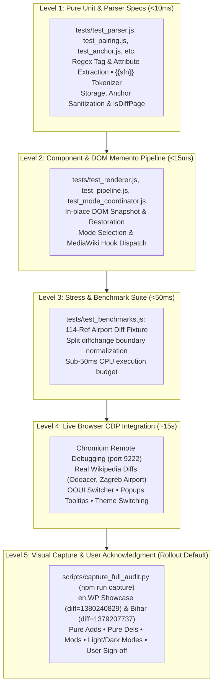

# RefDiff Test Plan & Quality Assurance Framework

This document defines the testing strategy, test pyramid, coverage evaluation, and quality assurance framework for **RefDiff** (Wikipedia zero-loss citation decoupling gadget and diff driver).

---

## 1. Test Strategy & Quality Metrics

### Quantitative Metrics
* **Unit, Component & Real DOM Tests (`npm test` / `npm run ci`):** **121 passing tests** across **15 modular test files** + benchmarks under [`tests/`](file:///home/mik/Documents/Bastel/2023-/einzelnachweise/tests/).
* **Execution Time:** **~20 ms** (unit suites) / **~250 ms** (combined with headless JSDOM suites via `npm run ci`).
* **Selective Execution:** Any test file can also be run independently in isolation (e.g. `node tests/test_parser.js`, `node tests/test_deployment.js`).
* **Code Coverage (Headless Node.js):** **100.0% function coverage** (71 of 71 functions) measured via V8 coverage without browser shims.
* **Browser Runtime Coverage (Chromium CDP):** Real MediaWiki DOM integration, OOUI visual transitions, and hovercard popups verified end-to-end via [`tests/test_live_cdp.py`](file:///home/mik/Documents/Bastel/2023-/einzelnachweise/tests/test_live_cdp.py).
* **Linting (`npm run lint`):** **0 errors, 0 warnings** across all files.

> [!NOTE]
> **Audit & Sufficiency Review in [`AUDIT_STRATEGY.md`](AUDIT_STRATEGY.md#26-test-proportionality--sufficiency-audit-is-it-enough-or-too-much):** The qualitative evaluation of whether the test suite is "too much" (over-testing, runner bloat, maintenance overhead) or "enough" (risk assessment, gap analysis, malformed wikitext boundaries) is governed by **[`AUDIT_STRATEGY.md` (§2.6 Test Proportionality & Sufficiency Audit)](AUDIT_STRATEGY.md#26-test-proportionality--sufficiency-audit-is-it-enough-or-too-much)**. Real-world diff verification transitions are authoritatively recorded in **[`LOG.md` (§3.3)](LOG.md#33-real-world-diff-verification-register)**.

---

## 2. Test Architecture: 1-to-1 Source-to-Test Mapping

While [`refdiff.js`](file:///home/mik/Documents/Bastel/2023-/einzelnachweise/refdiff.js) is distributed as a single physical bundle for Wikipedia/MediaWiki, the testing environment in `tests/` uses **real, modular test files** mapped 1-to-1 to each virtual file of `refdiff.js`:

| Virtual Source File | Modular Test File | Responsibility | Tests |
|---|---|---|:---:|
| — | [`tests/harness.js`](file:///home/mik/Documents/Bastel/2023-/einzelnachweise/tests/harness.js) | Test runner, assertions & `withMockEnvironment` sandbox | — |
| `src/anchor.js` | [`tests/test_anchor.js`](file:///home/mik/Documents/Bastel/2023-/einzelnachweise/tests/test_anchor.js) | Footnote anchor discovery (`cite_note-*`) & URL matching | 9 |
| `src/constants.js` | [`tests/test_constants.js`](file:///home/mik/Documents/Bastel/2023-/einzelnachweise/tests/test_constants.js) | Regex patterns (`TEMPLATE_REF_REGEX`) and constants | 2 |
| `src/dom_helpers.js` | [`tests/test_dom_helpers.js`](file:///home/mik/Documents/Bastel/2023-/einzelnachweise/tests/test_dom_helpers.js) | Body row categorization & `mw.hook` notifications | 2 |
| `src/init.js` | [`tests/test_init.js`](file:///home/mik/Documents/Bastel/2023-/einzelnachweise/tests/test_init.js) | Diff page detection, toolbar button mount, inline toggle & auto-start wiring | 10 |
| `src/memento.js` | [`tests/test_memento.js`](file:///home/mik/Documents/Bastel/2023-/einzelnachweise/tests/test_memento.js) | DOM row snapshot capture & in-place restoration | 1 |
| `src/mode_coordinator.js` | [`tests/test_mode_coordinator.js`](file:///home/mik/Documents/Bastel/2023-/einzelnachweise/tests/test_mode_coordinator.js) | 3-way mode switching, inlineModified / separateChanged config & switch locks | 11 |
| `src/pairing.js` | [`tests/test_pairing.js`](file:///home/mik/Documents/Bastel/2023-/einzelnachweise/tests/test_pairing.js) | 3-pass heuristic reference pairing algorithm | 6 |
| `src/parser.js` | [`tests/test_parser.js`](file:///home/mik/Documents/Bastel/2023-/einzelnachweise/tests/test_parser.js) | Wikitext regex parsing, nested container filtering, SFN tokenizer | 15 |
| `src/pipeline.js` | [`tests/test_pipeline.js`](file:///home/mik/Documents/Bastel/2023-/einzelnachweise/tests/test_pipeline.js) | Transformation pipeline, inlineModified mode, whitespace & unwrapped footnote regression | 12 |
| `src/renderer.js` | [`tests/test_renderer.js`](file:///home/mik/Documents/Bastel/2023-/einzelnachweise/tests/test_renderer.js) | Mathematical badges (`⟨ref1⟩`), safe DOM builder `el()` & citation diff rows | 13 |
| `src/state.js` | [`tests/test_state.js`](file:///home/mik/Documents/Bastel/2023-/einzelnachweise/tests/test_state.js) | State persistence (`localStorage`, `mw.storage`, URL) | 4 |
| `src/utils.js` | [`tests/test_utils.js`](file:///home/mik/Documents/Bastel/2023-/einzelnachweise/tests/test_utils.js) | `stripHtml`, `normalizeDiffTags`, `hasBalancedDiffTags`, `sanitizeAnchor`, `escapeRegex` | 9 |
| *Fixtures & Perf* | [`tests/test_benchmarks.js`](file:///home/mik/Documents/Bastel/2023-/einzelnachweise/tests/test_benchmarks.js) | Comprehensive fixture & 114-ref airport stress test | 5 |
| *Real DOM / JSDOM* | [`tests/test_jsdom.js`](file:///home/mik/Documents/Bastel/2023-/einzelnachweise/tests/test_jsdom.js) | Real MediaWiki DOM decoupling, Memento invariance, OOUI switcher, onTableClick & `<nowiki>` check | 12 |
| *Deployment & Release* | [`tests/test_deployment.js`](file:///home/mik/Documents/Bastel/2023-/einzelnachweise/tests/test_deployment.js) | Packaging, syntax safety, version synchronization, bundle budget, API contract, template validation, automated rollback, and deployment consistency | 10 |
| **Total** | [`tests/runner.js`](file:///home/mik/Documents/Bastel/2023-/einzelnachweise/tests/runner.js) | Master sequential test runner executing all suites | **121** |

---

## 3. Test Pyramid & Execution Levels



### Level 1: Pure Unit & Parser Specs (Headless Node.js)
* **Goal:** Verify algorithmic correctness, tokenization, regex robustness, heuristic pairing, and third-party gadget interoperability (`diffedit.js`) with zero side effects.
* **Files:** `tests/test_parser.js`, `tests/test_pairing.js`, `tests/test_anchor.js`, `tests/test_constants.js`, `tests/test_state.js`, `tests/test_utils.js`, `tests/test_init.js`.
* **Speed:** < 10 ms.

### Level 2: Component & Real DOM Pipeline (Mock DOM & JSDOM / Node.js)
* **Goal:** Verify that DOM mutations adhere to the Memento pattern, preserving live DOM nodes and closures on both mock environments and real MediaWiki DOM fixtures via `jsdom`.
* **Files:** `tests/test_memento.js`, `tests/test_pipeline.js`, `tests/test_renderer.js`, `tests/test_mode_coordinator.js`, `tests/test_dom_helpers.js`, `tests/test_jsdom.js`.
* **Speed:** < 250 ms.

### Level 3: Stress & Performance Benchmarks
* **Goal:** Prevent browser freezing on huge diffs with hundreds of references.
* **File:** `tests/test_benchmarks.js`.
* **Threshold:** Decoupling 114+ references must complete in **< 50 ms** (currently executes in ~12 ms).

### Level 4: Live Browser CDP Integration (Chromium via CDP)
* **Goal:** End-to-end verification inside a real MediaWiki browser environment.
* **Runner:** `python3 tests/test_live_cdp.py` (via port 9222).
* **Scenarios:**
  1. Injection and initialization on live MediaWiki diffs (e.g., Odoacer `diff=1379486498`, Zagreb Airport `diff=1379409916`, Kim Domingo `diff=1379491398`, Cosmic inflation `diff=1379470949`, Zipf's law `diff=1379548357`, Donnie Brasco `diff=1380017400`).
  2. OOUI 3-way toggle interaction: Visual Diff <-> Wikitext Diff <-> RefDiff Decoupled Diff.
  3. VisualEditor visual diff interop (no leaked citation rows).
  4. Native `Extension:Popups` hovercard integration (hovering `⟨1⟩` or `⟨~sfn~⟩` triggers rich reference tooltip).
  5. Automatic disabling and re-enabling of native Inline diff switch during RefDiff mode.
  6. Night Mode / Vector-2022 dark mode style verification.

### Level 5: Visual Capture & User Acknowledgment Gate (Rollout Default)
* **Goal:** Mandatory pre-rollout gate: capture comprehensive visual evidence across all change cases (pure additions, pure deletions, intra-line modifications, template refs) in both Vector 2022 Light and Dark themes, and obtain explicit user acknowledgment before rollout.
* **Runner:** `npm run capture` (`python3 scripts/capture_full_audit.py`).
* **Requirements:**
  1. Automated capture across all 5 sections of en.WP Showcase diff (`1380240829`) and Bihar diff (`1379207737`).
  2. Verified rendering: pure adds/dels have zero `<ins>`/`<del>` wrappers; modifications retain native diffchange highlights on changed words.
  3. Presentation of image gallery to the user and receipt of explicit user sign-off prior to advancing to deployment rings.

---

## 4. Test Execution & CI/CD Quality Gates

All checks can be run locally or in continuous integration using standard npm scripts:

```bash
# 1. Run ESLint code quality & style checks (0 warnings allowed)
npm run lint

# 2. Run the fast headless unit, component & real DOM test suite (121 tests in ~250ms)
npm test

# 3. Run combined CI verification
npm run ci

# 4. Run an individual test file in isolation (e.g. parser tests)
node tests/test_parser.js

# 5. Run live Chromium CDP browser integration suite (requires Chromium on port 9222)
npm run test:live

# 6. Capture full visual audit across all change cases (Rollout Default Gate)
npm run capture
```

### Quality Gates for Pull Requests & Releases
1. **Pass Rate:** 100% (0 failing tests).
2. **ESLint:** 0 errors, 0 warnings.
3. **Execution Budget:** Headless test suite must execute in `< 100ms`.
4. **Stress Budget:** High-density table benchmark must complete in `< 50ms`.
5. **DOM Invariance:** DOM Memento snapshots must restore exact original HTML byte-for-byte.

---

## 5. Future Test Expansion Roadmap

| Priority | Area | Proposed Test |
|---|---|---|
| **P1** | Prose Diff Retention & Invariance | Differential testing comparing native `diffchange` inventory vs post-RefDiff DOM to ensure subtle/whitespace edits are never masked as context rows. |
| **P1** | Default Mode Activation & Visual Diff Bug | Investigate bug making visual diff active/default unexpectedly. Test default mode selection across fresh profiles and when VisualEditor is enabled. |
| **P1** | wikidiff2 Token Boundary & Split-Span Fuzzing | Systematic testing of fragmented `diffchange` spans produced by MediaWiki's `wikidiff2` C++ engine (e.g. tag attributes or delimiters split across multiple `<ins>`/`<del>` spans separated by whitespace) to guarantee 100% normalization resilience. |
| **P2** | Ecosystem Interoperability (Twinkle & Ultraviolet) | Check compatibility and non-interference with WP:Twinkle (diff header rollback/vandalism links) and WP:Ultraviolet (CVPI floating overlays) to ensure zero DOM clashing or event interception. |
| **P2** | Regex Reevaluation & Parser Hardening | Reevaluate regexes (REF_REGEX, TEMPLATE_REF_REGEX) for nesting depth, ReDoS resilience, and benchmark against a dedicated token scanner. |
| **P2** | Malformed Wikitext | Test unclosed `<ref>` tags at line end, self-closing tags without slash, and unescaped HTML entities. |
| **P3** | Nested Transclusions | Test citations wrapped inside `{{refn&#124;...}}`, `{{sfnp}}`, and infobox template parameters. |
| **P4** | Mobile Diff Layout | Test table mutation on MinervaNeue mobile skin where side-by-side diff rows are stacked. |
| **P5** | Live Editor Hooks | Test multiple sequential diff updates fired by `mw.hook('wikipage.diff')` during live AJAX previewing. |

### 5.1 Real-World Diffs & Verification Queue

> [!NOTE]
> **Record Keeping in [`LOG.md`](LOG.md):** While this test plan defines the testing strategy, quality gates, and roadmap priorities, all detailed real-world diff triage logs, edge-case diagnoses, verification status transitions, and fix histories are recorded and tracked in the authoritative ledger: [**`LOG.md` (§3.3 Real-World Diff Verification Register)**](LOG.md#33-real-world-diff-verification-register).

| Diff / Article | Revision | Focus Area & Verification Rationale | Status | Ledger Record |
|---|---|---|:---:|:---:|
| [Odoacer](https://en.wikipedia.org/w/index.php?diff=1379486498) | `1379486498` | Shortened footnotes (`{{sfn}}`) & author-year popup anchor discovery | ✅ Verified | [`LOG.md#odoacer`](LOG.md#odoacer-diff1379486498) |
| [Zagreb Airport](https://en.wikipedia.org/w/index.php?diff=1379409916) | `1379409916` | High-density 114-ref airport destination table stress test (<50ms budget) | ✅ Verified | [`LOG.md#zagreb-airport`](LOG.md#zagreb-airport-diff1379409916) |
| [Kim Domingo](https://en.wikipedia.org/w/index.php?diff=1379491398) | `1379491398` | `wikidiff2` split tag boundaries (`/<del>&gt;`) & prose callout additions | ✅ Verified | [`LOG.md#kim-domingo`](LOG.md#kim-domingo-diff1379491398) |
| [Cosmic inflation](https://en.wikipedia.org/w/index.php?diff=1379470949) | `1379470949` | Whitespace-only prose edits retention without false context conversion | ✅ Verified | [`LOG.md#cosmic-inflation`](LOG.md#cosmic-inflation-diff1379470949) |
| [Zipf's law](https://en.wikipedia.org/w/index.php?title=Zipf%27s_law&diff=prev&oldid=1379548357) | `1379548357` | Footnote unwrapping (`{{efn}}`), `{{rp}}` page suffix retention, nested refs & brace delimiter guards | ✅ Verified | [`LOG.md#zipfs-law`](LOG.md#zipfs-law-diff1379548357) |
| [Donnie Brasco (film)](https://en.wikipedia.org/w/index.php?title=Donnie_Brasco_(film)&curid=1995696&diff=1380017400&oldid=1380012354) | `1380017400` | Unclosed quote attribute (`<ref name="mojo_2>`) tolerated; correct badge `⟨+mojo_2+⟩` & anchor discovery verified | ✅ Verified | [`LOG.md#donnie-brasco`](LOG.md#donnie-brasco-film-diff1380017400) |
| [Karl-Heinz Riedle](https://en.wikipedia.org/w/index.php?title=Karl-Heinz_Riedle&diff=1380008554&oldid=1335846068) | `1380008554` | Prose bold markup edit (`"'''Kalle'''"`) adjacent to context rows; clean non-citation diff invariance | ✅ Verified | [`LOG.md#riedle`](LOG.md#karl-heinz-riedle-diff1380008554) |
| [Bihar Legislative Assembly](https://en.wikipedia.org/w/index.php?title=Bihar_Legislative_Assembly&diff=prev&oldid=1379207737) | `1379207737` | Quotation attribute truncation on embedded apostrophe (`name="...Speaker's..."`) & space-to-underscore anchor discovery | ✅ Verified | [`LOG.md#bihar`](LOG.md#bihar-legislative-assembly-diff1379207737) |


